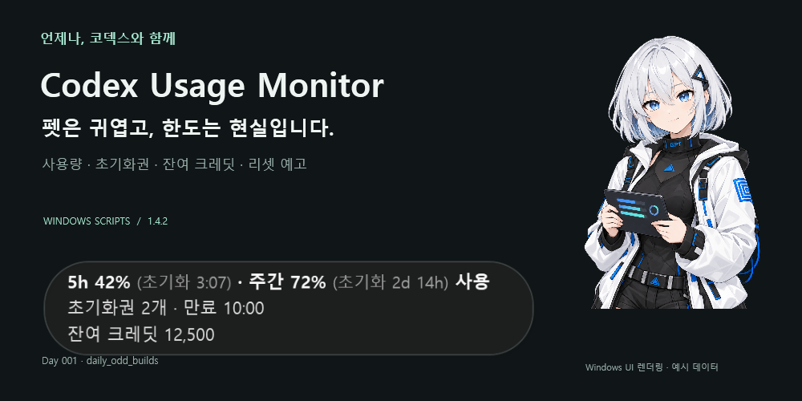

# daily_odd_builds

매일 하나의 생각을 실제로 작동하는 소프트웨어로 만들어 끝내는 프로젝트.

유용한 도구, 기술 데모, 게임, 자동화, 장난감 등 서로 독립적인 프로그램을 계속 만듭니다. 규모나 실용성보다 오늘 새로운 결과물 하나를 실제로 완성하는 것을 우선합니다.

## 배포와 다운로드

이 저장소는 `daily_odd_builds`의 공개 배포 저장소입니다. 프로그램별 배포물, 릴리즈 안내와 사용 방법을 이곳에서 제공합니다.

- [릴리즈 및 다운로드](https://github.com/hssum9409/daily_odd_builds-public/releases)

## 소스 공개 원칙

코드 공개가 필요한 경우에만 릴리즈 버전의 소스 스냅샷을 게시합니다. 개발 커밋 이력은 옮기지 않으며, 이 저장소는 공개 문서와 배포물, 릴리즈 소스를 위한 독립적인 이력을 관리합니다.

각 프로그램의 실행 환경, 설치 방법과 확인된 한계는 해당 릴리즈 안내에 기록합니다.

<!-- day001:start -->
## Day 001 — Codex Usage Monitor 1.4.2

**펫은 귀엽고, 한도는 현실입니다.** Codex Pet 옆에서 사용량·초기화권·잔여 크레딧·리셋 예고를 확인합니다.
Windows/Mac 스크립트 에디션입니다. 별도 개발 환경이나 업데이트 서버는 필요 없습니다.

| 형태 | 다운로드 | 실행 |
| --- | --- | --- |
| Windows 설치형 · 권장 | [CodexUsageMonitorScripts-1.4.2-windows-installer.zip](https://github.com/hssum9409/daily_odd_builds-public/releases/download/day001-v1.4.2/CodexUsageMonitorScripts-1.4.2-windows-installer.zip) | `Install.cmd` |
| Windows 포터블 | [CodexUsageMonitorScripts-1.4.2-windows-portable.zip](https://github.com/hssum9409/daily_odd_builds-public/releases/download/day001-v1.4.2/CodexUsageMonitorScripts-1.4.2-windows-portable.zip) | `Start.cmd` |
| macOS 설치형 · preview | [CodexUsageMonitorScripts-1.4.2-macos-installer-preview.zip](https://github.com/hssum9409/daily_odd_builds-public/releases/download/day001-v1.4.2/CodexUsageMonitorScripts-1.4.2-macos-installer-preview.zip) | `Install.command` |
| macOS 포터블 · preview | [CodexUsageMonitorScripts-1.4.2-macos-portable-preview.zip](https://github.com/hssum9409/daily_odd_builds-public/releases/download/day001-v1.4.2/CodexUsageMonitorScripts-1.4.2-macos-portable-preview.zip) | `Start.command` |

Windows: 실제 실행 검증. Mac: 실기기 미검증 preview.
설치형은 설치 후 다운로드 파일을 삭제할 수 있습니다. 포터블은 실행 폴더를 유지하세요.

[사용 방법과 실행 소스](day-001-codex-usage-scripts/README.md) · [Mac 검증 범위](day-001-codex-usage-scripts/docs/MAC-QA.md)

만든놈은 [hssum9409](https://github.com/hssum9409). 매일 한개씩 잡동사니 만드는 사람.
그 외 잡동사니가 보고싶은 사람은 [여기](https://daily-odd-builds.web.app/)로. AI 슬롭 같다구요? 으쩌라구요
<!-- day001:end -->
