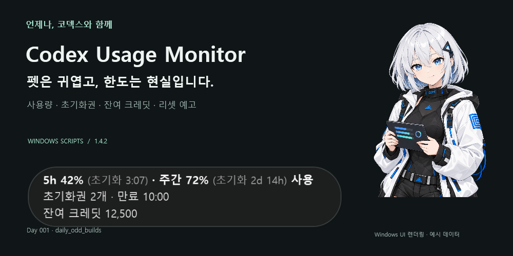
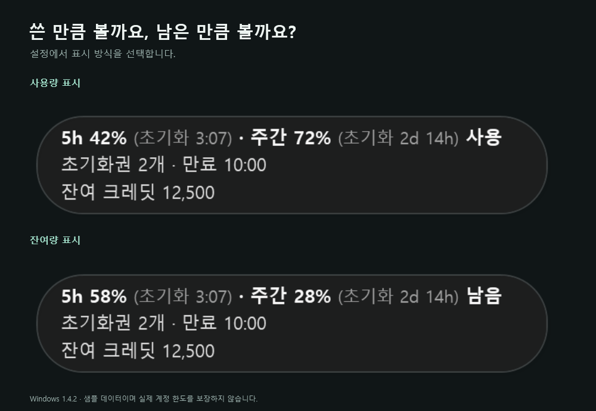
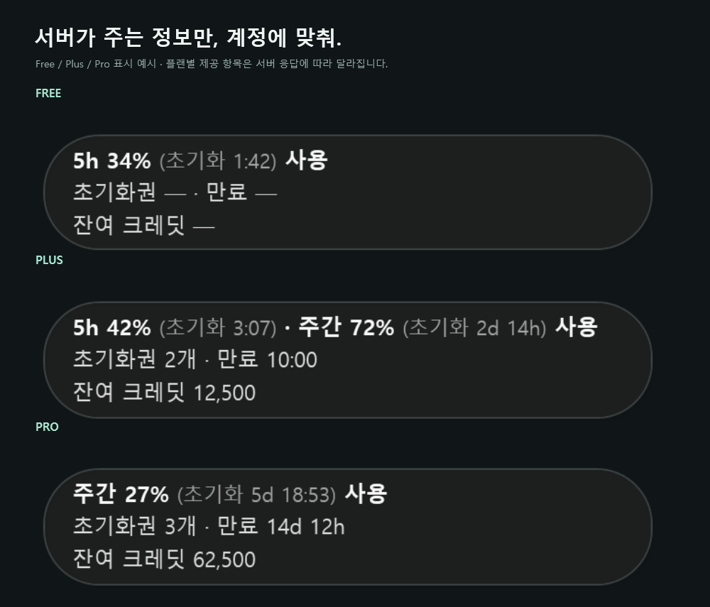
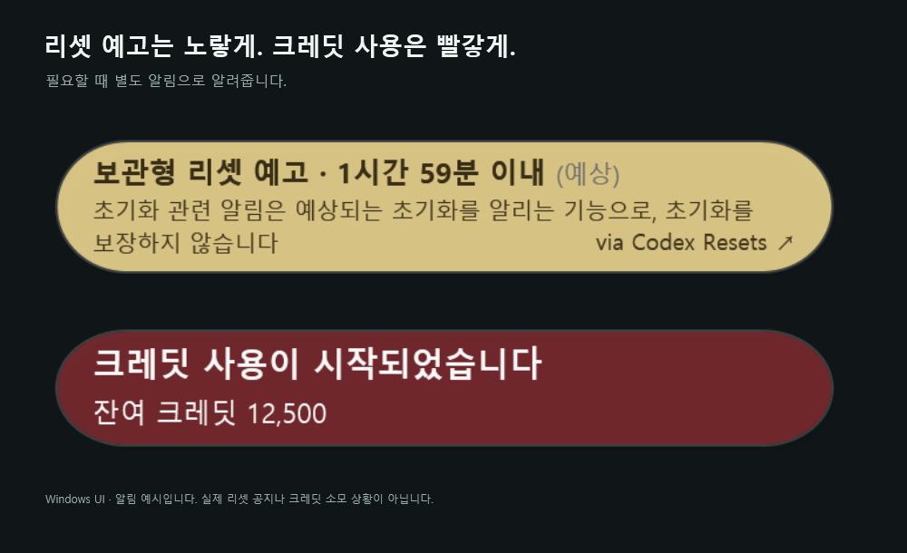
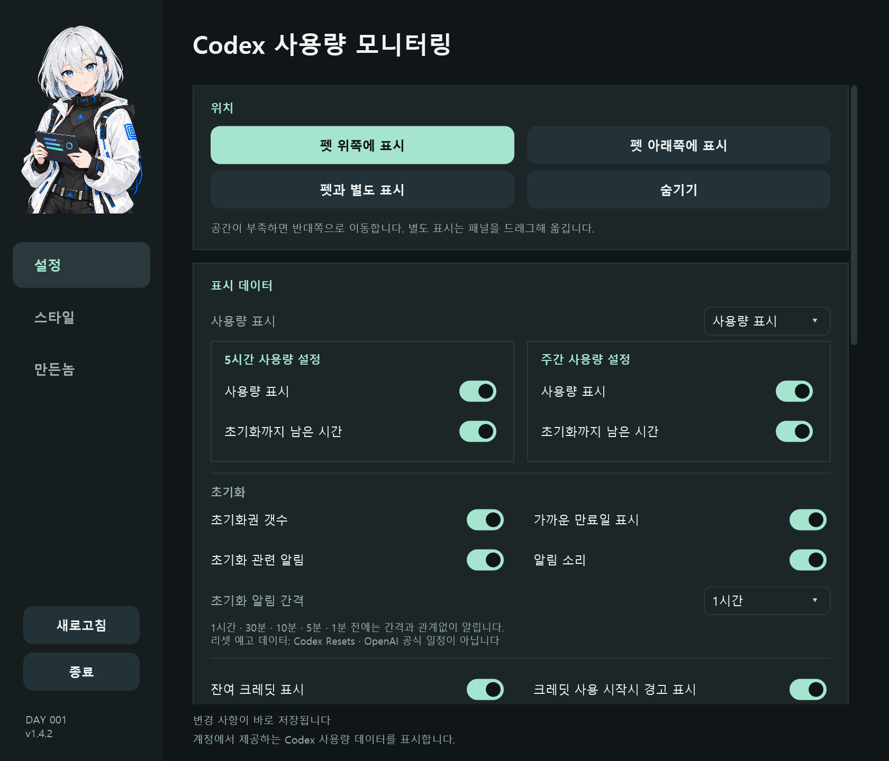
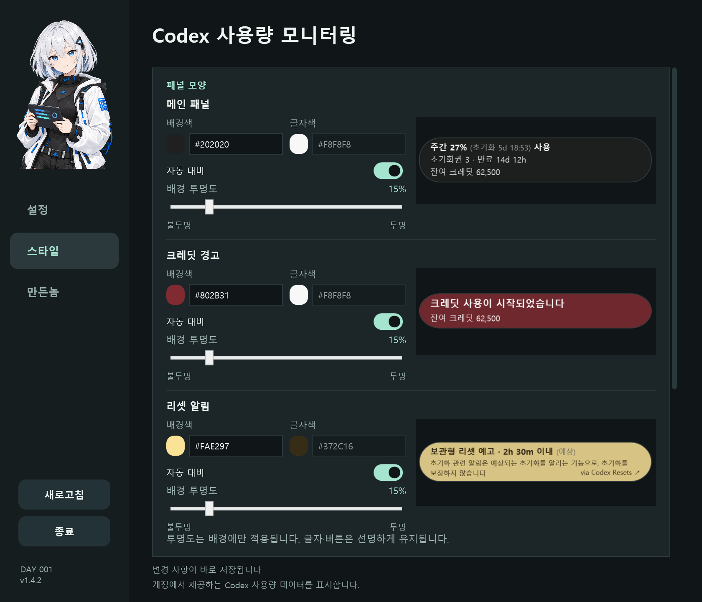

AI로 작성되었습니다. 슬롭 같으면 님 말이 맞음.

  

<h1 align="center">Codex Usage Monitor</h1>

  언제나, 코덱스와 함께. 
  펫은 귀엽고, 한도는 현실입니다.

  
  
  
  

<b><a href="https://github.com/hssum9409/daily_odd_builds-public/releases/download/day001-v1.5.2/CodexUsageMonitorScripts-1.5.2-windows-installer.zip">Windows 설치형 다운로드 →</a></b> · <a href="https://github.com/hssum9409/daily_odd_builds-public/releases/tag/day001-v1.5.2">전체 다운로드와 변경 사항</a>

기존 Windows 카드 렌더러와 예시 데이터로 만든 소개 이미지입니다. 신규 대시보드와는 디자인이 다릅니다.

**Codex Pet 옆에 사용량·초기화권·잔여 크레딧·리셋 예고를 붙여두는 작은 모니터입니다.**

한도 확인하러 창을 뒤적이는 수고를 조금 줄입니다. 한도 자체를 늘려주진 않습니다. 그건 저도 갖고 싶은 기능입니다.

Day 001 of [daily_odd_builds](https://daily-odd-builds-portal.web.app/) · OS 기본 런타임으로 실행하는 **스크립트 에디션**입니다.

## 다운로드

잘 모르겠으면 **Windows 설치형**을 받으세요. 별도의 개발 환경, API 키, 관리자 권한 설치가 필요 없습니다. 로그인된 Codex 데스크톱 앱은 필요합니다.

| 환경 | 다운로드 | 압축 해제 후 실행 | 상태 |
| --- | --- | --- | --- |
| Windows 설치형 · 권장 | [설치형 ZIP](https://github.com/hssum9409/daily_odd_builds-public/releases/download/day001-v1.5.2/CodexUsageMonitorScripts-1.5.2-windows-installer.zip) | `Install.cmd` | 실제 Windows 실행 검증 |
| Windows 포터블 | [포터블 ZIP](https://github.com/hssum9409/daily_odd_builds-public/releases/download/day001-v1.5.2/CodexUsageMonitorScripts-1.5.2-windows-portable.zip) | `Start.cmd` | 실제 Windows 실행 검증 |
| Mac 설치형 | [설치형 preview ZIP](https://github.com/hssum9409/daily_odd_builds-public/releases/download/day001-v1.5.2/CodexUsageMonitorScripts-1.5.2-macos-installer-preview.zip) | `Install.command` | **실기기 미검증 preview** |
| Mac 포터블 | [포터블 preview ZIP](https://github.com/hssum9409/daily_odd_builds-public/releases/download/day001-v1.5.2/CodexUsageMonitorScripts-1.5.2-macos-portable-preview.zip) | `Start.command` | **실기기 미검증 preview** |

[릴리즈 전체 파일](https://github.com/hssum9409/daily_odd_builds-public/releases/tag/day001-v1.5.2) · [SHA-256 체크섬](https://github.com/hssum9409/daily_odd_builds-public/releases/download/day001-v1.5.2/SHA256SUMS.txt)

**Mac은 아직 전체 기능의 실기기 검증이 끝나지 않았습니다.** 일부 사용자 진단으로 글자 표시·CLI 탐색·사용량 응답을 확인했으며, 권한·Pet 추적·로그인 자동 실행·실제 자동 업데이트 전체 흐름은 장치 검증 전입니다. 아래 이미지도 모두 Windows 화면입니다. [미검증 목록](docs/MAC-QA.md)을 확인하고 preview 테스트 용도로 사용해주세요.

## 빠른 시작

### Windows

1. ZIP을 **전부 압축 해제**합니다. ZIP 안에서 바로 실행하지 않습니다.
2. 설치형은 `Install.cmd`, 포터블은 `Start.cmd`를 실행합니다.
3. Codex와 Pet을 켭니다. 패널의 `···`로 설정을 열어 표시 항목과 위치를 고릅니다.

포터블의 `Start.cmd` 실행 창은 자동으로 닫힙니다. 모니터는 백그라운드에서 계속 실행됩니다.

설치형은 `%LOCALAPPDATA%\Programs\CodexUsageMonitorScripts`에 설치됩니다. **설치가 끝나면 다운로드 ZIP과 압축 해제 폴더를 지워도 됩니다.** 포터블은 실행 폴더 전체를 유지해야 합니다. 포터블은 다운로드 폴더를 졸업시켜주는 기능이 아닙니다.

시작 프로그램에 등록하면 Codex를 켤 때마다 따로 실행할 필요가 없습니다. 등록은 선택입니다. Codex가 꺼져 있으면 조회·Pet 추적을 멈추고 백그라운드에서 실행 여부만 확인합니다. 런타임 메모리는 남으므로 “자원 사용 0”은 아닙니다.

Mac preview 실행과 권한

ZIP을 전부 푼 뒤 설치형은 `Install.command`, 포터블은 `Start.command`를 실행합니다. 실행 권한 문제라면 해당 폴더의 터미널에서 `sh ./Install.command` 또는 `sh ./Start.command`로 실행할 수 있습니다.

개발자 확인 경고가 나오면 실행을 시도한 뒤 **시스템 설정 → 개인정보 보호 및 보안 → 그래도 열기**에서 해당 파일을 승인할 수 있습니다. [Apple 공식 안내](https://support.apple.com/ko-kr/102445)를 확인하세요. `runModal` 오류가 나거나 1.4.5에서 동의 뒤 아무 설치 결과가 없었다면 1.4.6 이상 설치 ZIP으로 수동 갱신하세요. 정상 설치가 끝나면 터미널에 `Installed at ...`가 표시됩니다. 실행 오류는 `~/Library/Application Support/DailyOddBuilds/CodexUsageMonitorScripts/startup.log`에서 확인할 수 있습니다.

일반 실행기는 `nohup`과 입출력 분리로 백그라운드 실행합니다. 실행이 끝난 터미널 창이 남는지는 [Terminal 프로필 설정](https://support.apple.com/en-gb/guide/terminal/trmlshll)에 따라 달라집니다. 셸 종료·SIGHUP 동작은 Git Bash의 모의 자식으로 확인했으며, 실제 Mac에서 창을 닫은 뒤 모니터가 유지되는지는 아직 미검증입니다.

설치형 경로는 `~/Library/Application Support/DailyOddBuilds/CodexUsageMonitorScripts/app`입니다. 설치가 끝난 뒤 다운로드 원본을 지울 수 있습니다. 포터블 실행 폴더는 유지합니다.

Pet 추적에는 접근성 권한이 필요할 수 있습니다. 실제 권한 주체와 Finder/quarantine 동작은 실기기 미검증입니다. 보안 정책을 강제로 변경하지 않습니다. [설치 안내](docs/INSTALLATION.md)와 [Mac QA](docs/MAC-QA.md)를 참고하세요.

## 어떤 걸 보여주나요?

| 기능 | 하는 일 |
| --- | --- |
| 창 부착 · Windows | Codex 테마를 따르는 원형 게이지·내부 알림·세션 차트. 폭에 따라 자동 배치합니다. |
| 작업표시줄 · Windows | 화살표 왼쪽에 5시간/주간 퍼센트와 남은 시간을 표시합니다. |
| 사용량 / 잔여량 | 5시간·주간 비율과 초기화까지 남은 시간을 표시합니다. |
| 초기화권 | 개수·가까운 만료일, 마우스를 올리면 개별 만료 정보를 표시합니다. |
| 잔여 크레딧 | 숫자에 쉼표를 붙입니다. 소수점 아홉 자리를 감상할 필요는 없습니다. |
| 리셋 예고 | Codex Resets의 일반/보관형 예고와 원문 링크를 표시합니다. |
| 크레딧 경고 | 크레딧 사용 시작과 설정한 잔액 단위에 알립니다. 자동 충전은 안 합니다. |
| Pet 위치 | 위/아래, 공간 부족 시 반대편, 별도 표시와 드래그를 지원합니다. |
| 스타일 | 패널별 색·불투명도, 간격과 반응 속도를 조절합니다. |
| 기본 편의 | 알림 소리, 4개 언어, 시간대, 시작 등록, 자동 업데이트를 제공합니다. |

### 창 안과 작업표시줄에서도 · Windows

설정의 위치에서 Codex 창 부착을 선택하면 우측 하단 대시보드를 사용합니다. 톱니바퀴로 설정을 열고 옆 아이콘으로 접습니다. 폭에 따라 기본형/좁은형을 자동 선택하며 우측 패널이 열리면 요약으로 표시합니다. 창을 옮기거나 크기를 바꾸는 동안 숨었다가 다시 나타납니다. 기존 Pet 표시도 유지합니다.

세션 토큰·캐시 적중률·환산 비용·출력 속도는 현재 보고 있는 로컬 대화의 기록을 따라가며 각각 끌 수 있습니다. 대화 ID를 직접 지정할 수도 있습니다. 원격·새 대화·여러 창의 대화를 확실히 구분하지 못하는 경우에는 다른 대화의 수치를 대신 보여주지 않습니다. 비용은 입력한 단가로 계산한 환산치이며 실제 청구액이 아닙니다. 단가가 없으면 미설정, 완료된 턴의 시간 기록이 없으면 속도를 미제공으로 표시합니다. 세션 본문이나 계정 토큰을 외부로 보내지 않습니다.

작은 창이나 트레이 팝업이 올라와도 대시보드 전체가 사라지지는 않습니다. 다른 창이 덮은 부분만 자연스럽게 가려지고, Codex 최소화·창 이동 중에는 숨습니다. 설정창을 열거나 우측 패널의 요약 상태에서 돌아올 때도 마지막 정상 위치를 유지합니다.

작업표시줄 위젯을 켜면 숨겨진 아이콘 화살표 왼쪽에 작은 원형 게이지·퍼센트·초기화까지 남은 시간이 나타납니다. 5시간 한도가 있는 계정은 주간과 함께 표시합니다. 클릭하면 설정이 열립니다. Windows 전용 옵션이며 기본 OFF입니다.

앱 파일을 패치하거나 내부 공간을 예약하는 확장은 아닙니다. 외부 창을 Codex에 맞춰 배치하므로 테마·창 구조·작업표시줄 구성에 따라 달라질 수 있습니다. Mac에는 신규 UI를 제공하지 않습니다. [구현·실사용 검증 범위](docs/WINDOWS-APP-DOCK.md)

### 쓴 만큼, 또는 남은 만큼

사용량 표시는 기본값입니다. 잔여량으로 바꾸면 퍼센트와 마지막 문구가 `남음`으로 바뀝니다. 표시 항목은 각각 끌 수 있습니다.

계정 서버가 주는 정보만 표시합니다. 없는 데이터는 `—`입니다. Free를 포함해 **플랜 이름만으로 한도를 만들어내지 않습니다.** Pro의 5시간 설정은 비활성화합니다.

Free / Plus / Pro 표시 예시 보기

실제 UI 렌더러에 샘플 데이터를 넣은 예시입니다. 플랜별 고정 혜택표나 현재 계정의 보장 한도가 아닙니다. 제공되는 window·초기화권·크레딧은 서버 응답에 따라 달라집니다.

### 알림은 색으로 구분

리셋 예고와 조짐은 노랗게, 크레딧 사용 경고는 빨갛게 표시합니다. 알림과 소리는 각각 ON/OFF 할 수 있습니다. 알림 창의 화살표는 원문으로 이동합니다. 조짐은 `리셋 조짐 · 11시간 48분 이내 가능성`처럼 표시하며 일반/보관형 리셋 예고와 구분합니다. 조짐의 종료 시각을 기준으로 남은 시간이 줄어듭니다. 확정된 리셋 일정이라는 뜻은 아닙니다.

리셋 알림 간격은 10분/30분/1시간/2시간입니다. 실제 예정 시각이 있는 예고는 1시간·30분·10분·5분·1분 전에도 간격과 관계없이 알립니다. 조짐에는 확정된 예정 시각이 없으므로 설정한 간격으로만 다시 알리고 유효기간이 지나면 숨깁니다. 크레딧 경고 단위는 1,000/3,000/5,000/10,000입니다.

**리셋 예고는 [Codex Resets](https://codex-resets.com/)가 정리한 제3자 정보이며 실제 초기화를 보장하지 않습니다.** 위 이미지도 알림 UI 예시입니다. 미래를 맞히는 고양이는 아직 못 만들었습니다.

설정과 스타일 화면 보기

설정은 즉시 저장됩니다. 반응 속도는 빠름/기본/여유로움 또는 범위 내 개별 값으로 조절합니다. 더 빠르게 확인하면 시스템 자원 사용률이 상승할 수 있습니다.

정사각 홍보 카드 보기

설명용 생성 일러스트이며 실제 OS 화면이나 계정 데이터 캡처가 아닙니다. [이미지 출처](docs/README-MEDIA.md)

## 업데이트와 제거

**설치형·포터블 모두 자동 업데이트 기능을 제공합니다.** Mac의 실제 업데이트 실행은 미검증입니다.

- 기본 OFF: 새 버전을 발견하면 설치 여부를 묻습니다.
- ON: 확인창 없이 다운로드·SHA-256 검증·교체·재실행합니다.
- 설정과 시작 등록은 보존합니다. 포터블은 현재 폴더에 쓰기 권한이 있어야 합니다.
- Codex 활성화 시 확인하고, 활성 중에는 6시간 간격으로 확인합니다.

릴리즈의 `CodexUsageMonitorScripts-windows-update.zip`과 `CodexUsageMonitorScripts-macos-update-preview.zip`은 **앱이 선택하는 업데이트 파일**입니다. 처음 설치할 때는 위 다운로드 표를 사용하세요. 별도 업데이트 서버는 없습니다.

수동 갱신은 새 설치 ZIP의 설치기를 실행합니다. 포터블은 종료 후 새 포터블 ZIP으로 교체합니다. 내부 `update.cmd`/`update.command`는 설치형 갱신용입니다.

설치형 제거는 설치 폴더의 `uninstall.cmd`(Windows) / `uninstall.command`(Mac)입니다. 포터블은 종료하고 폴더를 지우면 됩니다. 시작 등록을 했다면 먼저 해제하세요. 설정은 기본적으로 보존합니다. [자세한 설치·제거 안내](docs/INSTALLATION.md)

## 알아두면 덜 당황합니다

데이터가 안 나오거나 Pet에 붙지 않아요

Codex에 ChatGPT 계정으로 로그인했는지 확인하세요. API 키만 있는 CLI는 계정 사용량을 제공하지 않습니다. Windows `windows/once.cmd`, Mac `macos/once.command`로 한 번 읽어 확인할 수 있습니다. 모니터를 종료한 뒤 실행하세요.

Pet이 숨겨지면 별도 표시로 동작하고 다시 나타나면 이전 위/아래 선호 위치로 복원합니다. 명시적으로 별도 표시/숨기기를 선택한 설정은 유지합니다. Mac은 접근성 권한과 실제 AX 구조를 먼저 확인해야 합니다.

연결되는 값은 **Codex 계정 한도**입니다. 일반 ChatGPT 모델별 모든 대화 한도를 보여주는 프로그램은 아닙니다.

실시간인가요? 어떤 정보를 보내나요?

사용량 기본 조회는 10초, 리셋 예고는 최소 60초 간격입니다. 사용량 변경 이벤트는 조회를 앞당기며, 남은 시간은 로컬 시계로 감소합니다. 마지막 정상 예고는 로컬에 저장해 재실행 직후 복원합니다. 네트워크 오류·429·절전 중에는 지연될 수 있으며 30분 이상 조회가 지연되면 알림에 표시합니다. 캐시는 최대 48시간이고 조짐 유효기간·완료 확인을 우선합니다.

Codex App Server에서 계정/한도 정보를 읽고, Codex Resets의 공개 API와 GitHub Release를 조회합니다. 계정 토큰·이메일·인증 파일을 복사하거나 별도 서버에 업로드하지 않습니다. 초기화권 자동 사용이나 한도 우회도 하지 않습니다.

서명·실행 정책과 확인된 테스트 범위

정식 서명/공증된 제품은 아닙니다. Windows 실행기는 해당 프로세스에만 `ExecutionPolicy Bypass`를 적용합니다. 시스템 정책을 바꾸지 않으며 조직의 실행 차단을 우회하지 못합니다. Mac 보안·권한 동작은 실기기 검증 전입니다.

Windows는 실제 계정/Pet 연결 검사와 격리 WPF·설치·업데이트·롤백·제거 검사를 제공합니다. 1.4.13에서는 실제 Windows HTTP 처리와 배포 ZIP의 WPF 프로세스로 오프라인 재실행·닫기 상태·통신 복구를 검사합니다. 오류 응답은 로컬 HTTP 서버로 주입하고 이 격리 재실행 검사에서는 Codex 존재/계정 조회를 대체합니다. Mac 배포 설치기의 LF·CRLF 파일 작업은 Windows Git Bash에서, 피드·화면·업데이트 로직은 모의 AppKit에서 검사하며 실제 Mac 장치 검증과 구분합니다. 공개 후 실제 GitHub 다운로드와 Windows updater 경로도 별도로 확인합니다. Pet 실조작·Windows 로그온·Codex 완전 종료/재실행은 이번에 재검사하지 않습니다. [검증 범위](docs/TESTING.md) · [Windows QA](docs/WINDOWS-QA.md) · [Mac 미검증 목록](docs/MAC-QA.md)

체크섬은 파일 무결성 확인이며 전자서명을 대신하지 않습니다.

## 업데이트 로그

### 1.5.2 · 2026-10-28

- **작업표시줄 위젯이 켜져 있어도 작업표시줄 뒤에 가려지던 문제**를 수정했습니다. 좌표·최상위 속성뿐 아니라 실제 창 순서를 확인하고, 필요한 경우 작업표시줄 바로 위로 복구합니다. 트레이 팝업의 순서는 유지합니다.
- Windows에서 패널을 숨기면 트레이 아이콘 OFF 설정이어도 복귀용 아이콘을 유지합니다. 패널을 다시 표시하면 원래 아이콘 설정을 따릅니다.
- 숨김 상태에서 앱을 다시 실행하면 설정이 열립니다. Windows 시작 메뉴·포터블과 Mac 포터블 실행기에 반영했으며 로그온 자동 시작은 설정창을 열지 않습니다.
- 실제 Explorer에서 1.5.1의 가림을 재현하고 수정본의 복구·반복 가림·팝업·포커스를 검사했습니다. Windows/Mac 설치형·포터블·자동 업데이트 파일을 갱신하며 Mac은 실기기 미검증 preview를 유지합니다.

### 1.5.1 · 2026-10-28

- 자동 접힘에서 복원될 때 대시보드가 위로 튀던 문제와 설정창이 Codex 뒤에 가려지던 창 순서를 수정했습니다.
- 카카오톡 같은 작은 창이나 트레이 팝업만 열어도 대시보드 전체가 숨던 조건을 제거했습니다. 덮인 부분만 Windows 창 순서에 따라 가려집니다.
- 현재 로컬 대화를 따라 토큰·캐시 통계를 표시하며 Work의 `대화ID_실행ID` 기록도 찾습니다. 확인되지 않은 대화의 값을 대신 보여주지는 않습니다.
- 로그 증분 읽기, 화면 컨트롤 재사용, 작업표시줄의 별도 PowerShell 프로세스 제거, 반복 갱신 캐시를 적용했습니다. 자원 사용이 0이라는 뜻은 아닙니다.
- 실제 일반 실행에서 한글·포커스·접힘/복원·설정창·부분 가림·토큰 표시를 사용자와 확인했습니다. Windows/Mac 배포 파일을 함께 갱신하며 Mac은 실기기 미검증 preview를 유지합니다.

### 1.5.0 · 2026-10-28

- Windows 창 부착 대시보드: 테마 추종, 원형 게이지, 내부 리셋/크레딧 안내, 세션 지표와 접기·펼치기. 기존 Pet 모드는 유지합니다.
- 작업표시줄 위젯: 화살표 왼쪽에 퍼센트와 초기화까지 남은 시간. 5시간/주간을 함께 지원하며 클릭하면 설정이 열립니다.
- 폭에 따라 자동 배치: 기본형/좁은형 전환, 우측 패널 열림 시 요약, 창 조작 중 숨김 후 복원. 툴팁만으로 배치를 바꾸지 않습니다.
- 입력 간섭 줄이기: C# 창 메시지 필터, 대상 이벤트 범위 축소, 필요한 세션 이벤트만 읽기, 설정창 재사용과 조회 상태 안내를 적용했습니다. 일반 실행에서 한글·포커스·접기/펼치기를 확인했습니다.
- Windows/Mac 설치형·포터블·자동 업데이트 ZIP을 갱신했습니다. 신규 UI는 Windows 전용이며 Mac은 실기기 미검증 preview를 유지합니다.

### 1.4.13 · 2026-10-22

- **껐다 켜도 리셋 안내 복원.** 마지막 정상 예고를 저장해 API 조회 전에도 무음으로 표시합니다. X로 닫은 상태와 알림 OFF는 유지합니다.
- **통신 오류 때 멋대로 사라지지 않게.** 손상 응답은 버리고 정상 정보를 보존합니다. 30분 이상 갱신 지연을 표시하며 캐시·예고의 유효기간은 지킵니다. Windows 304 응답 때문에 조회가 느려지던 문제도 수정했습니다.
- **재알림과 작은 화면 개선.** 10분 설정의 50·40·20분 경계와 시각 미정 예고도 반복 알립니다. 공간이 부족하면 알림을 나누어 배치하고 위/아래 선호 위치는 유지합니다.
- Windows의 첫 App Server 요청 앞에 BOM 문자가 붙지 않도록 전송 인코딩을 고정했습니다.
- **늦어진 예고는 확인 중으로.** 예상 시각 경과 후 최대 6시간, 시각 미정과 캐시는 최대 48시간까지만 유지하며 후속 동일 종류 리셋 완료가 확인되면 제거합니다. 오류·숨김 사유는 계정 정보 없이 `feed-diagnostic.json`에 남깁니다.
- Windows/Mac 설치형·포터블·업데이트 파일을 함께 갱신했습니다. **Mac은 실기기 미검증 preview 유지**입니다.

### 1.4.12 · 2026-10-21

- Mac 설치기가 **LF·CRLF 파일 목록을 일관되게 처리**합니다. 혼합 줄바꿈과 마지막 개행 생략도 지원합니다.
- 파일 목록 검증·필수 파일 확인·복사에 같은 정규화 사본을 사용합니다. 잘못된 경로와 손상 파일은 계속 거부하며 기존 설치·설정을 보존합니다.
- 배포 체크섬과 manifest를 LF로 고정하고, 실제 배포 ZIP을 사용하는 설치·갱신·복원·제거 회귀 검사를 추가했습니다.
- Windows/Mac 설치형·포터블·자동 업데이트 파일을 함께 갱신했습니다. **Mac은 실기기 미검증 preview를 유지합니다.**

### 1.4.11 · 2026-10-17

- Pet이 없어서 임시로 별도 표시 중이면 **설정창에서도 ‘펫과 별도 표시’를 선택 표시**합니다. Windows/Mac 모두 반영했습니다.
- Pet이 돌아오면 **기존 위/아래 위치와 선택 표시를 함께 복원**합니다. 임시 전환으로 저장한 위치를 덮어쓰지 않습니다.
- 사용자가 직접 별도 표시나 숨기기를 고른 경우에는 해당 선택을 유지합니다. 열린 설정창도 실행 모드 변경에 맞춰 갱신합니다.
- Windows/Mac 설치형·포터블·자동 업데이트 파일을 함께 갱신했습니다. **Mac은 실기기 전체 검증 전인 preview를 유지합니다.**

### 1.4.10 · 2026-10-17

- 작업표시줄 아이콘 캐시를 쓸 수 없어도 **설정창이 정상적으로 열리도록** 수정했습니다. 다음 열기에서 같은 창으로 다시 적용하며, 같은 아이콘은 덮어쓰지 않습니다.
- Windows에서 설정까지 삭제하는 제거 옵션을 선택하면 **작업표시줄 아이콘·바로가기 캐시도 정리**합니다. 일반 제거는 설정을 보존하고, 알 수 없는 파일과 연결된 외부 폴더는 지우지 않습니다.
- Mac의 **응답이 정확히 30분 지난 시점**에도 리셋 안내를 숨기도록 Windows와 경계 조건을 맞췄습니다.
- Windows/Mac 설치형·포터블·자동 업데이트 파일을 함께 갱신했습니다. **Mac은 실기기 전체 검증 전인 preview를 유지합니다.**

### 1.4.9 · 2026-10-17

- **업데이트·재시작 후 리셋 알림이 사라지던 문제**를 수정했습니다. 표시 중이던 알림은 소리 없이 복원하고, X로 닫은 알림은 다음 알림 구간까지 숨깁니다. Windows/Mac 모두 적용했습니다.
- 리셋 안내의 **`1일 0시간`을 `24시간`**으로 표시합니다. 종료 시각 기준으로 남은 시간이 줄어들며 ‘가능성’ 문구는 유지합니다.
- Windows 설정창 작업표시줄에 **지피쨩 아이콘 + `Codex Usage Monitor` 이름**을 지정했습니다. 긴 경로에서도 작업표시줄을 통한 재실행이 설정창으로 연결됩니다.
- Windows/Mac 설치형·포터블·자동 업데이트 파일을 함께 갱신했습니다. **Mac은 실기기 전체 검증 전인 preview를 유지합니다.**

### 1.4.8 · 2026-10-17

- **리셋 조짐의 남은 시간이 24시간으로 고정되던 문제**를 수정했습니다. Windows/Mac 모두 종료 시각 기준으로 `11시간 48분 이내 가능성`처럼 줄어듭니다.
- 이미 떠 있는 알림도 추가 API 요청 없이 분 단위로 갱신하고, 종료 시각이 되면 숨깁니다. ‘가능성’ 문구와 기존 알림 간격·소리 설정을 유지합니다.
- 네 언어, 설치형·포터블·자동 업데이트 파일에 함께 반영했습니다. **Mac은 실기기 전체 검증 전인 preview를 유지합니다.**

### 1.4.7 · 2026-10-17

- Windows **1.4.4에서 자동 업데이트할 때 설치 폴더가 사용 중이라 실패하던 문제**를 수정했습니다. PowerShell과 백그라운드 실행기의 작업 위치를 임시 폴더로 분리합니다.
- 업데이트와 복구 설치의 표준 출력·오류를 보관합니다. 복구까지 실패하더라도 원래 오류·복구 오류·실패 단계·백업 위치를 기록합니다.
- Windows/Mac ‘만든놈’의 프로젝트 링크를 [Daily Odd Builds](https://daily-odd-builds-portal.web.app/)로 바로잡았습니다.
- 설치형·포터블·자동 업데이트 파일을 함께 갱신합니다. **Mac은 preview를 유지합니다.**

### 1.4.6 · 2026-10-16

- Windows/Mac에서 **리셋 조짐**도 알립니다. `리셋 조짐 · 24시간 이내 가능성`처럼 기존 리셋 예고와 구분하고, 만료되거나 후속 리셋이 완료되면 숨깁니다. 기존 알림/소리 설정을 함께 사용합니다.
- Mac의 폴더 생성·텍스트 표시·CLI 탐색을 수정했습니다. 사용자 진단 v6에서 실제 계정/사용량 응답 수신을 확인했습니다. 설정창 갱신 오류를 고친 v7 영역은 아직 실기기 미검증입니다.
- Mac에서 라이선스 동의 뒤 설치가 진행되지 않는 언어 추출 코드를 POSIX 정규식으로 수정했습니다. 설치 진행·취소·오류도 터미널에 표시합니다.
- Mac 백그라운드 실행 오류를 `startup.log`에 기록하고 직전 로그 한 개를 보관합니다. 설치 UI에서 파일 설치로 이어지는 경로의 회귀 검사를 추가했습니다.
- 설치형·포터블·자동 업데이트 파일을 같은 버전으로 제공합니다. **Mac은 전체 기능 검증이 끝나지 않은 preview입니다.**

### 1.4.5 · 2026-10-15

- **Mac 설치 중 `choice.runModal is not a function` 오류로 중단되던 문제를 수정했습니다.** 언어 선택·라이선스 창과 실행·종료·업데이트의 같은 JXA 호출 오류도 함께 수정했습니다.
- Windows/Mac 설치형·포터블·자동 업데이트 파일을 1.4.5로 갱신했습니다. Windows는 기존 백그라운드 실행 동작을 유지합니다.
- 1.4.4 이하 Mac 버전은 새 설치 ZIP을 전체 압축 해제하고 `Install.command`로 수동 갱신하세요. 구버전 Mac 업데이터에도 같은 호출 오류가 있습니다.
- Mac은 **실기기 미검증 preview**입니다. getter 기반 회귀 검사와 패키지 검증은 실제 JXA/AppKit 실행 성공을 뜻하지 않습니다.

### 1.4.4 · 2026-10-15

- **Windows 설치본을 다시 켰을 때 빈 PowerShell 창이 남고, 그 창을 닫으면 모니터도 꺼지던 문제를 수정했습니다.**
- 시작 메뉴·설정 바로가기·시작 프로그램·설치 직후·업데이트 후 실행이 같은 백그라운드 실행기를 사용합니다.
- 구버전 바로가기와 업데이터의 직접 실행도 지원하며, 기존 시작 프로그램 등록은 새 실행 방식으로 이행합니다. 설치 경로와 사용자 설정은 유지합니다.
- Windows 설치형·포터블과 OS별 자동 업데이트 파일을 함께 갱신했습니다. Mac은 **실기기 미검증 preview**를 유지합니다.

### 1.4.3 · 2026-10-12

- Windows 포터블의 실행용 CMD 창이 자동으로 닫히도록 수정했습니다. 부모 CMD를 닫아도 모니터가 계속 실행됩니다.
- 시작·새로고침·설정 실행기에 같은 백그라운드 실행 방식을 적용했습니다.

### 1.4.2 · 2026-10-12

- Windows/Mac 설치형·포터블 스크립트 에디션과 자동 업데이트 파일을 공개했습니다. Mac은 preview입니다.

[전체 릴리즈 이력](https://github.com/hssum9409/daily_odd_builds-public/releases?q=day001-v)

## 만든놈

### [hssum9409](https://github.com/hssum9409)

매일 한개씩 잡동사니 만드는 사람 
요청사항은 [github](https://github.com/hssum9409/daily_odd_builds-public/issues) 에 보내면 수정할지도 안할지도. 버그는 가능한 빠르게 수정함.

그 외 잡동사니가 보고싶은 사람은 [여기](https://daily-odd-builds-portal.web.app/)로. 
AI 슬롭 같다구요? 으쩌라구요

버그 제보에는 OS, 버전, 설치형/포터블 여부와 재현 순서를 적어주세요. 계정 토큰이나 인증 파일은 올리지 마세요.

## 소스와 라이선스

이 폴더는 **1.5.2 배포 버전의 실행 소스 스냅샷**입니다. 개발 저장소의 Git 이력과 내부 QA 자료는 포함하지 않습니다. 설치·업데이트에는 파일 manifest가 포함된 Release ZIP을 사용하세요.

코드는 [MIT](LICENSE)입니다. 한국어·중국어·일본어 참고 번역과 영어 원문을 제공합니다. 지피쨩 캐릭터 아트의 출처와 적용 범위는 [ARTWORK.md](docs/ARTWORK.md), 화면 예시의 제작 방식은 [README-MEDIA.md](docs/README-MEDIA.md)를 참고하세요. OpenAI 공식 제품이 아닙니다.

README 구성은 [fzf](https://github.com/junegunn/fzf), [es-toolkit](https://github.com/toss/es-toolkit), [TOAST UI Editor](https://github.com/nhn/tui.editor)의 소개·설치 안내·시각 예시 구성을 참고했습니다. 이미지와 문구는 이 프로젝트용으로 만들었습니다.
