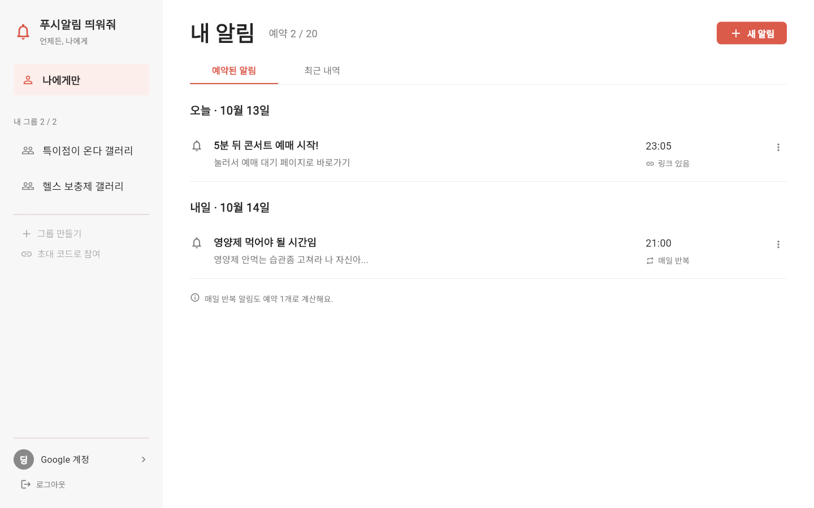
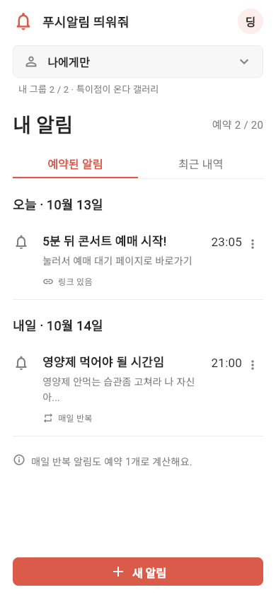
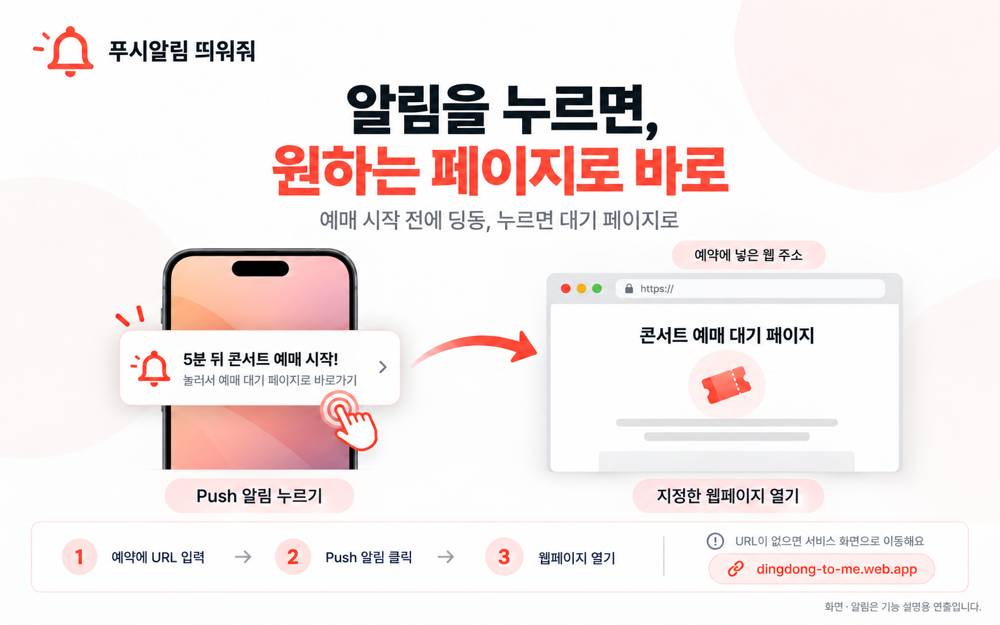
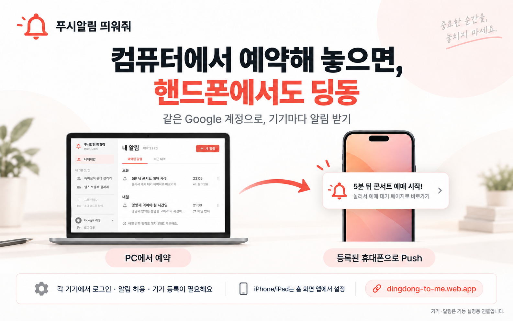
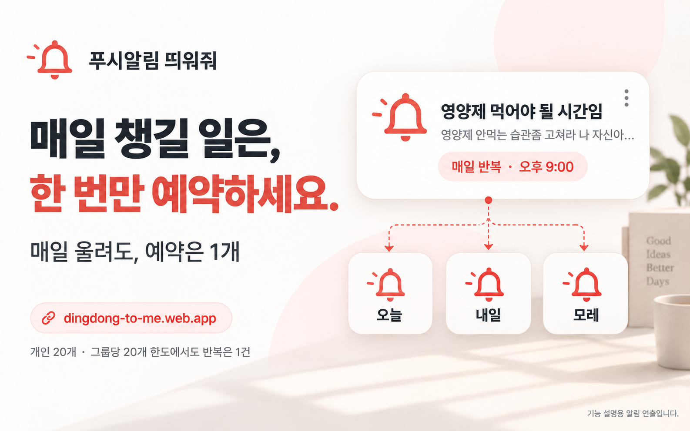
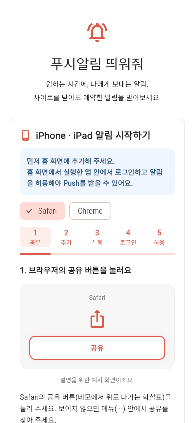

AI로 작성되었습니다. 슬롭 같으면 님 말이 맞음.

<h1 align="center">푸시알림 띄워줘</h1>

언제든, 나에게. 미래의 나에게, 딩동.

  
  
  
  

<b><a href="https://dingdong-to-me.web.app/">서비스 열기 →</a></b> · <a href="https://github.com/hssum9409/daily_odd_builds-public/releases/tag/day002-web-v1.0.0">웹서비스 릴리즈</a>

**원하는 시간과 내용을 예약하면, 사이트를 닫아도 내 휴대폰이나 브라우저로 Push 알림을 보내는 웹서비스입니다.**

“나중에 해야지”의 나중을 입력하는 사이트입니다. 기억력이 좋아지진 않습니다. 미래의 나한테 벨을 맡겨두는 쪽입니다.

Day 002 of [daily_odd_builds](https://daily-odd-builds-portal.web.app/) · **서비스와 사용 안내·구조 설명을 공개합니다. 원본 앱/서버 소스는 비공개입니다.**

## 서비스 열기

### [딩동하러 가기 → dingdong-to-me.web.app](https://dingdong-to-me.web.app/)

Chrome/Edge 등 Web Push 지원 브라우저와 Google 계정으로 시작하세요. iPhone/iPad는 **홈 화면에 추가한 앱에서 로그인·알림 허용**이 필요합니다. 실제 iPhone 수신은 아직 검증하지 않았습니다.

카카오톡 안에서 열었다면 **외부 브라우저로 열기** 안내를 따라 주세요. 이동하지 않으면 버튼·주소 복사·카카오톡 메뉴를 사용할 수 있습니다. 처음 로딩할 때는 시작 화면을 표시하고, 연결 오류나 지연에는 다시 불러오기를 제공합니다.

## 2분이면 시험할 수 있어요

1. **Google로 로그인**합니다.
2. **알림 받기**를 눌러 권한을 허용합니다. 동의하면 설정 안내가 사라집니다.
3. 계정 메뉴에서 **알림 허용됨 · 기기 등록 완료**를 확인합니다.
4. **새 알림 → 2분 뒤로 설정**을 누르고 제목·내용을 적어 **알림 예약하기**를 누릅니다.
5. 사이트 탭을 닫고 알림을 기다립니다. 이동 URL을 넣었다면 알림을 눌러 그 페이지로 이동합니다.

세로의 오른쪽 위 계정 아이콘, 넓은 화면의 왼쪽 아래 **Google 계정** 메뉴에 기기 상태와 새로고침이 있습니다. 권한 허용과 기기 등록은 별개라, 등록 오류가 보이면 **다시 시도**나 **기기 등록 새로고침**을 눌러 주세요.

예약 시각 이후 매분 실행하는 서버가 처리합니다. 초 단위 정각 알람은 아니며 네트워크·브라우저·OS 설정으로 늦거나 누락될 수 있습니다. [자세한 사용법](docs/USAGE.md)

## 어떤 걸 할 수 있나요?

| 기능 | 하는 일 |
| --- | --- |
| 나에게만 | 제목·내용·시간·선택 URL로 개인 Push를 예약합니다. |
| 그룹 알림 | 그룹장·관리자가 예약/취소하고 일반 멤버는 목록을 봅니다. 관리권한 부여·회수는 그룹장만 합니다. |
| 매일 반복 | 같은 현지 시각에 계속 알립니다. 날짜마다 새 예약을 만들지 않습니다. |
| 알림 클릭 | HTTP/HTTPS 웹 URL로 이동합니다. URL이 없으면 서비스 화면으로 돌아옵니다. |
| 예약 관리 | 예약됨·발송됨·취소됨·실패를 구분합니다. 발송 전 예약을 취소할 수 있습니다. |
| 모바일 화면 | 세로는 간단한 목록, 넓은 가로 화면은 사이드바로 개인/그룹을 고릅니다. |

### 나에게만, 또는 우리 그룹에게

“5분 뒤 콘서트 예매 시작!”을 예약하고, 알림을 누르면 예매 대기 페이지로 바로 이동합니다. 매일 영양제를 챙길 시간도 한 번만 예약해 둡니다.

| 한도 | 기준 |
| --- | --- |
| 개인 예약 | 활성 예약 최대 **20개** |
| 그룹 예약 | **그룹당 20개**. 개인 한도와 별개 |
| 매일 반복 | 반복 전체를 **예약 1개**로 계산 |
| 그룹 가입 | 만든 그룹을 포함해 **계정당 2개** |
| 최근 내역 | 지난 내역 **최근 30개** 표시. 아직 오지 않은 예약은 별도 |

최근 내역 30개는 화면과 기기 캐시의 표시 한도입니다. 서버의 옛 기록을 자동 삭제하는 보관 기간은 아닙니다.

### 알림을 누르면, 원하는 페이지로 바로

예약할 때 **이동 URL**에 예매 대기 페이지 주소를 넣어두세요. “5분 뒤 콘서트 예매 시작!” 알림을 누르면 그 페이지가 열립니다. HTTP/HTTPS 웹 주소를 사용할 수 있으며 URL이 없으면 서비스 화면으로 돌아옵니다. [알림 클릭으로 웹페이지 열기](docs/NOTIFICATION-CLICK.md)

### 컴퓨터에서 예약해 놓으면, 핸드폰에서도 딩동

PC에서 긴 내용과 예매 URL을 적어두고, 외출 중에는 등록한 휴대폰에서 알림을 받습니다. **같은 Google 계정으로 각 기기에서 로그인 → 알림 허용 → 기기 등록**을 완료해야 합니다. iPhone/iPad는 홈 화면 앱에서 설정합니다. [기기 간 수신 안내](docs/CROSS-DEVICE.md)

### 갤러리 공지도, 그룹으로 딩동

완장이 그룹을 만들고 초대 코드를 공유한 뒤 알림을 예약합니다. 가입한 멤버는 자기 기기에서 받습니다. 알림에 링크를 넣으면 공앱 소개 페이지나 상품 페이지로 이동할 수 있습니다. **그룹당 20개 / 가입 그룹 최대 2개**입니다.

그룹장은 그룹을 선택한 뒤 **관리권한 설정**에서 멤버에게 예약·취소 권한을 부여하거나 회수할 수 있습니다. 이 메뉴는 그룹장에게만 보이며, 관리자는 다른 사람에게 권한을 줄 수 없습니다. 대상은 멤버가 **그룹 정보 → 내 멤버 코드 복사**로 알려준 코드로 확인합니다.

Gemini 4 아르곤 출시와 다이마 8.3 소식은 말투와 사용 장면을 보여주는 **가상 메시지**입니다. 실제 출시·특가 공지나 갤러리의 공식 알림이 아닙니다. [그룹 메시지 사용 장면](docs/GROUP-MESSAGES.md)

### 매일 챙길 일은, 한 번만 예약하세요

“영양제 먹어야 될 시간임 / 영양제 안먹는 습관좀 고쳐라 나 자신아...”처럼 미래의 나한테 한마디 남깁니다. **매일 반복을 켜면 계속 예약 1건**이며, 중단할 때는 예약을 취소합니다. [반복 알림 안내](docs/DAILY-REPEAT.md)

iPhone · iPad에서는 이 순서로 시작하세요

**iOS/iPadOS 16.4 이상**에서 공유 → 홈 화면에 추가 → 홈 화면 아이콘으로 실행 → Google 로그인 → 알림 받기 → 허용 순서입니다.

Safari/Chrome 일반 탭에서는 설치 안내가 먼저 나옵니다. 홈 화면 앱과 일반 탭은 로그인 상태가 다를 수 있으니 **추가 후 앱 안에서 로그인**하세요. 앱에서 실제 지원 여부와 기기 등록을 확인합니다.

기기 설정에서 알림을 끈 경우 설치할 때 정한 앱 이름을 찾아 허용하고 다시 등록하세요. Focus·알림 요약 등 OS 설정도 확인하세요. [iOS 상세 순서](docs/USAGE.md#iphone--ipad)

[Firebase Safari FCM 안내](https://firebase.blog/posts/2023/08/fcm-for-safari) · [WebKit Home Screen Push 안내](https://webkit.org/blog/13878/web-push-for-web-apps-on-ios-and-ipados/)

**실제 iPhone/iPad의 설치·Google 로그인·권한 팝업·Push 수신은 아직 미검증입니다.** 이 가이드 이미지가 iPhone 수신 증거는 아닙니다.

알림이 안 오거나 예약 시간이 달라 보여요

- 계정 메뉴에서 기기 등록 완료인지 확인하고 등록을 새로고침하세요.
- 기기/브라우저 알림 허용, 인터넷 연결, OS의 알림/집중 모드 설정을 확인하세요.
- 입력은 브라우저의 현지 시각이며 서버에는 명확한 timestamp로 저장합니다.
- 매일 반복은 처음 예약한 시간대를 유지합니다. 시간대를 이동했다면 원하는 기준으로 다시 예약하세요.
- 목록의 **발송됨**은 FCM 접수입니다. 실제 기기 화면 표시를 보증하지 않습니다.
- 브라우저 프로그램의 완전 종료·절전·네트워크 단절 등은 탭만 닫는 것과 조건이 다릅니다.

필수 일정·응급·정각 보장용으로 사용하지 마세요. 알림 벨도 인터넷이 필요합니다.

## 어떻게 만들었나요?

**Flutter Web/PWA + Firebase Auth·Firestore·FCM·Hosting + GCP Scheduler/Functions**를 사용했습니다. FCM은 발송을 맡고, 예약 시각 관리는 서버 Scheduler가 맡습니다.

작은 상태 버전과 기기 캐시를 비교해 변경된 내역만 가져옵니다. 서버는 조건부 발송 권한을 확보해 중복을 줄이고, 결과가 불명확한 발송은 자동 재전송하지 않습니다.

[포트폴리오용 구조 설명](docs/ARCHITECTURE.md) · [사용법](docs/USAGE.md) · [데이터 처리](docs/DATA-AND-PRIVACY.md) · [이미지 제작/검증 범위](docs/README-MEDIA.md)

## 확인한 것과 아직 확인하지 못한 것

2026-10-15 서비스 업데이트 기준입니다. 최초 웹서비스 릴리즈는 [릴리즈 기록](docs/RELEASE.md)에 남겨두었습니다.

| 확인 | 범위 |
| --- | --- |
| 실제 개인 Push | Chrome에서 예약 → 서비스 탭 전부 닫기 → 실제 알림 도착 → 클릭 시 example.com 이동을 사용자와 확인 |
| 예약 서버 | Scheduler/Functions 정상 실행, FCM 접수/발송 결과 기록 확인 |
| 화면 | 데스크톱·모바일 viewport·가로, 작성/목록/그룹 UI 검사. 예시 데이터 사용 |
| 코드 검사 | Flutter analyze, Flutter 18개·JS/backend 33개·Rules/통합 20개 검사, production web build 통과 |
| 그룹 관리권한 | Auth/Firestore/Functions emulator의 두 계정으로 그룹장 전용 메뉴, 부여·회수, 관리자 예약, 열려 있던 작성 창의 회수 후 저장 차단을 실제 앱에서 확인. 실서비스의 복수 실기기 시험과는 별개 |
| 시작 화면 | 데스크톱·모바일 로딩/재시도, 이전 진입 HTML 캐시 복구, root URL 캐시 갱신 확인 |
| 미검증 | 실제 iPhone/iPad, 그룹의 복수 사용자 실기기 수신, 다음 날 실제 매일 반복 수신, 실제 카카오톡 앱에서 외부 브라우저 전환 |

## 만든놈

웹앱에서도 **만든놈**을 열 수 있습니다. 세로 화면은 오른쪽 위 계정 메뉴, 넓은 화면은 사이드바 아래에 있습니다. 로그인 전에는 시작 화면 아래 버튼으로 들어갑니다.

### [hssum9409](https://github.com/hssum9409)

매일 한개씩 잡동사니 만드는 사람. 
요청사항은 [GitHub](https://github.com/hssum9409/daily_odd_builds-public/issues)에 보내면 수정할지도 안할지도. 버그는 가능한 빠르게 수정함.

그 외 잡동사니가 보고싶은 사람은 [여기](https://daily-odd-builds-portal.web.app/)로. 
AI 슬롭 같다구요? 으쩌라구요

버그 제보에는 브라우저/OS와 재현 순서를 남겨주세요.

**계정 이메일·UID·기기 토큰·개인 예약 내용은 공개 이슈에 올리지 마세요.**

## 공개 범위

이 폴더는 서비스 안내·홍보 이미지·개념 구조 설명입니다. 앱 원본·서버 원본·개발 Git 이력과 운영 설정은 제공하지 않습니다. 브라우저 실행에 필요한 컴파일된 클라이언트 파일은 웹서비스에서 내려받습니다.

이미지에는 생성 연출과 실제 UI 예시가 함께 있습니다. [README-MEDIA](docs/README-MEDIA.md)와 [ARTWORK](docs/ARTWORK.md)를 확인하세요. 앱 소스의 MIT/오픈소스 배포를 뜻하지 않습니다. Google/Firebase 또는 Todoist의 공식 제품이 아닙니다.
