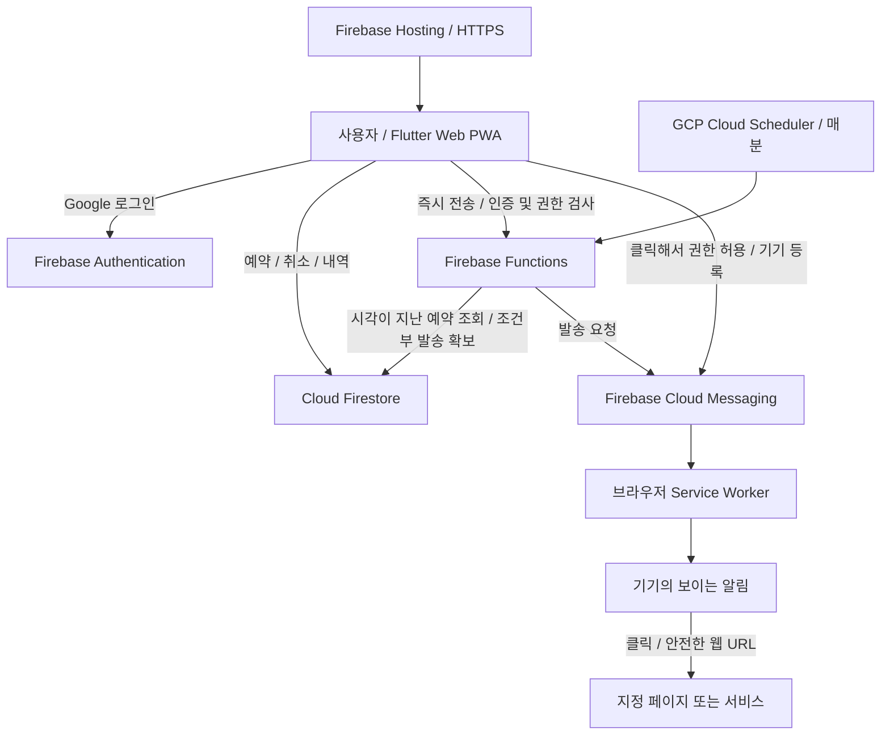

# 푸시알림 띄워줘 — 공개 구조 설명

2026-10-14 웹서비스 릴리즈. 구성과 기술 선택을 설명하는 포트폴리오 문서이며 원본 소스·운영 설정·서버 인증정보는 포함하지 않습니다.

## 핵심 흐름

사이트를 닫아도 서버의 예약 처리는 계속됩니다. 브라우저의 Service Worker가 Push를 받아 보이는 알림을 표시합니다. 기기 수신에는 OS/브라우저 권한과 네트워크 상태가 영향을 줍니다.

## 책임 분리

| 구성 | 책임 |
| --- | --- |
| Flutter Web/PWA | 반응형 목록, 입력/검증, 현지 시각, 개인/그룹 전환 |
| Firebase Auth | Google 계정 인증과 사용자 식별 |
| Firestore / Rules | 사용자·기기·예약·그룹, 사용자 간 데이터 격리, 예약 한도 |
| Scheduler / Functions | 기한이 된 예약 처리, 그룹 수신자 확인, 다음 반복 시각 계산 |
| FCM / root Service Worker | 기기별 Push 전달 요청, foreground/background 알림, 클릭 처리 |
| Hosting | HTTPS 앱 및 PWA 파일 제공 |

## 데이터와 비용을 줄이는 선택

- 개인 20개, 그룹당 20개, 가입 그룹 2개. 반복 예약도 한 문서를 계속 사용해 슬롯 1개를 유지합니다.
- 사용자/그룹별 **작은 Firestore 상태 버전**을 구독하고 기기의 목록 캐시 버전과 비교합니다. 이전 내역 전체를 매번 읽지 않고 변경된 revision 이후 문서를 반영합니다. 별도 RTDB는 현재 사용하지 않습니다.
- 완료 내역은 화면/캐시에 30개까지만 보관합니다. 서버 데이터의 자동 삭제 정책과는 별개입니다.
- 전용 Firebase 프로젝트로 인증 사용자/기기/예약과 Rules의 운영 경계를 분리합니다.
- 사용자가 Blaze를 선택해 Scheduler/Functions를 GCP에 통합했습니다. 외부 Cron/Cloudflare와 장기 인증 키를 추가하지 않았습니다. 작은 무료 범위를 목표로 운영하지만 인프라 비용 0원을 보장하지 않습니다.

## 시간·반복·중복

사용자 입력은 브라우저 현지 시각으로 받고 서버에는 UTC 기준 timestamp를 저장합니다. 매일 반복은 최초 IANA timezone의 시각을 유지합니다. 장애로 놓친 날의 알림을 몰아서 보내지 않고 다음 미래 시각으로 진행합니다.

서버가 예약을 읽은 것만으로 보내지 않고 조건부 변경으로 발송 권한을 확보합니다. 취소나 다른 실행이 먼저 상태를 바꾸면 발송을 진행하지 않습니다. 기기 token 중복도 제거합니다.

FCM 전송과 Firestore 결과 저장은 하나의 원자적 작업이 아닙니다. 발송 결과가 불명확하면 무조건 다시 보내는 대신 불명 상태로 남깁니다. 중복 위험을 줄이는 선택이며 exactly-once나 무누락을 보장하지 않습니다. 그룹은 수신자별 처리 기록으로 작업을 이어갑니다.

## 기기와 권한

HTML 시작 화면 → 설정과 Push 모듈 → Flutter 엔진 → 인증 복원 → 첫 의미 있는 화면 순서로 진입합니다. 완료 프레임 이후 시작 화면을 제거하며 오류/지연 시 재시도를 제공합니다. 카카오톡 내장 브라우저는 SDK 로딩 전에 외부 브라우저 안내로 분기합니다.

클라이언트 스크립트와 FCM worker는 같은 수동 릴리즈 버전 URL로 구분합니다. root/라우팅 URL을 포함한 Hosting 응답은 재검증하도록 설정하며, 이전 HTML과 새 bootstrap이 섞이면 한 번 갱신해 복구합니다. 기존 FCM 구독이나 기기 캐시를 일괄 삭제하지 않습니다.

페이지 접속만으로 권한 팝업을 열지 않습니다. 사용자 버튼 클릭에서 권한을 요청한 뒤 지원 여부 확인·token 발급·계정의 기기 등록을 진행합니다. token은 바뀔 수 있으므로 재등록/갱신을 허용합니다.

Flutter의 오프라인 Service Worker는 사용하지 않고 FCM용 root worker 하나를 사용합니다. data-only 메시지를 수신 코드에서 한 번 표시하고, 사용자 클릭은 HTTP/HTTPS URL만 허용합니다. JavaScript/data/custom scheme으로 이동하지 않습니다.

iOS/iPadOS는 16.4+ Home Screen Web App에서 진행합니다. 표준 기능 검사와 FCM SDK 지원 검사, 실제 token 발급 성공을 확인해 등록 완료를 표시합니다. iPhone 실기기 수신은 아직 미검증입니다.

## 그룹 권한

초대 링크를 열고 로그인한 뒤 그룹을 확인하고 참여합니다. 본인이 만든 그룹도 가입 한도에 포함합니다. 그룹장·관리자가 그룹 알림을 예약·취소하고 일반 멤버는 내역을 읽습니다. 관리권한 부여/회수와 그룹 종료는 그룹장만 할 수 있습니다. 다른 사용자의 기기 token과 서버 수신자 처리 기록은 멤버에게 공개하지 않습니다. 발송이 시작되어 FCM에 접수된 메시지는 탈퇴/취소로 회수할 수 없습니다.

권한 변경 API는 인증된 호출자가 실제 그룹장인지 transaction 안에서 확인하고, 멤버의 권한과 본인 그룹 목록의 표시 정보를 함께 갱신합니다. Firestore Rules는 실제 멤버 권한을 확인하며 클라이언트가 역할을 직접 수정하지 못하게 합니다. 알림 작성자는 유지되고 그룹장/관리자는 서로가 작성한 그룹 예약도 취소할 수 있습니다. 기존 그룹은 역할 필드가 없어도 소유자는 그룹장, 나머지는 일반 멤버로 처리합니다. 탈퇴 시 권한도 제거하며 재가입으로 복구하지 않습니다.

관리권한 부여 목록은 그룹장만, 구독자·차단 목록은 그룹장·관리자만 접근하며 해당 그룹의 서버가 선택한 계정만 50명씩 선택하고 Firebase Admin Auth에서 이름·이메일을 조회합니다. 요청자가 보낸 임의 UID로 프로필을 조회하지 않습니다. Auth 조회 후에도 현재 관리 권한·목록 대상 상태를 다시 검사하며 그룹 공용 문서에 개인정보를 저장하지 않습니다. 기존 멤버도 Auth 계정 정보로 바로 구분할 수 있습니다. [Firebase Admin 사용자 조회](https://firebase.google.com/docs/auth/admin/manage-users)

## 현재 검증과 후속 범위

Chrome 개인 예약의 실제 백그라운드 수신/클릭과 production 예약 서버를 확인했습니다. 그룹/매일 반복의 로직·권한·UI는 자동 검사와 격리 환경에서 확인했으며, 복수 실계정 수신 및 다음 날 실제 반복 수신은 별도 검증 대상입니다.

공개 채널/페이지 구독, 계정 삭제 UI, 대규모 발송 최적화는 이번 서비스의 완성 범위에 포함하지 않습니다. 긴급·정각 보장용 알람이 아닌 작은 예약 Push 서비스입니다.

## 즉시 전송

인증된 API가 개인 또는 그룹장/관리자의 그룹 대상만 허용하고, 활성 한도와 발송 시작 상태를 하나의 transaction으로 확정합니다. 분 단위 예약 실행을 기다리지 않고 기존 FCM 전달 처리기를 호출합니다. 같은 요청의 재전송은 저장된 결과만 돌려주며, 불명확한 전송을 자동 재발송하지 않습니다. 완료 후 활성 슬롯을 반환하고 변경 버전과 최근 내역을 갱신합니다. 그룹은 제한 시간까지 수신자를 나누어 처리하고 남은 작업은 기존 예약 서버가 이어갑니다.

## 가입 보호와 구독자 차단

그룹장·관리자의 서버 API가 비밀번호 설정과 차단을 담당합니다. 비밀번호는 원문 대신 무작위 salt를 포함한 scrypt 해시로 서버 전용 문서에 저장합니다. 일반 클라이언트는 그룹장이어도 해시·차단 기록·시도 횟수를 직접 읽거나 쓰지 못합니다. 가입은 계정/그룹별 15분 5회 입력 제한과 비밀번호 검증을 거치고, 마지막 transaction에서 비밀번호 버전·차단·가입 한도를 다시 확인합니다.

차단은 멤버십과 본인 그룹 링크 삭제, 인원·가입 수 감소와 함께 원자적으로 처리합니다. 관리자끼리의 차단과 그룹장이 내린 차단 해제는 그룹장만 가능하며 자신·그룹장은 차단할 수 없습니다. 차단 해제로 가입이나 역할이 복원되지는 않습니다. 발송은 각 기기로 보내기 직전에 현재 멤버십을 확인합니다. 이미 FCM으로 보낸 요청을 취소하거나 이미 내려받은 정보를 회수하는 보장은 없습니다.
