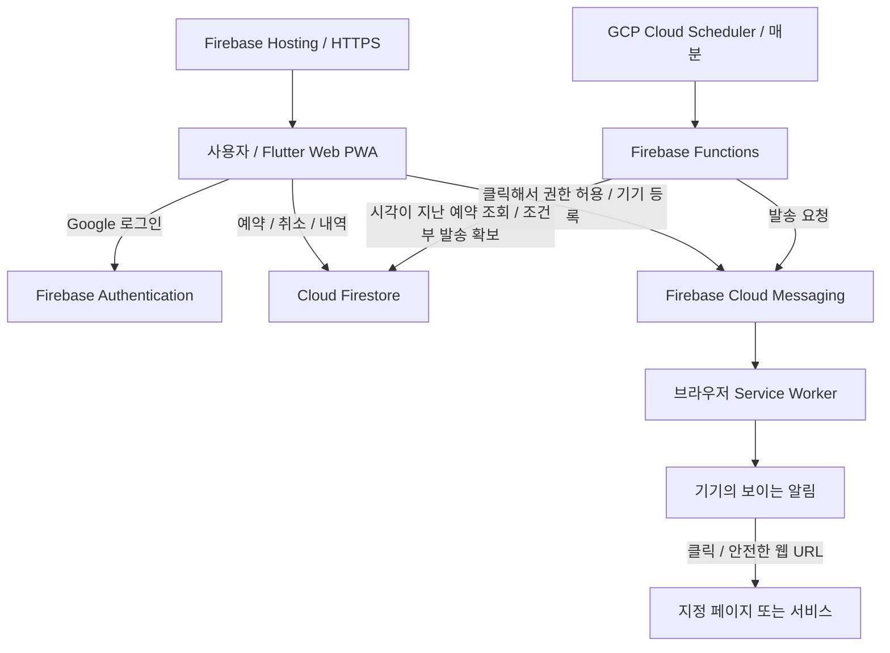

# 푸시알림 띄워줘 — 공개 구조 설명

2026-10-13 스냅샷. 구성과 기술 선택을 설명하는 포트폴리오 문서이며 원본 소스·운영 설정·서버 인증정보는 포함하지 않습니다.

## 핵심 흐름

사이트를 닫아도 서버의 예약 처리는 계속됩니다. 브라우저의 Service Worker가 Push를 받아 보이는 알림을 표시합니다. 기기 수신에는 OS/브라우저 권한과 네트워크 상태가 영향을 줍니다.

## 책임 분리

| 구성 | 책임 |
| --- | --- |
| Flutter Web/PWA | 반응형 목록, 입력/검증, 현지 시각, 개인/그룹 전환 |
| Firebase Auth | Google 계정 인증과 사용자 식별 |
| Firestore / Rules | 사용자·기기·예약·그룹, 사용자 간 데이터 격리, 예약 한도 |
| Scheduler / Functions | 기한이 된 예약 처리, 그룹 수신자 확인, 다음 반복 시각 계산 |
| FCM / root Service Worker | 기기별 Push 전달 요청, foreground/background 알림, 클릭 처리 |
| Hosting | HTTPS 앱 및 PWA 파일 제공 |

## 데이터와 비용을 줄이는 선택

- 개인 20개, 그룹당 20개, 가입 그룹 2개. 반복 예약도 한 문서를 계속 사용해 슬롯 1개를 유지합니다.
- 사용자/그룹별 **작은 Firestore 상태 버전**을 구독하고 기기의 목록 캐시 버전과 비교합니다. 이전 내역 전체를 매번 읽지 않고 변경된 revision 이후 문서를 반영합니다. 별도 RTDB는 현재 사용하지 않습니다.
- 완료 내역은 화면/캐시에 30개까지만 보관합니다. 서버 데이터의 자동 삭제 정책과는 별개입니다.
- 전용 Firebase 프로젝트로 인증 사용자/기기/예약과 Rules의 운영 경계를 분리합니다.
- 사용자가 Blaze를 선택해 Scheduler/Functions를 GCP에 통합했습니다. 외부 Cron/Cloudflare와 장기 인증 키를 추가하지 않았습니다. 작은 무료 범위를 목표로 운영하지만 인프라 비용 0원을 보장하지 않습니다.

## 시간·반복·중복

사용자 입력은 브라우저 현지 시각으로 받고 서버에는 UTC 기준 timestamp를 저장합니다. 매일 반복은 최초 IANA timezone의 시각을 유지합니다. 장애로 놓친 날의 알림을 몰아서 보내지 않고 다음 미래 시각으로 진행합니다.

서버가 예약을 읽은 것만으로 보내지 않고 조건부 변경으로 발송 권한을 확보합니다. 취소나 다른 실행이 먼저 상태를 바꾸면 발송을 진행하지 않습니다. 기기 token 중복도 제거합니다.

FCM 전송과 Firestore 결과 저장은 하나의 원자적 작업이 아닙니다. 발송 결과가 불명확하면 무조건 다시 보내는 대신 불명 상태로 남깁니다. 중복 위험을 줄이는 선택이며 exactly-once나 무누락을 보장하지 않습니다. 그룹은 수신자별 처리 기록으로 작업을 이어갑니다.

## 기기와 권한

페이지 접속만으로 권한 팝업을 열지 않습니다. 사용자 버튼 클릭에서 권한을 요청한 뒤 지원 여부 확인·token 발급·계정의 기기 등록을 진행합니다. token은 바뀔 수 있으므로 재등록/갱신을 허용합니다.

Flutter의 오프라인 Service Worker는 사용하지 않고 FCM용 root worker 하나를 사용합니다. data-only 메시지를 수신 코드에서 한 번 표시하고, 사용자 클릭은 HTTP/HTTPS URL만 허용합니다. JavaScript/data/custom scheme으로 이동하지 않습니다.

iOS/iPadOS는 16.4+ Home Screen Web App에서 진행합니다. 표준 기능 검사와 FCM SDK 지원 검사, 실제 token 발급 성공을 확인해 등록 완료를 표시합니다. iPhone 실기기 수신은 아직 미검증입니다.

## 그룹 권한

초대 코드로 가입하며 본인이 만든 그룹도 가입 한도에 포함합니다. 그룹장이 예약·취소하고 멤버는 내역을 읽습니다. 다른 사용자의 기기 token과 서버 수신자 처리 기록은 멤버에게 공개하지 않습니다. 발송이 시작되어 FCM에 접수된 메시지는 탈퇴/취소로 회수할 수 없습니다.

## 현재 검증과 후속 범위

Chrome 개인 예약의 실제 백그라운드 수신/클릭과 production 예약 서버를 확인했습니다. 그룹/매일 반복의 로직·권한·UI는 자동 검사와 격리 환경에서 확인했으며, 복수 실계정 수신 및 다음 날 실제 반복 수신은 별도 검증 대상입니다.

공개 채널/페이지 구독, 계정 삭제 UI, 대규모 발송 최적화는 이번 서비스의 완성 범위에 포함하지 않습니다. 긴급·정각 보장용 알람이 아닌 작은 예약 Push 서비스입니다.
