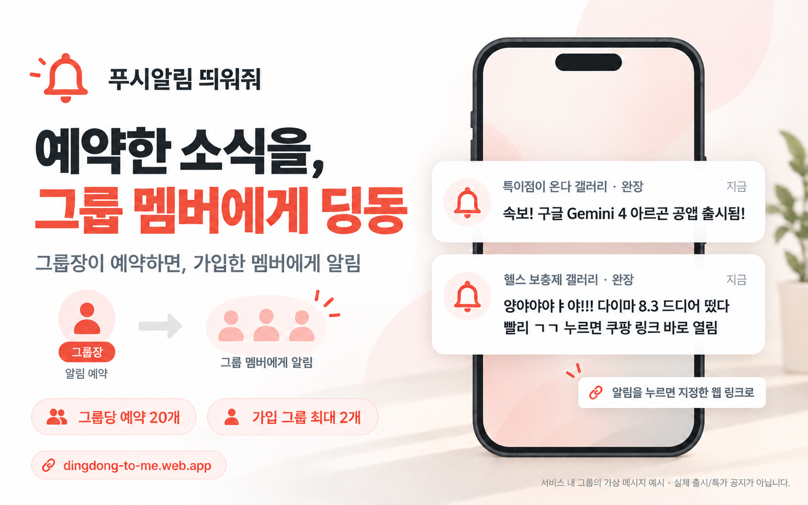

# 예약한 소식을, 그룹 멤버에게 딩동

완장 역할의 그룹장이 서비스 안에 그룹을 만들고, 받을 사람들이 초대 링크로 가입합니다. 그룹장이 예약하면 각 멤버의 등록된 기기로 알림을 보냅니다.

### 특이점이 온다 갤러리 · 완장

> 속보! 구글 Gemini 4 아르곤 공앱 출시됨!

### 헬스 보충제 갤러리 · 완장

> 양야야야ㅑ야!!! 다이마 8.3 드디어 떴다 
> 빨리 ㄱㄱ 누르면 쿠팡 링크 바로 열림

두 내용은 기능 설명용 **가상 메시지 예시**입니다. 실제 출시/가격/특가/갤러리 공지로 읽지 마세요. 그룹 이름도 사용자가 서비스에서 만든 그룹의 예시입니다. 실제 상품/공앱 링크는 예약을 만드는 사람이 입력합니다.

- **그룹장·관리자**가 예약·취소하고 **일반 멤버**는 예약 목록을 확인합니다. 관리권한 부여·회수는 그룹장만 할 수 있습니다. [권한 설정 순서](USAGE.md#그룹-관리권한)
- 그룹 예약은 **그룹마다 최대 20개**. 만든 그룹을 포함해 계정당 **2개 그룹**에 가입합니다.
- 초대 링크로 가입한 각 멤버가 로그인·알림 허용·기기 등록을 완료해야 받습니다.
- 발송 시작 이후 FCM 접수 메시지는 취소/탈퇴로 회수할 수 없습니다. 많은 멤버는 여러 처리 주기에 걸쳐 받을 수 있습니다.

알림 클릭은 예약의 HTTP/HTTPS 페이지로 이동합니다. [그룹/반복 사용법](USAGE.md#그룹과-매일-반복)
