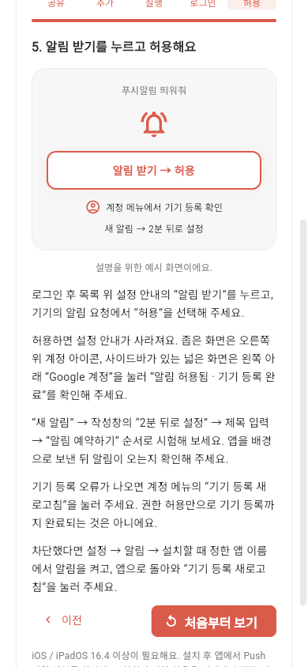

# 사용법

## 처음 시작

1. [서비스](https://dingdong-to-me.web.app/)에서 Google로 로그인합니다.
2. 목록 위 **알림 받기**를 직접 누르고 브라우저 요청을 허용합니다.
3. 안내는 허용 후 사라집니다. 계정 메뉴에서 **기기 등록 완료**를 확인합니다. 등록이 실패하면 별도 오류/재시도로 처리합니다.
4. **새 알림**에서 제목, 내용, 날짜, 시간, 선택 URL을 입력합니다. 내 현지 시간과 시간대를 확인하고 예약합니다.
5. **2분 뒤로 설정**으로 시험한 뒤 탭을 닫거나 배경으로 보냅니다.

예약 시각 이후 매분 처리하므로 조금 늦게 도착할 수 있습니다. URL은 HTTP/HTTPS만 가능하며 URL 없는 알림은 서비스로 이동합니다.

## 로딩 / 카카오톡에서 열기

첫 화면에서는 앱과 계정을 준비하는 시작 화면을 보여줍니다. 연결이 느리면 도움말과 **다시 불러오기**가 나오며, 초기화가 끝난 뒤 로그인 또는 목록으로 전환합니다. 이전 버전의 HTML이 남아 있으면 한 번 새 주소로 갱신합니다. 예약이나 기기의 Push 구독을 지우는 동작은 아닙니다.

카카오톡 내장 브라우저는 외부 브라우저 열기를 먼저 시도하고 안내 화면을 표시합니다. 자동 이동이 안 되면 **외부 브라우저로 열기**를 누르거나 **주소 복사** 후 Chrome/Edge/Safari에 붙여넣으세요. 카카오톡 메뉴(⋯)의 브라우저 열기도 사용할 수 있습니다. iPhone은 Safari에서 홈 화면에 추가한 뒤 그 앱 안에서 로그인·허용합니다. 실제 카카오톡 앱의 OS 전환은 아직 검증하지 않았습니다.

## iPhone / iPad

일반 Safari/Chrome 탭에선 설치 안내부터 시작합니다. iOS/iPadOS 16.4 이상이 필요하며, 공유 메뉴 위치는 OS/브라우저 버전에 따라 달라질 수 있습니다.

1. **공유** 버튼을 누릅니다. 보이지 않으면 메뉴의 공유를 찾습니다.
2. **홈 화면에 추가 → 추가**를 누릅니다. 웹 앱으로 열기 옵션이 보이면 켜 둡니다. 메뉴가 없다면 Safari로 열어 다시 시도합니다.
3. 홈 화면의 **푸시알림 띄워줘** 아이콘을 누릅니다. 주소창 없는 앱 화면으로 실행합니다.
4. 이 앱 안에서 **Google로 로그인**합니다. 브라우저에서 로그인했어도 다시 필요할 수 있습니다.
5. **알림 받기 → 허용**을 진행합니다. 좁은 화면은 오른쪽 위 계정 아이콘, 넓은 화면은 사이드바 아래 **Google 계정**에서 등록 완료를 확인합니다.
6. **새 알림 → 2분 뒤로 설정 → 제목 입력 → 알림 예약하기**, 앱을 배경으로 보내 수신을 시험합니다.

차단했다면 OS 설정의 알림에서 설치할 때 정한 앱 이름을 찾아 허용하고 앱에서 **기기 등록 새로고침**을 누릅니다. 지원 검사/등록이 실패하면 성공으로 표시하지 않습니다. 실제 iPhone의 설치·인증·권한·수신은 아직 검증하지 않았습니다.

## 그룹과 매일 반복

- 그룹 만들기 또는 초대 코드로 참여합니다. 만든 그룹까지 포함해 계정당 최대 2개입니다.
- 개인 대상/그룹 대상을 선택합니다. 그룹장과 부여받은 관리자가 그룹 알림을 예약/취소할 수 있습니다.
- **매일 반복**은 최초 선택한 시간대/시각에 한 예약으로 유지됩니다. 다른 시간대로 이동했다면 원하는 기준으로 다시 예약하세요.
- 발송 전 예약을 메뉴에서 취소하면 반복이 중단됩니다. 발송이 이미 시작되거나 FCM에 접수된 메시지는 회수하지 못합니다.
- 개인 활성 20개, 그룹별 활성 20개. 지난 내역 최근 30개는 별도 표시합니다.

## 그룹 관리권한

1. 대상 멤버는 그룹을 선택하고 **그룹 정보 → 내 멤버 코드 복사**로 그룹장에게 코드를 알려줍니다. 계정 이메일이나 Google 비밀번호를 보낼 필요는 없습니다.
2. 그룹장은 해당 그룹의 **관리권한 설정**을 엽니다. 이 버튼과 권한 변경 화면은 그룹장에게만 제공됩니다.
3. 멤버 코드를 확인한 뒤 **관리권한 부여 → 부여**를 누릅니다. 관리자는 그룹의 모든 예약을 생성·취소할 수 있습니다.
4. 중단할 때는 같은 화면에서 **관리권한 회수 → 회수**를 누릅니다. 상대방이 보고 있는 그룹 화면에도 권한 변경이 반영됩니다.

관리자는 다른 멤버의 권한을 변경하거나 그룹을 종료할 수 없습니다. 권한을 회수해도 기존 예약은 유지되며 그룹장이나 다른 관리자가 취소할 수 있습니다. 그룹을 나갔다 재가입하면 일반 멤버로 시작합니다. 개인/그룹 예약 한도는 그대로 유지됩니다. 그룹 관리 화면은 멤버를 50명씩 더 불러올 수 있습니다.

## 만든놈

세로 화면에서는 오른쪽 위 계정 메뉴 → **만든놈**, 사이드바가 있는 화면에서는 아래 **만든놈**을 누릅니다. 로그인 전에도 화면 아래 버튼으로 열 수 있습니다. GitHub 프로필, 요청·버그 제보, 다른 잡동사니, 서비스 사용법 링크를 새 탭에서 열며 뒤로 가면 기존 알림 화면으로 돌아갑니다.

## 알림 끄기 / 확인

로그아웃하면 이 브라우저의 기기 등록을 비활성화하고 token 제거를 시도합니다. 다른 기기의 로그인/알림은 별도로 관리합니다. 예약 자체가 삭제되지는 않습니다. 특정 반복을 멈추려면 예약을 취소하세요.

발송됨은 FCM 접수입니다. OS 알림 설정·Focus·네트워크·브라우저 완전 종료 상태로 수신이 달라질 수 있습니다. 기기 등록 새로고침 후 2분 시험으로 확인하세요. [데이터 처리와 현재 제한](DATA-AND-PRIVACY.md)
