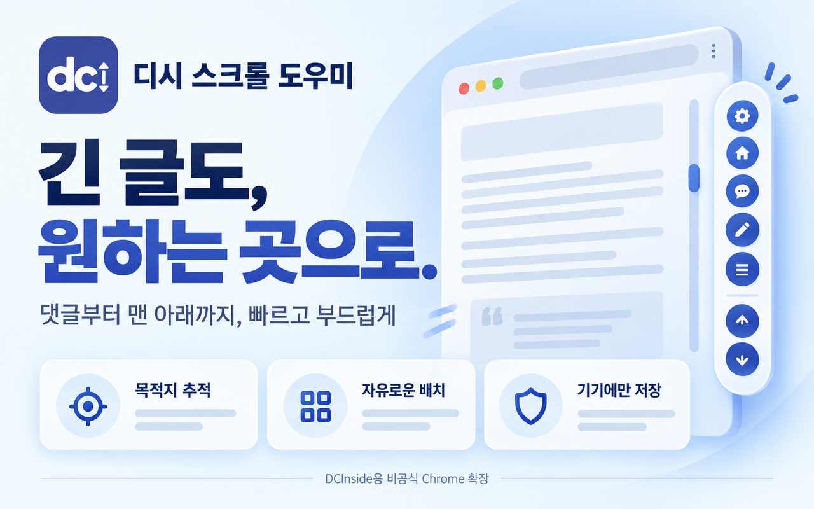
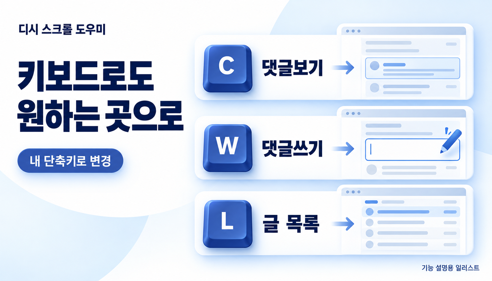
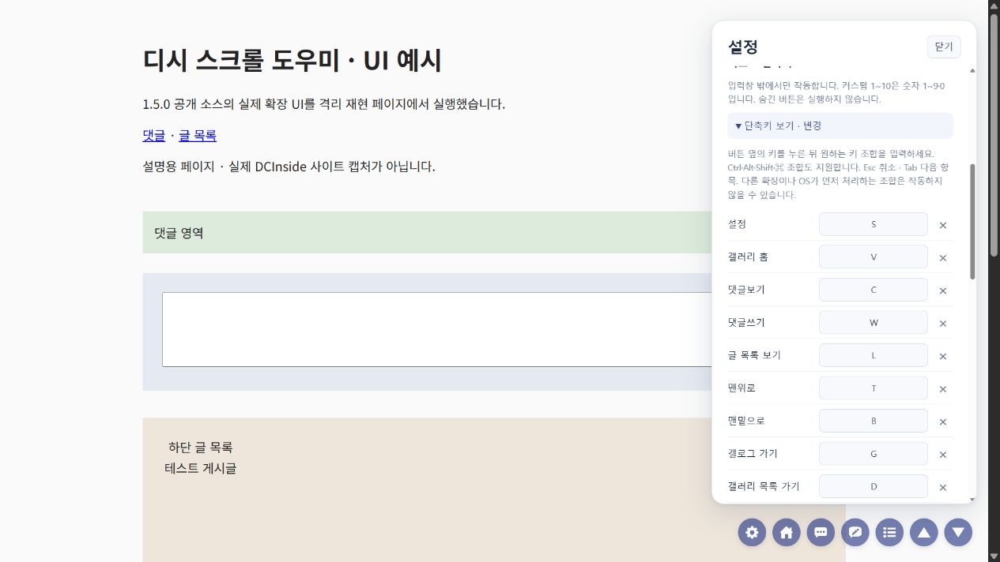
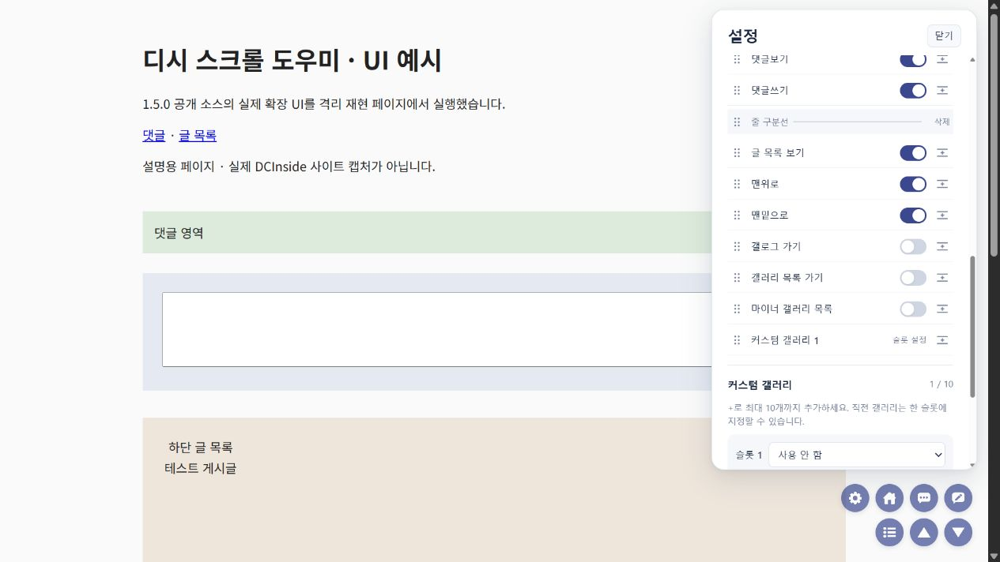
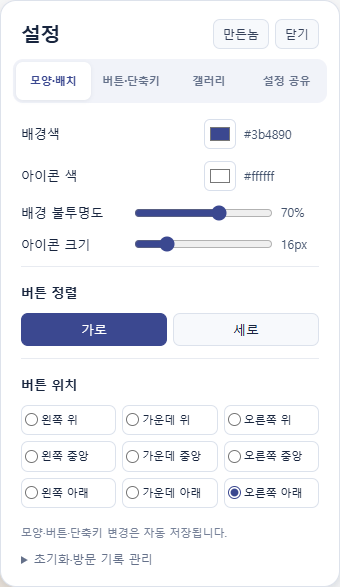
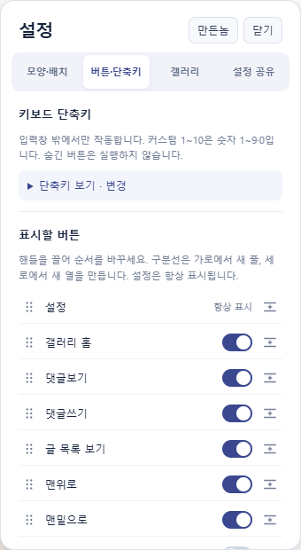
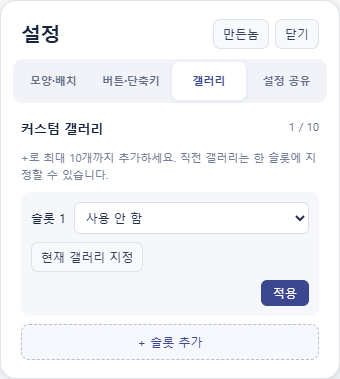
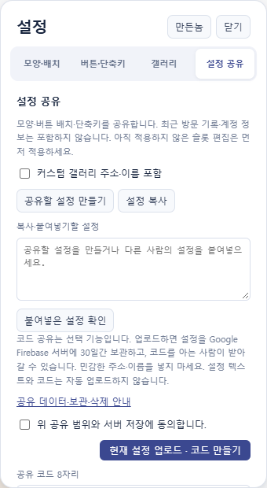
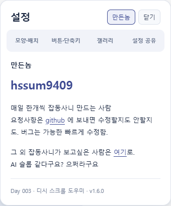

AI로 작성되었습니다. 슬롭 같으면 님 말이 맞음.

  

<h1 align="center">디시 스크롤 도우미</h1>

  긴 글도, 원하는 곳으로. 
  댓글 보러 가다가 휠부터 닳을 필요는 없습니다.

  
  
  
  

<b><a href="https://chromewebstore.google.com/detail/ncfjoncjghbhknfmlnniciobbddebnff">Chrome에 추가하기 →</a></b> · <a href="https://github.com/hssum9409/daily_odd_builds-public/releases/tag/day003-v1.6.0">릴리즈와 ZIP</a> · <a href="https://daily-odd-builds-portal.web.app/privacy/dcinside-scroll-helper">개인정보처리방침</a>

기존 기능을 설명하는 홍보 일러스트입니다. 기본 설정은 로컬 저장이며, 1.6.0의 선택적 코드 공유는 서버를 사용합니다. 실제 사이트 화면과 로컬 재현 화면은 아래에서 구분합니다.

**DCInside PC 페이지에 자주 쓰는 이동 버튼을 붙여주는 작은 Chrome 확장 프로그램입니다.**

댓글, 댓글 쓰기, 글 목록, 맨 위와 맨 아래로 빠르고 부드럽게 이동합니다. 이미지가 뒤늦게 로드되어 목적지가 밀리면 이동 중 위치를 다시 확인합니다. 긴 글을 줄여주진 않습니다. 내려가는 수고를 줄입니다.

Day 003 of [daily_odd_builds](https://daily-odd-builds-portal.web.app/) · 개인용으로 쓰던 확장을 배포 가능한 도구로 다듬었습니다. **DCInside가 제작·승인·운영하는 공식 제품은 아닙니다.**

**1.6.0 실행 ZIP과 확장 소스를 GitHub에 공개합니다. Chrome 웹 스토어에는 아직 제출하지 않았습니다.** 2026-10-28 공개 등록정보에서 확인한 버전은 1.4.0이며, 1.5.0의 심사 제출 기록(2026-10-27, 사용자 확인)은 별도로 보존합니다. 새 버전에는 선택적 설정 코드 공유용 사이트 권한이 추가됩니다. [업데이트와 검증 기록](docs/RELEASE.md)

## 설치

### [Chrome 웹 스토어에서 설치하기 →](https://chromewebstore.google.com/detail/ncfjoncjghbhknfmlnniciobbddebnff)

스토어에서 **Chrome에 추가**를 누른 뒤 디시인사이드 PC 게시글을 새로고침하세요. 오른쪽 아래에 원형 버튼이 나타납니다. 개발 환경, API 키, 확장 전용 계정은 필요 없습니다.

기존 개인용 또는 개발자 모드 버전을 사용 중이면 그 확장을 꺼서 패널이 겹치지 않게 해 주세요. 설정 버튼은 패널 안에 있습니다. 별도의 툴바 팝업을 찾을 필요는 없습니다.

ZIP 또는 공개 소스로 직접 설치하기

1. [1.6.0 실행 ZIP](https://github.com/hssum9409/daily_odd_builds-public/releases/download/day003-v1.6.0/dcinside-scroll-helper-1.6.0.zip)을 받아 **전부 압축 해제**합니다.
2. Chrome 주소창에 `chrome://extensions`를 입력하고 **개발자 모드**를 켭니다.
3. **압축해제된 확장 프로그램을 로드합니다**에서 `manifest.json`이 있는 폴더를 선택합니다. 이 저장소를 내려받았다면 `day-003-dcinside-scroll-helper/extension/`을 선택하세요.
4. 디시인사이드 페이지를 새로고침합니다.

직접 설치는 실행 폴더를 유지해야 하고, 새 버전을 직접 교체해야 합니다. 일반 사용에는 스토어 설치를 권장합니다.

## 어떤 버튼이 있나요?

기본 순서는 **설정 → 갤러리 홈 → 댓글보기 → 댓글쓰기 → 글 목록 보기 → 맨위로 → 맨밑으로**입니다.

| 버튼 | 하는 일 |
| --- | --- |
| 설정 | 모양, 위치, 표시할 버튼과 순서를 고릅니다. 항상 표시됩니다. |
| 갤러리 홈 | 지금 보고 있는 갤러리의 글 목록 페이지를 엽니다. |
| 댓글보기 | 현재 게시글의 댓글 영역으로 이동합니다. |
| 댓글쓰기 | 댓글 작성 영역으로 이동합니다. 내용을 입력하거나 제출하지 않습니다. |
| 글 목록 보기 | 현재 게시글 아래에 있는 글 목록으로 이동합니다. |
| 맨위로 / 맨밑으로 | 페이지의 시작과 끝으로 이동합니다. 이동 중 바닥이 늘어나면 다시 확인합니다. |
| 추가 버튼 | 본인 갤로그, 전체 갤러리 목록, 마이너 갤러리 목록과 커스텀 갤러리를 설정에서 켤 수 있습니다. |

페이지에서 할 수 있는 동작만 표시합니다. 로그인하지 않았거나 본인 갤로그 링크를 확인할 수 없으면 **갤로그 버튼을 숨깁니다.** 표시 설정과 순서는 기억했다가 조건이 맞으면 같은 자리에 나타납니다.

### 내려가는 중에도 방향을 바꿀 수 있습니다

다른 이동 버튼을 누르면 앞선 이동을 취소합니다. **Esc**, 휠·터치 스크롤 또는 스크롤 키로도 멈출 수 있습니다. 하나의 이동 작업만 실행되므로 댓글로 가다가 맨 위를 눌러도 서로 끌어당기지 않습니다.

## 키보드로도 이동합니다

설명용 생성 이미지입니다. 아래 표가 실제 기본 키이며, 댓글쓰기는 입력 영역으로 이동하는 동작입니다.

입력창 밖에서 아래 키를 누르면 같은 버튼 동작을 실행합니다. 기본 영문 키는 Shift 없이 누릅니다.

| 동작 | 기본 키 |
| --- | --- |
| 설정 | S |
| 현재 갤러리 홈 | V |
| 댓글보기 / 댓글쓰기 | C / W |
| 글 목록 보기 | L |
| 맨위로 / 맨밑으로 | T / B |
| 갤로그 가기 | G |
| 갤러리 목록 / 마이너 갤러리 목록 | D / M |
| 커스텀 갤러리 1–9 / 10 | 1–9 / 0 |

**설정 → 버튼·단축키 → 단축키 보기 · 변경**에서 키를 클릭하고 새 키 조합을 누르세요. Ctrl·Alt·Shift·⌘ 조합도 지정할 수 있습니다. 예를 들어 Ctrl+Alt+E를 사용할 수 있습니다. 중복 조합과 대표적인 브라우저 예약키는 안내 후 저장하지 않습니다.

`×`로 해당 키를 해제하고 **모두 해제**로 전부 끌 수 있습니다. **기본 키로**는 모양과 갤러리 설정을 유지한 채 키만 되돌립니다. 키를 모두 꺼도 설정 버튼은 클릭할 수 있습니다. 변경은 이 기기에 저장되고 새로고침 후에도 유지됩니다.

댓글·검색 입력창, 편집 영역이나 한글 조합 중에는 실행하지 않습니다. 설정창 안에서도 전역 단축키를 멈춥니다. 숨긴 버튼, 로그아웃 상태의 갤로그, 미설정 커스텀 슬롯은 키로도 실행되지 않습니다. 숫자 패드는 Num Lock으로 숫자를 입력할 때 같은 슬롯에 연결됩니다. 다른 확장이나 OS가 먼저 처리하는 조합은 사용할 수 없을 수 있습니다.

## 작은 패널, 내 취향대로

기능 설명용 생성 이미지이며 실제 설정창은 아래 캡처에서 구분해 볼 수 있습니다.

기본값은 **파란 배경 · 흰색 아이콘 · 불투명도 70% · 아이콘 16px · 우측 하단 가로 배치**입니다.

| 설정 | 선택할 수 있는 것 |
| --- | --- |
| 색 | 배경색과 단색 아이콘 색 |
| 배경 불투명도 | 20–100%. 아이콘과 설정창은 함께 흐려지지 않습니다. |
| 아이콘 크기 | 10–40px. 14px 이하에서는 내부 그림 크기를 14px 기준으로 유지합니다. |
| 정렬 | 가로 / 세로 |
| 위치 | 위·중앙·아래 × 왼쪽·가운데·오른쪽, 총 아홉 곳 |
| 버튼 구성 | 설정을 제외한 버튼을 표시하거나 숨기고 순서를 바꿉니다. |
| 여러 줄 / 열 | 줄 구분선을 넣어 가로에서는 새 줄, 세로에서는 새 열을 만듭니다. |

**표시할 버튼**의 점 핸들을 드래그해 순서를 바꾸세요. 핸들에 초점을 두고 위·아래 방향키를 눌러도 됩니다. 각 버튼 뒤에 줄 구분선을 추가하고, 구분선도 옮기거나 삭제할 수 있습니다.

가로 배치의 줄은 왼쪽·가운데·오른쪽 위치를 따라 정렬합니다. 세로 배치의 열은 위·중앙·아래 위치를 따라 정렬합니다. 줄마다 버튼 수가 달라도 기준선은 유지합니다.

모양·버튼 배치·단축키는 자동 저장됩니다. **기본값으로**를 누르면 모양·버튼·커스텀 설정을 초기화합니다. 최근 갤러리 기록은 별도로 지워야 합니다.

### 자주 가는 갤러리는 최대 10개

커스텀 갤러리는 **빈 슬롯 하나**로 시작합니다. **+ 슬롯 추가**를 눌러 최대 10개까지 늘릴 수 있습니다.

- **갤러리** 탭에서 **현재 갤러리 지정**을 누르면 현재 갤러리를 바로 저장합니다. 주소를 복사할 필요가 없습니다.
- 직접 입력하려면 슬롯에서 **갤러리 지정**을 고르고 갤러리 주소와 선택적인 이름을 입력한 뒤 **적용**을 누릅니다.
- 기본 아이콘 또는 별·하트·북마크·게임·번개·나침반을 선택하거나 이모지 한 개를 지정합니다.
- 한 슬롯은 **직전 갤러리로 이동**으로 사용할 수 있습니다. 방문 기록이 없으면 비활성화됩니다.
- **사용 안 함**으로 바꾸면 버튼을 숨기고 기존 주소·이름·아이콘 설정은 보관합니다.

일반·마이너·미니 갤러리의 PC 게시글 또는 글 목록 주소를 넣을 수 있습니다. 저장할 때 갤러리 목록 주소로 정리합니다. 단색 아이콘에는 설정한 아이콘 색이 적용되고, 이모지는 운영체제의 원래 색과 글꼴로 표시됩니다.

1.5.0 공개 소스의 실제 설정 UI 보기

아래는 2026-10-27에 **1.5.0 공개 소스의 실제 UI**를 격리 재현 페이지에서 실행해 촬영한 화면입니다. 페이지 내용과 저장소 API는 테스트용이며 실제 DCInside 사이트·Chrome 설치본을 촬영한 결과가 아닙니다. 새 단축키 편집 영역을 열고, 댓글쓰기 뒤에 줄 구분선을 추가해 두 줄 배치가 되는 것을 확인했습니다.

기존에 만든 홍보 이미지 더 보기

기존 이미지는 기본 기능을 설명하는 이 프로젝트용 홍보 일러스트이며 실제 사용 화면이나 공식 DCInside 광고가 아닙니다. [이미지 출처와 범위](docs/ARTWORK.md)

## 설정은 네 탭으로, 공유는 선택해서

설정을 **모양·배치 / 버튼·단축키 / 갤러리 / 설정 공유**로 나눴습니다. 커스텀 갤러리 행의 톱니바퀴를 누르면 해당 슬롯으로 바로 이동합니다. 닫기 옆 **만든놈**은 내부 소개 화면이며 다시 누르면 이전 탭으로 돌아갑니다. 입력 중인 내용과 탭별 스크롤을 유지합니다.

1.6.0 설정 화면 보기

아래는 Chrome 156에서 **1.6.0 확장 UI 코드**를 로컬 재현 페이지로 실행한 캡처입니다. 페이지와 저장소/runtime 연결은 테스트용이며 실제 DCInside의 설치본 촬영이 아닙니다.

### 같은 설정, 복사해서 나누세요

**설정 공유 → 설정 복사**로 텍스트를 보내고, 받는 사람은 붙여넣어 **붙여넣은 설정 확인 → 확인한 설정 적용**을 누릅니다. 이 방식은 서버 없이 동작합니다. 커스텀 갤러리 주소·이름은 기본 제외되며, 제외한 설정을 받으면 내 갤러리는 유지됩니다.

코드로 나누려면 서버 저장 안내에 동의한 뒤 **현재 설정 업로드 · 코드 만들기**를 누르세요. 8자리 코드가 발급됩니다. 다른 사람은 **코드 불러오기** 후 내용을 확인하고 적용합니다. 업로드와 적용은 자동으로 실행하지 않습니다.

공유 설정은 Google Firebase 서울 리전에 보관합니다. **코드를 아는 사람은 누구나 조회**할 수 있으니 민감한 주소·이름을 넣지 마세요. 코드는 30일 후 만료되고 실제 삭제는 TTL 처리로 지연될 수 있습니다. 작성 기기의 **내가 만든 코드 관리 → 서버에서 삭제**로 먼저 삭제할 수 있습니다. 확장 제거가 서버 공유 삭제를 대신하지 않습니다.

## 어디에서 쓰나요?

**PC HTTPS 일반·마이너·미니 갤러리의 게시글과 글 목록**을 지원합니다. 전체 갤러리·마이너·미니 목록과 갤로그의 지원 화면에서도 해당 페이지에 맞는 버튼을 표시합니다.

모바일 페이지, 글쓰기, 계정 설정, 인물 갤러리와 지원하지 않는 경로에는 패널이 나타나지 않습니다. 글 목록 화면에 댓글 버튼이 없는 것은 정상입니다.

## 설정과 최근 갤러리는 내 기기에

설정, 지정한 갤러리와 **최근 서로 다른 갤러리 두 곳**을 해당 Chrome 프로필의 `chrome.storage.local`에 저장합니다. 직전 갤러리 이동을 위한 기록은 지원 갤러리를 방문할 때 갱신되며, **직전 갤러리 버튼을 숨겨도 기록됩니다.**

설정의 **모양·배치 → 초기화·방문 기록 관리 → 방문 기록 지우기**로 최근 갤러리 기록을 삭제할 수 있습니다. 이후 지원 갤러리를 방문하면 새 기록을 저장합니다. 확장을 제거하면 확장의 로컬 데이터도 제거됩니다.

기본 탐색·설정과 텍스트 복사·붙여넣기는 로컬에서 동작합니다. **8자리 코드 공유를 선택할 때만** 고정 Google Cloud Functions API로 선택한 설정을 업로드·조회·삭제합니다. 최근 갤러리 기록, 본인 갤로그 링크, 키 입력 내용·이력은 업로드하지 않습니다. 삭제 키는 작성 기기에 보관하고 삭제 요청 때만 전송합니다.

공유 API의 IP·시각·응답 상태가 Google Cloud 운영 로그에서 처리될 수 있습니다(현재 30일). 남용 방지용 일별 IP 지문·요청 횟수는 최대 약 48시간에 만료되며 물리 삭제는 지연될 수 있습니다. 광고·분석 SDK와 데이터 판매는 없습니다.

일반 권한은 **storage**이고, 기존 DCInside 콘텐츠 스크립트 적용 범위에 **고정 공유 API 도메인의 사이트 권한 한 곳**이 추가됩니다. 클립보드 읽기·tabs·history·cookies 권한은 요청하지 않습니다. 새 사이트 권한으로 Chrome에서 추가 승인을 요청하거나 업데이트 적용이 보류될 수 있으므로 확장 상태를 확인하세요. 원격 실행 코드는 사용하지 않습니다. [전체 개인정보처리방침 · 1.2](https://daily-odd-builds-portal.web.app/privacy/dcinside-scroll-helper)

## 알아두면 덜 당황합니다

버튼이 없거나 목적지에 도착하지 못해요

지원하는 PC 주소인지, 페이지를 새로고침했는지 확인하세요. 표시 옵션이 꺼졌거나 사이트에서 해당 기능을 제공하지 않으면 버튼을 숨깁니다.

사이트 DOM이나 로그인 메뉴가 바뀌면 일부 기능이 제한될 수 있습니다. 댓글 페이지를 자동으로 펼치지 않고, 이동이 끝난 뒤 새로 시작되는 모든 로딩을 계속 추적하지 않습니다. 로딩이 계속되면 최대 120초에 이동을 중단합니다. 로딩 후 다시 버튼을 눌러 주세요.

2026년 10월 12일 실제 Chrome의 AI 활용·특이점이 온다 갤러리에서 패널·설정·여러 줄 배치를 확인했고, 긴 글의 맨 위·맨 아래·댓글·댓글쓰기·글 목록 이동을 확인했습니다. 자동 검사는 일반·마이너·미니 URL 판별, 추적 이동과 취소, 설정, 패키징을 다룹니다. 모든 페이지·로그인 상태·Chrome 버전의 실사용을 검증했다는 의미는 아닙니다. [출시 및 검증 기록](docs/RELEASE.md)

## 만든놈

### [hssum9409](https://github.com/hssum9409)

매일 한개씩 잡동사니 만드는 사람. 
요청사항은 [GitHub Issues](https://github.com/hssum9409/daily_odd_builds-public/issues)에 보내 주세요. 버그 제보에는 **Day 003, 확장 버전, Chrome 버전, 문제가 생긴 페이지 종류와 재현 순서**를 적어주면 도움이 됩니다.

스크린샷에는 계정 정보와 관련 없는 개인정보를 가려 주세요. 비밀번호나 인증 쿠키는 보내지 마세요. 개인정보 문의는 [hkw96110886@gmail.com](mailto:hkw96110886@gmail.com)으로 받습니다.

그 외 잡동사니는 [Daily Odd Builds](https://daily-odd-builds-portal.web.app/)에서 볼 수 있습니다.

## 소스와 라이선스

이 폴더는 **1.6.0 배포 버전의 확장 실행 소스 스냅샷**입니다. `extension/` 전체를 Chrome에서 로드하면 빌드 없이 실행할 수 있습니다. 공유 서버의 운영 소스, 개발 이력, 세션 로그와 내부 작업 자료는 포함하지 않습니다. 서버 공유 없이 기본 탐색·설정과 텍스트 공유를 사용할 수 있습니다.

코드는 [MIT](LICENSE)입니다. 포함된 로고·아이콘·홍보 이미지의 출처와 사용 범위는 [ARTWORK.md](docs/ARTWORK.md)에 기록했습니다. [구조 설명](docs/ARCHITECTURE.md)

이 프로그램은 DCInside 공식 제품이 아닙니다.
