
AI로 작성되었습니다. 슬롭 같으면 님 말이 맞음.

<h1 align="center">성실삐 </h1>

일한 시간을, <b>확실히 기록하세요.</b>

  
  
  
  

<b><a href="https://bbi.hssum.kr/">웹에서 시작하기 →</a></b> · <a href="https://bbi.hssum.kr/download">데스크톱 다운로드</a> · <a href="https://daily-odd-builds-portal.web.app/">Daily Odd Builds</a>

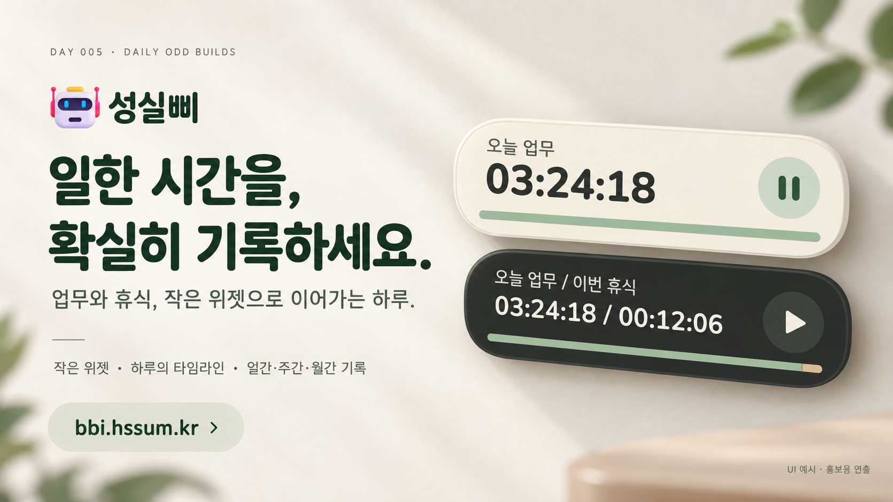

위젯 디자인을 참고한 홍보용 연출입니다. 아래 기능 화면은 실제 제품 렌더러와 예시 데이터로 제작했습니다.

**업무와 휴식을 구간별로 기록하고, 하루가 어떻게 흘렀는지 돌아보는 작은 시간 기록 앱입니다.**

바탕 화면에는 오늘 일한 시간과 시작·일시정지, 퇴근 버튼을 작게 띄웁니다. 자세히 보고 싶을 때 웹을 열어 기록을 수정하고 일간·주간·월간 통계를 확인합니다. 성실함까지 대신해 드리진 못하지만, 얼마나 했는지는 남길 수 있어요.

Day 005 of [Daily Odd Builds](https://daily-odd-builds-portal.web.app/). Windows는 기본 런타임으로 실행하는 스크립트 설치판이며, **macOS는 실기기 미검증 preview**입니다.

## 시작하기

| 환경 | 시작하는 곳 | 사용 방법 |
| --- | --- | --- |
| 웹 · beta | [bbi.hssum.kr](https://bbi.hssum.kr/) | 이메일로 가입하고 인증 메일을 확인합니다. |
| Windows · beta | [설치 ZIP 받기](https://bbi.hssum.kr/download) | ZIP 전체 압축 해제 → `Install.cmd` → 위젯의 업무 시작 |
| macOS · preview | [설치 안내와 다운로드](https://bbi.hssum.kr/download/macos?download=1) | ZIP 전체 압축 해제 → `Install.command`. 보안 경고 시 안내 페이지의 허용 절차를 확인하세요. 실제 Mac 검증은 남아 있습니다. |

데스크톱은 웹에서 만든 **같은 이메일 계정**으로 로그인합니다. Node, Flutter, .NET SDK나 Swift 개발 도구를 별도로 설치할 필요가 없습니다. 설치가 끝나면 내려받은 ZIP과 압축 해제 폴더를 지워도 됩니다. [자세한 설치·진단 안내](desktop/README.md)

**0.6.6**에서 macOS 설치 중 `Unsafe payload`로 종료되던 파일 목록 줄바꿈 문제를 수정했습니다. 이전 설치에 실패했다면 새 ZIP 전체를 받아 다시 설치해 주세요.

문서는 **0.6.6 릴리스** 기준이며, 기능 화면은 0.6.4에서 촬영했습니다. 공개 ZIP의 현재 버전은 다운로드 페이지에서 확인하세요.

다운로드 페이지는 열거나 새로고침할 때 GitHub의 공개된 `day005-vX.Y.Z` 릴리스를 한 번 확인합니다. Windows·Mac 설치 ZIP과 `SHA256SUMS.txt`가 모두 업로드된 가장 높은 버전을 제공합니다. Git 커밋·태그만 올리거나 초안으로 저장한 릴리스는 반영되지 않습니다. 조회가 실패하면 페이지에 명시된 기존 버전과 GitHub 확인 링크를 표시합니다.

## 시작하고, 쉬었다가, 다시 이어서

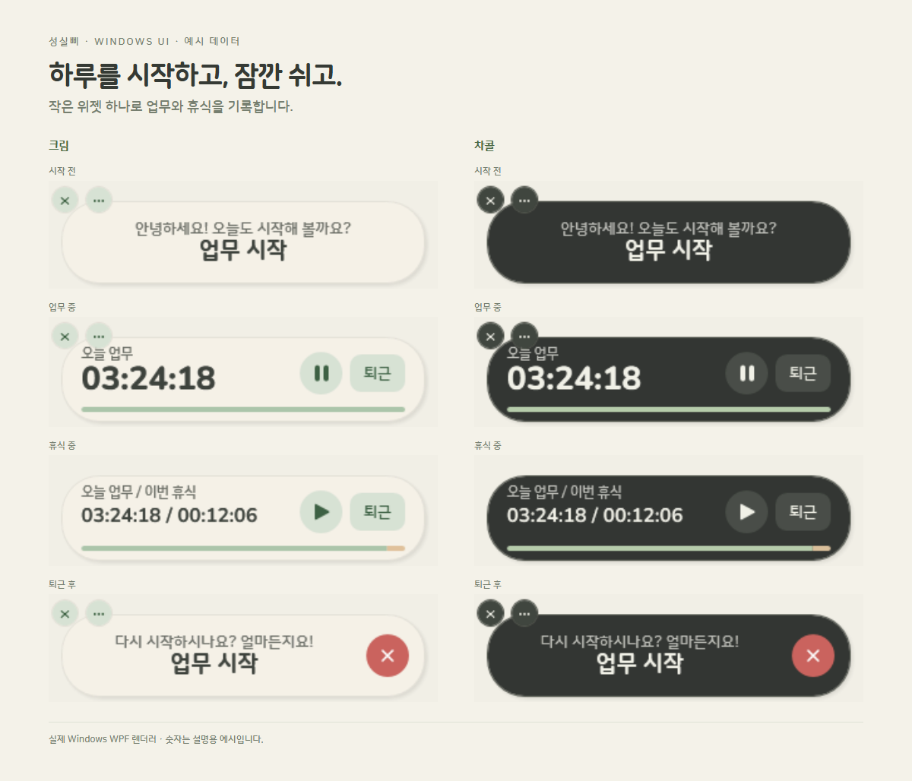

- **첫 업무 시작**: 인사와 함께 위젯 전체가 업무 시작 버튼이 됩니다. 로그인이 필요하면 로그인 창부터 엽니다.
- **업무 중**: 오늘 누적 업무시간을 표시합니다. 일시정지를 누르면 휴식이 시작됩니다.
- **휴식 중**: 누적 업무시간은 멈추고, 이번 휴식시간을 함께 보여줍니다. 재생 버튼으로 업무를 재개합니다.
- **퇴근**: 토글 오른쪽의 `퇴근` 글자 버튼으로 마칩니다. “다시 시작하시나요? 얼마든지요!” 카드에서 같은 날 업무를 다시 시작하고, 별도의 빨간 X로 위젯을 트레이에 숨깁니다.

구분은 **업무 / 휴식** 두 가지입니다. 별도의 잔업 모드는 없습니다. 처음부터 이름을 정할 필요도 없습니다. 필요할 때 `프로젝트 설계`, `점심 시간`, `잠깐 스트레칭`처럼 붙이면 됩니다.

좌측 위 X는 위젯만 숨깁니다. 진행 중 시간은 계속 기록되며 트레이/메뉴 막대에서 다시 엽니다. `···`는 설정을 바로 열고, 로그인 후에도 설정창은 유지됩니다. 설치·앱 실행 때 시작 프로그램 등록을 묻고, 등록하거나 ‘다시는 묻지 않음’을 선택하면 이후에는 묻지 않습니다.

## 작은 위젯, 자세한 하루

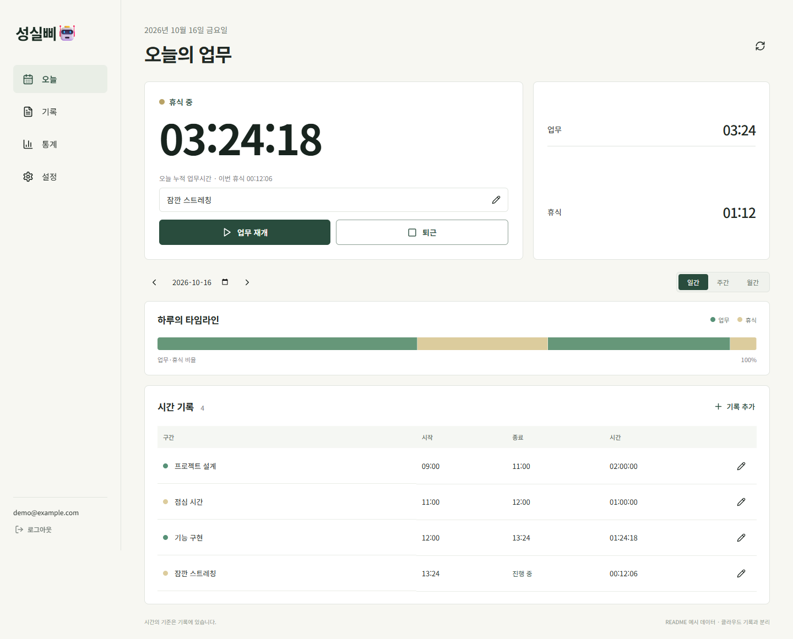

데스크톱은 시작·일시정지·현황 확인에 집중하고, 웹은 구간 목록과 편집을 넓게 보여줍니다. 같은 계정의 기록을 이어받으므로 앱을 바꿀 때 타이머를 새로 만들 필요가 없습니다.

위젯 아래의 타임라인도 업무와 휴식을 시간 순서대로 보여줍니다.

| 목표 설정 | 타임라인의 기준 |
| --- | --- |
| 목표 없음 | 기록된 업무·휴식의 비율로 항상 100%를 채웁니다. 퇴근 후 공백은 제외합니다. |
| 목표 있음 | 순 업무시간 ÷ 목표시간만큼 채우고, 채운 영역 안을 업무·휴식 비율로 나눕니다. |

예를 들어 목표 8시간에 업무 4시간·휴식 1시간이면 **목표 진행은 50%**입니다. 바는 업무 40% + 휴식 10% + 남은 목표 50%로 표시됩니다. 휴식으로 목표가 채워지지는 않습니다.

## 깜빡한 기록은 나중에 고치세요

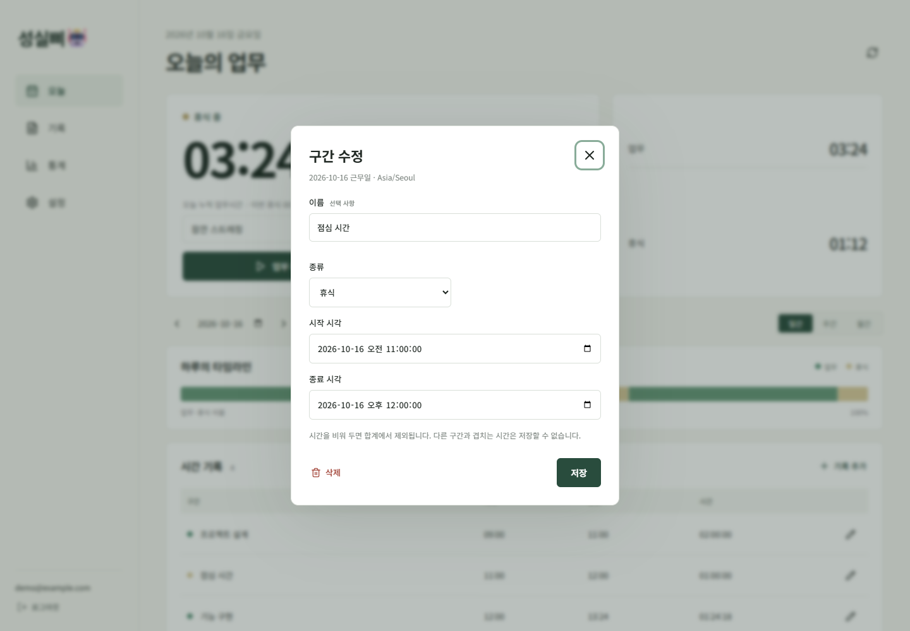

연필 버튼에서 구간의 **이름·종류·시작·종료 시각**을 바꿉니다. 놓친 기록은 직접 추가하고, 잘못 만든 기록은 삭제할 수 있습니다. 삭제한 구간은 합계에서 빠지며 복원할 수 있습니다.

다른 구간과 겹치는 시간이나 시작보다 이른 종료 시각은 저장하지 않습니다. 진행 중 구간에 종료 시각을 넣으면 그 타이머도 종료됩니다.

## 하루씩, 한 주씩, 한 달씩

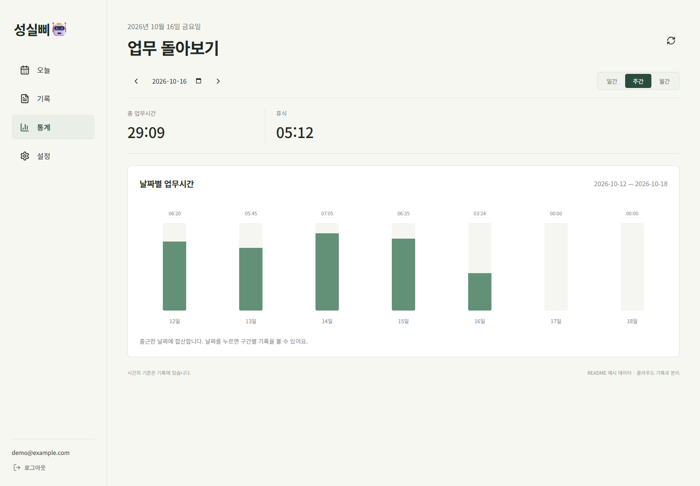

일간 기록은 구간 단위로, 주간·월간은 날짜별 합계로 봅니다. 그래프의 날짜를 누르면 해당 날짜의 기록을 확인할 수 있습니다. 주간은 월요일부터 시작합니다.

월간 화면 보기

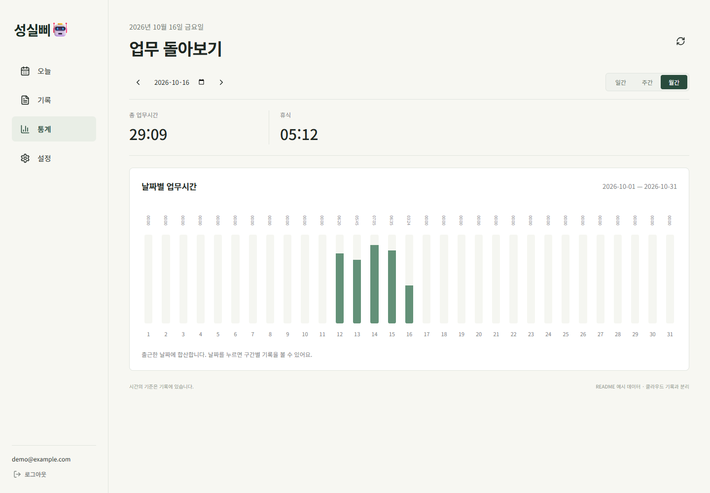

출근한 날짜를 기준으로 합산합니다. 자정을 넘어 일한 시간도 시작한 근무일에 이어집니다.

## 크림과 차콜, 내 취향대로

| 크림 · 기본 | 차콜 · 다크 |
| --- | --- |
| 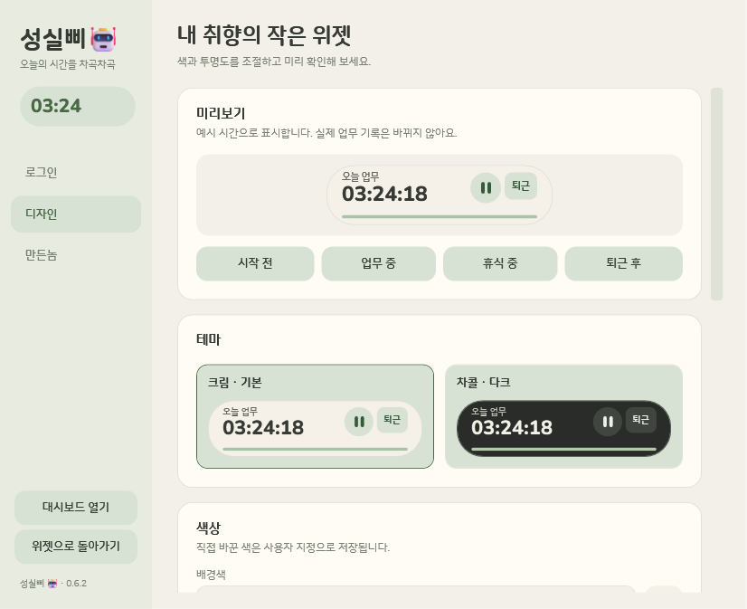 | 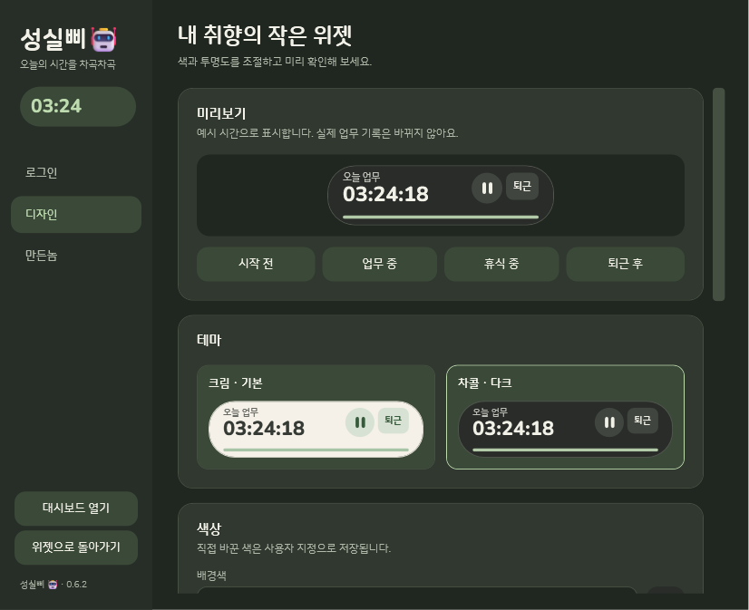 |

색과 불투명도는 기기에 저장합니다. 평소에는 더 투명하게, 마우스를 올리면 더 선명하게 설정할 수 있습니다. **평소 / 마우스를 올렸을 때**의 불투명도는 각각 조절합니다. 원하면 현재 상태·누적 휴식·현재 구간명을 추가로 표시합니다.

색·투명도 설정 자세히 보기

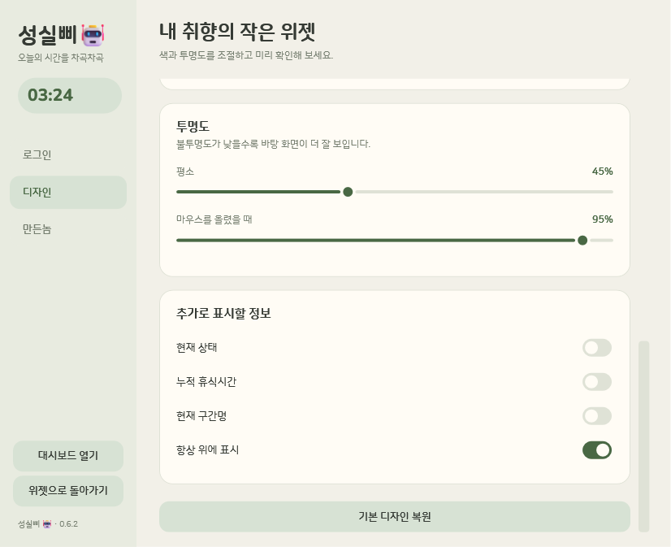

디자인과 만든놈 탭은 로그인하지 않아도 열 수 있습니다. 미리보기에서 시작 전·업무 중·휴식 중·퇴근 후 모습을 확인한 뒤 조절하세요.

## 같은 계정으로 이어서

이메일 가입과 인증은 웹에서 진행합니다. 데스크톱의 **대시보드 열기**는 로그인한 계정을 웹으로 연결합니다. 처음 연결하거나 다른 웹 계정이 열려 있으면 계정을 확인하는 단계를 거칩니다.

데스크톱은 마지막 로그인 성공 이메일을 기억하고, 기기의 암호화 저장소에서 로그인 세션을 복원합니다. 앱을 종료해도 로그인을 이어가며 로그아웃하면 인증 정보를 지웁니다. 비밀번호 원문은 저장하지 않습니다. 마지막 이메일은 다음 로그인 편의를 위해 남깁니다.

로그인 화면 보기

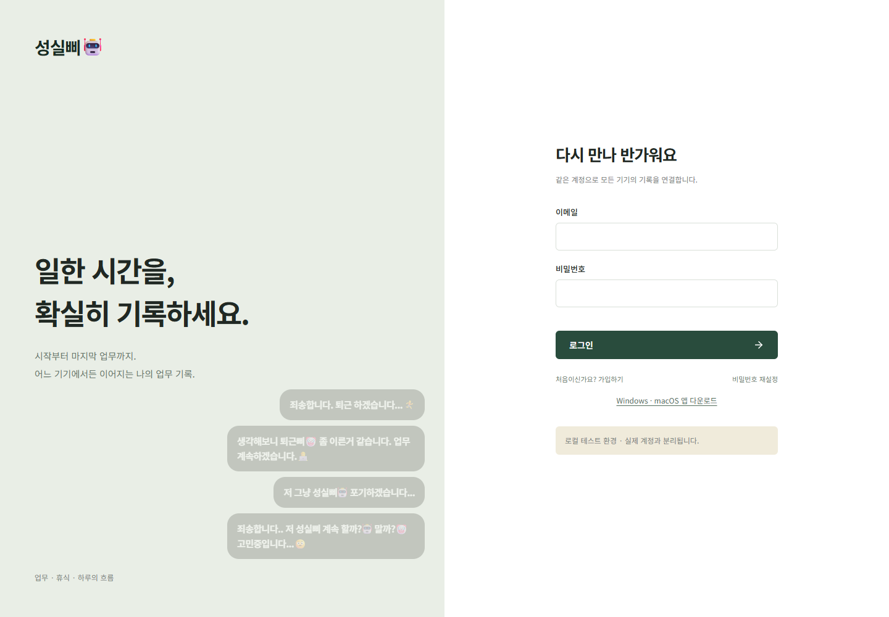

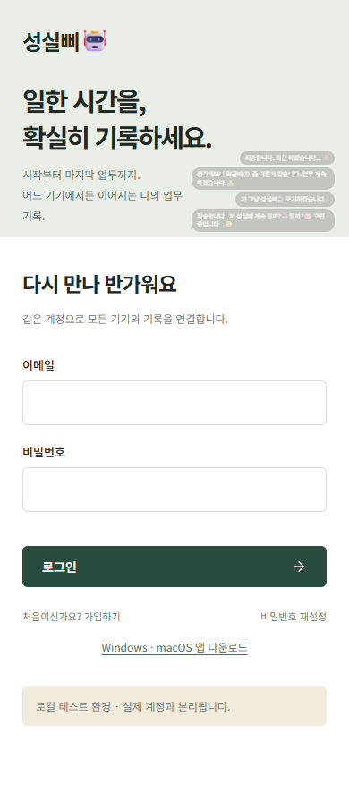

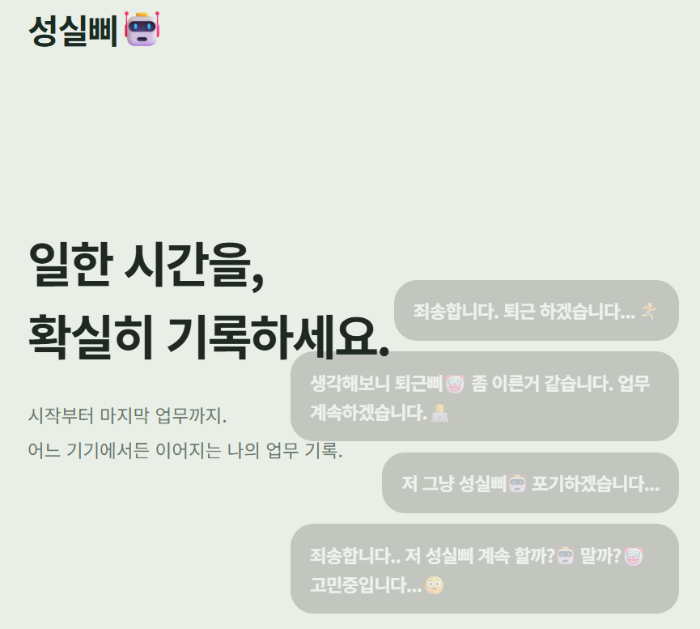

## 업데이트와 제거

설정의 **만든놈 → 지금 업데이트 확인**에서 GitHub의 성실삐 릴리스를 확인합니다. 자동 설치는 기본 꺼짐이며 설정에서 켤 수 있습니다. 다운로드 파일의 크기·체크섬을 확인하고, 새 버전 시작에 실패하면 이전 버전 복구를 시도합니다. 자동 업데이트의 실제 Mac 동작은 미검증입니다.

제거는 Windows의 `Uninstall.cmd`, Mac의 `Uninstall.command`를 실행합니다. 앱을 제거해도 계정과 서버 기록은 삭제되지 않으며, 로컬 프로필도 유지합니다. [설치 경로·제거·검증기 안내](desktop/README.md)

## 현재 범위

- 웹·Windows는 beta, macOS는 preview입니다. Android/iOS 배포와 그룹·랭킹은 포함하지 않습니다.
- Windows 설치·실행·토큰 갱신·프로세스 재시작·테마를 검사했습니다. 기능 이미지는 실제 Windows 렌더러 또는 웹 컴포넌트에 예시 데이터를 넣은 화면이며, Mac 실행이나 실제 OS 포인터 조작의 증거는 아닙니다.
- 기록 저장에는 인터넷 연결이 필요합니다. 완전한 오프라인 편집·병합은 지원하지 않습니다.
- [개인정보처리방침](https://daily-odd-builds-portal.web.app/privacy/seongsilbbi)은 웹 화면과 앱 설정창 하단에서도 확인할 수 있습니다. 계정·전체 데이터 삭제 UI는 준비 중이며, 기록 삭제는 복원 가능한 삭제입니다.

[이미지 출처와 재현 범위](docs/README-MEDIA.md) · [홍보 이미지와 프롬프트](docs/ARTWORK.md) · [릴리스와 체크섬](https://github.com/hssum9409/daily_odd_builds-public/releases/tag/day005-v0.6.6)

## 만든놈

[hssum9409](https://github.com/hssum9409) · 매일 한개씩 잡동사니 만드는 사람

요청사항은 github 에 보내면 수정할지도 안할지도. 버그는 가능한 빠르게 수정함.

그 외 잡동사니가 보고싶은 사람은 [여기로](https://daily-odd-builds-portal.web.app/).

AI 슬롭 같다구요? 으쩌라구요

코드는 [MIT](LICENSE), Nunito·나눔스퀘어라운드는 SIL OFL 1.1입니다. 로봇 이미지는 Microsoft Fluent Emoji의 MIT 고지를 따릅니다. 고지는 `desktop/assets/`에 포함했습니다.
