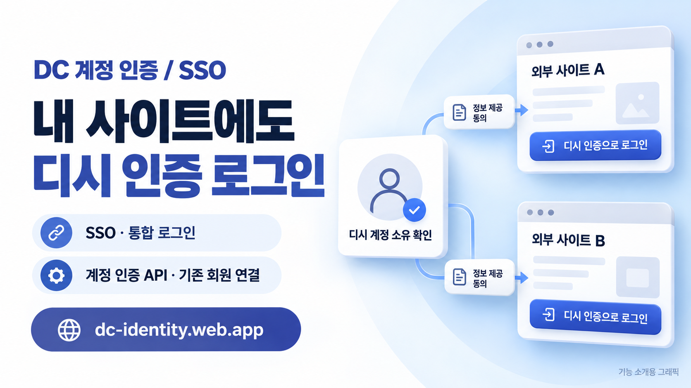
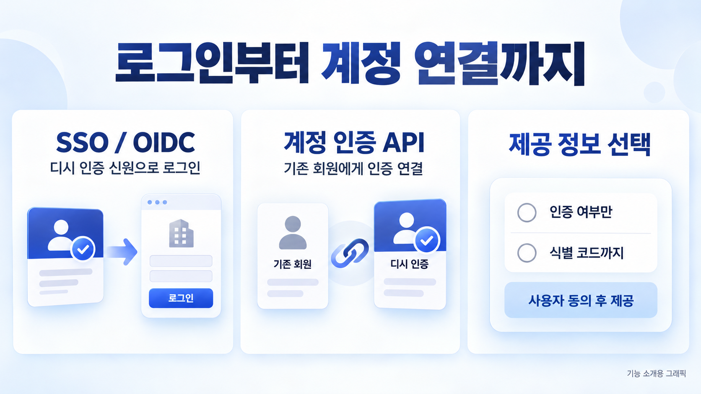
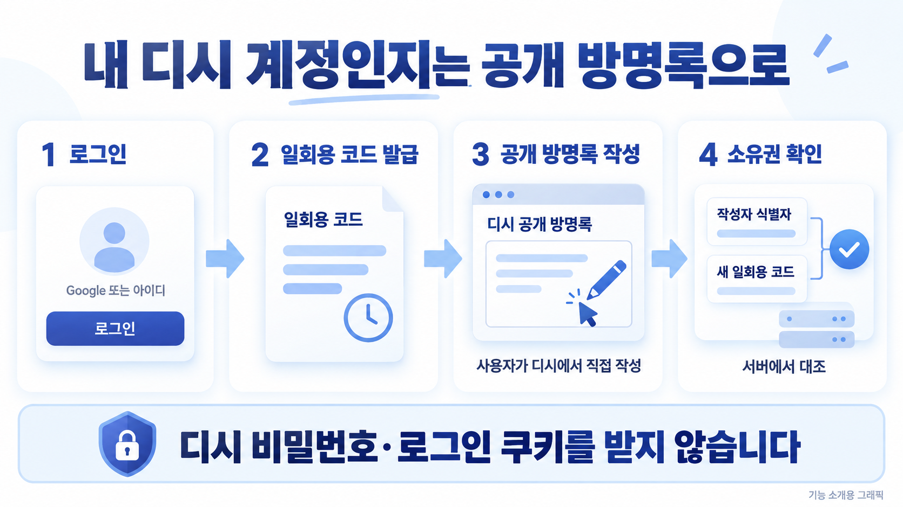
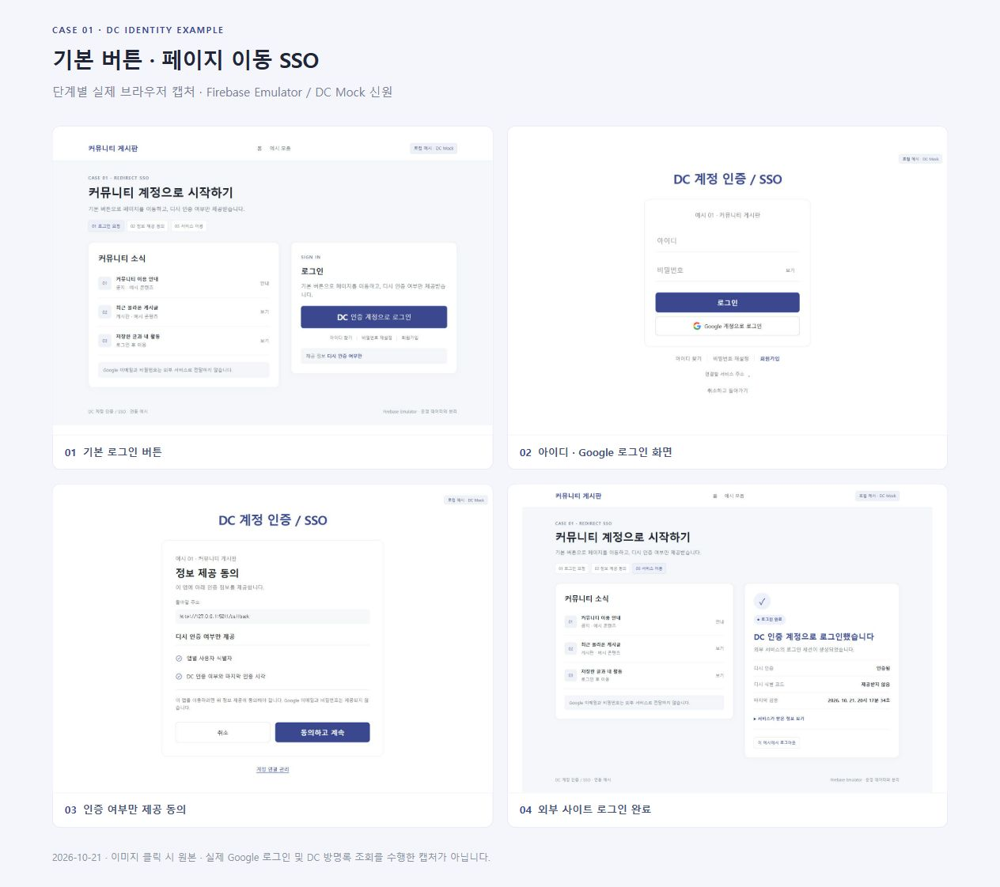
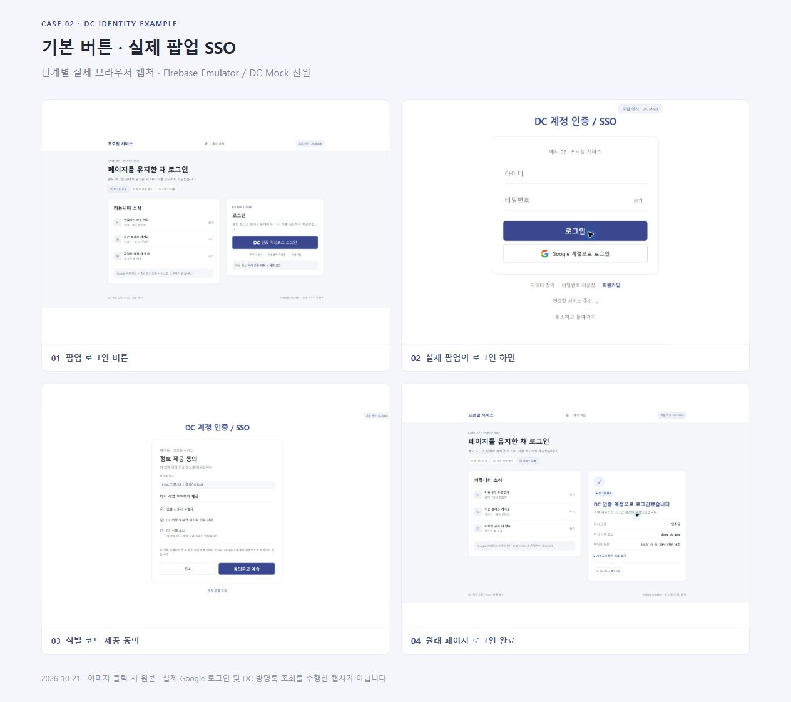
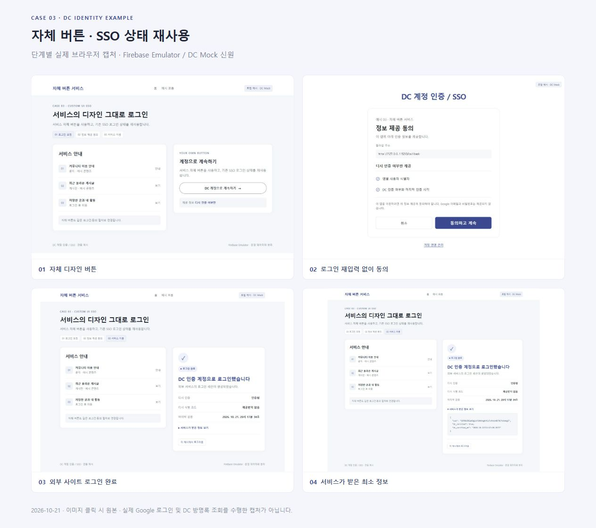
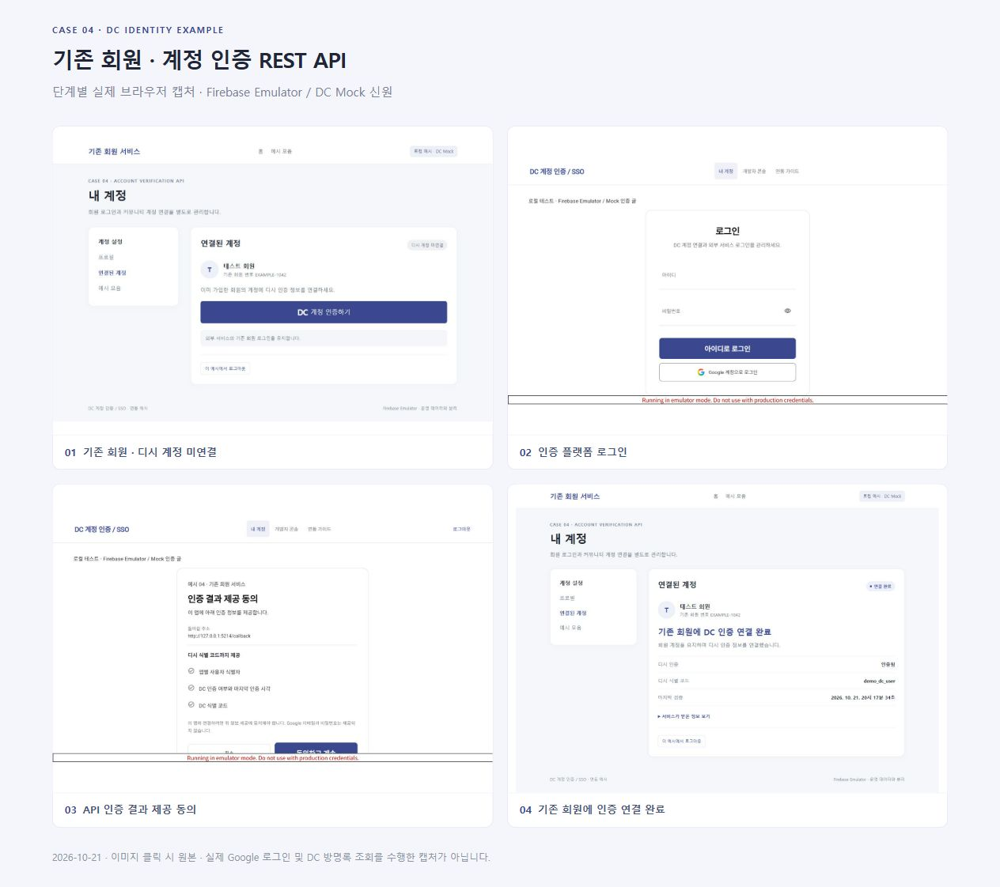

<h1 align="center">DC 계정 인증 / SSO</h1>

내 사이트에도 디시 인증 로그인. 로그인을 붙이거나, 기존 회원에게 인증만 연결하거나.

  
  
  
  

<b><a href="https://dc-identity.web.app/">서비스 열기 →</a></b> · <a href="https://dc-identity.web.app/?guide=1&section=examples">개발자 연동 가이드</a> · <a href="https://dc-identity.web.app/examples/">화면 체험</a>

기능 소개용 생성 이미지입니다. 실제 화면 예시와 검증 범위는 아래에서 구분해 안내합니다.

**디시인사이드 계정 소유권을 확인하고, 그 인증 결과를 외부 웹사이트의 회원 계정 연결과 로그인에 사용하는 비공식 웹서비스입니다.**

사용자는 Google 또는 아이디·비밀번호로 로그인한 뒤 자신의 디시 계정을 연결합니다. 개발자는 기존 회원에게 디시 인증을 붙이거나, DC 인증 계정으로 로그인하는 기능을 제공할 수 있습니다.

디시 이용자를 위한 사이트를 만들 때, 계정 인증부터 매번 새로 만들 필요가 없도록 만들었습니다. 사이트의 회원 시스템은 그대로 두고 인증만 더해도 되고, 로그인 전체를 맡겨도 됩니다. 이용자는 자신의 계정을 확인하고, 어떤 정보를 보낼지 동의합니다.

[daily_odd_builds 공개 포털 Day 007 · 2026-10-18](https://daily-odd-builds-portal.web.app/detail?id=day-2026-10-18)에 등록한 웹서비스입니다. **서비스와 공개 안내·이미지를 배포하며 앱·서버 원본 소스와 운영 설정은 공개하지 않습니다.** DCInside의 공식 OAuth 서비스나 공식 제휴 제품은 아닙니다.

## 시작하기

| 이용 목적 | 시작하는 곳 |
| --- | --- |
| 내 디시 계정 연결 | [서비스 열기](https://dc-identity.web.app/) → Google 로그인 또는 아이디 회원가입 → DC 계정 인증 |
| 외부 서비스에 로그인 추가 | [개발자 콘솔](https://dc-identity.web.app/)에서 웹사이트 등록 → 연동 가이드의 **SSO / OIDC** |
| 기존 회원에게 인증 연결 | 웹사이트를 서버 앱으로 등록 → 연동 가이드의 **계정 인증 API** |
| 가입 전에 흐름 확인 | [설치 없이 화면 체험](https://dc-identity.web.app/examples/) · [단계별 캡처 16장](https://dc-identity.web.app/examples/?view=captures) |

별도 앱 설치는 필요 없습니다. 개발자 연동에는 본인 웹사이트와 콜백 주소를 등록하고, 제공 방식에 맞는 서버·세션 처리를 연결해야 합니다. 등록한 활성 웹사이트의 연동 정보는 즉시 사용할 수 있습니다.

## 두 가지 연동 방식

| | SSO / OIDC | 계정 인증 REST API |
| --- | --- | --- |
| 목적 | 디시 인증 신원으로 외부 서비스에 로그인 | 이미 로그인한 외부 회원에게 디시 인증 연결 |
| 외부 회원 처리 | 검증한 서비스별 식별자로 회원 조회·가입·로그인 | 요청을 시작한 기존 회원에게만 인증 결과 연결 |
| 결과 수신 | Authorization Code + PKCE, ID Token 검증, UserInfo | 인증 세션 생성, 사용자 동의, 서버의 일회용 코드 교환 |
| 구현 안내 | [SSO 가이드](https://dc-identity.web.app/?guide=1&section=examples&mode=sso) | [인증 API 가이드](https://dc-identity.web.app/?guide=1&section=examples&mode=api) |

최초 DC 소유권 확인을 마친 사용자는 유효한 인증 상태를 다른 연동 서비스에서도 재사용합니다. 매 로그인마다 방명록 글을 다시 작성하는 방식은 아닙니다. 인증 유효기간이 지났거나 재확인이 필요한 경우에는 새 소유권 확인이 필요합니다.

### 내 사이트에는 버튼 하나부터

기본 **DC 인증 계정으로 로그인** 버튼을 놓고 로그인 페이지로 이동하거나, 별도 팝업으로 띄울 수 있습니다. 이미 사이트의 디자인이 있다면 자체 버튼·일반 링크를 연결해도 됩니다. 기본 버튼을 꼭 사용할 필요는 없습니다. 계정 입력과 정보 제공 동의 화면은 인증 서비스가 제공합니다.

[기본 버튼으로 체험](https://dc-identity.web.app/examples/?case=1) · [팝업으로 체험](https://dc-identity.web.app/examples/?case=2) · [자체 버튼으로 체험](https://dc-identity.web.app/examples/?case=3)

### 필요한 정보만 선택하세요

- **디시 인증 여부만 제공:** 서비스별 사용자 식별자, 인증 여부, 마지막 검증 시각을 받습니다. 디시 식별 코드는 제공하지 않습니다.
- **디시 식별 코드까지 제공:** 앱에 등록한 권한과 사용자 동의를 확인한 뒤 갤로그 식별 코드도 받습니다. 닉네임으로 계정을 식별하지 않습니다.

처음 연결하거나 새 권한을 요청하면 사용자에게 제공 범위를 보여주고 동의를 받습니다. 외부 서비스의 신규 가입마다 동의를 다시 요청하는 방법도 가이드에 포함합니다. Google 이메일·비밀번호와 디시 비밀번호·세션 쿠키는 외부 서비스에 전달하지 않습니다.

## 소유권은 어떻게 확인하나요?

1. 서비스에 로그인하고 본인의 DC 식별 코드를 입력합니다.
2. 발급된 일회용 코드를 안내된 인증용 공개 방명록에 **본인의 DC 로그인 계정으로** 새 공개 글로 작성합니다.
3. 인증 확인을 누르면 서버가 발급 코드, 작성자 식별자와 유효기간을 대조합니다.
4. 성공하면 서비스 계정에 연결됩니다. 이후 연결 상태 확인·재인증·연결 해제·탈퇴를 할 수 있습니다.

유동닉·식별자를 확인할 수 없는 글·비밀글·답글은 소유권 증명으로 인정하지 않습니다. 서비스는 DC 비밀번호나 로그인 쿠키를 입력받지 않으며 게시글·댓글을 대신 작성하지 않습니다. 인증 글의 목적지와 코드는 서비스 화면에 표시되는 값을 사용하세요.

아이디 계정의 아이디 찾기·비밀번호 재설정은 이전에 연결한 DC 계정으로 새 소유권 확인을 수행합니다. Google 전용 계정의 복구는 Google의 절차를 이용합니다. [사용 안내](docs/USAGE.md)

## 버튼부터 결과 화면까지 직접 비교

[화면 체험 모음](https://dc-identity.web.app/examples/)에서 아래 사례를 조작할 수 있습니다.

| 사례 | 보여주는 흐름 |
| --- | --- |
| [기본 버튼 SSO](https://dc-identity.web.app/examples/?case=1) | 페이지 이동 → 로그인 → 인증 여부 제공 동의 → 외부 사이트 로그인 |
| [팝업 SSO](https://dc-identity.web.app/examples/?case=2) | 별도 창에서 진행 → 식별 코드 제공 동의 → 원래 페이지에 결과 표시 |
| [자체 버튼·SSO 재사용](https://dc-identity.web.app/examples/?case=3) | 서비스 자체 디자인의 버튼 → 기존 SSO 상태 재사용 → 해당 앱에 동의 |
| [기존 회원의 API 연결](https://dc-identity.web.app/examples/?case=4) | 기존 회원 유지 → 인증 요청 → 정보 제공 동의 → 해당 회원에게 연결 |

**웹의 화면 체험은 합성 신원을 사용하는 UI 시뮬레이션입니다.** 실제 로그인·DC 조회·토큰 발급을 수행하지 않습니다. 실제 연동은 등록한 Client로 가이드의 실행 예제를 내려받아 테스트하세요.

실제 로컬 엔진 실행 화면 4가지 보기

아래 캡처는 실제 OIDC·REST 엔진을 Firebase Emulator와 DC Mock 신원으로 실행한 2026-10-21 기록입니다. 실제 Google·DC 인증이나 실기기 모바일 검증을 의미하지 않습니다. 이미지 안의 계정·주소는 테스트 예시입니다.

[캡처 원본과 ZIP 다운로드](https://dc-identity.web.app/examples/?view=captures)

## 외부 개발자 안내

[개발자 연동 가이드](https://dc-identity.web.app/?guide=1)에서 내 앱을 선택하면 Client ID·Redirect URI·정보 제공 범위를 반영한 Node.js 실행 예제를 받을 수 있습니다. 기본 버튼 CSS·팝업 모듈, 자체 버튼·일반 링크와 Flutter Web 연결 예제도 제공합니다. 기본 버튼 사용은 선택 사항입니다.

Client Secret은 본인 서버에만 저장하며 다운로드 예제에 포함되지 않습니다. Public 클라이언트에는 Secret을 보관하도록 요구하지 않습니다. 외부 서비스는 state·PKCE·콜백 검증과 자체 회원 권한·세션·탈퇴 처리를 올바르게 연결해야 합니다. [연동 체크포인트](docs/INTEGRATION.md)

## 현재 범위

- 현재 MVP는 **디시인사이드만 지원**합니다. 다른 커뮤니티 인증은 지원 완료 기능으로 안내하지 않습니다.
- Google 로그인과 아이디·비밀번호 로그인을 병행합니다. 별도로 가입한 두 계정은 자동 병합하지 않습니다.
- DC 접근 실패나 증거 구조 변경 시 인증을 성공 처리하지 않습니다. 외부 사이트 상태에 따라 일시적인 확인 실패가 발생할 수 있습니다.
- 연결 해제 후에도 이미 발급된 JWT와 외부 서비스의 로그인 캐시는 각 만료 정책의 영향을 받습니다. 온라인 상태 조회와 짧은 세션 정책을 함께 사용하세요.
- 공개 서비스와 브라우저 화면 체험은 배포되어 있습니다. 공식 OIDC 적합성 인증을 받았다고 주장하지 않습니다.

문의·오류 제보는 [공개 저장소 Issues](https://github.com/hssum9409/daily_odd_builds-public/issues)를 이용하세요. 비밀번호·Client Secret·토큰·인증 코드는 공개 제보에 적지 마세요.

## 만든 기록

<!-- usage:start -->
**기록된 누적 토큰 314,135,620개** · 2026-10-22 07:30 KST 기준 · 주 작업과 보조 작업 5개 세션의 확인 가능한 로그를 집계했습니다. 캐시 입력을 포함하며, 재개된 세션은 중복 합산하지 않았습니다. [세부 수치와 집계 방법](docs/TOKEN-USAGE.md)
<!-- usage:end -->

Flutter Web·Firebase Authentication·Firestore·Cloud Functions를 사용하고, 외부 SSO는 검증된 OIDC 라이브러리 `oidc-provider`를 기반으로 제공합니다. Google 로그인과 아이디·비밀번호 로그인은 함께 사용할 수 있습니다.

홍보·기능 이미지는 **GPT-6 Astra High 작업자가 non-fast 설정으로 내장 이미지 생성 도구를 직접 호출**해 만들었습니다. 파란색과 제품 카드 구성을 맞췄으며, 실제 동작 캡처와 설명용 그래픽을 구분합니다.

만든 사람 [hssum9409](https://github.com/hssum9409) · 다른 결과물은 [Daily Odd Builds](https://daily-odd-builds-portal.web.app/)에서 볼 수 있습니다.

[이미지 제작 방식·검증 범위](docs/README-MEDIA.md) · [토큰 집계 기준](docs/TOKEN-USAGE.md) · [공개 MVP 릴리즈](https://github.com/hssum9409/daily_odd_builds-public/releases/tag/day006-web-v0.1.0)
