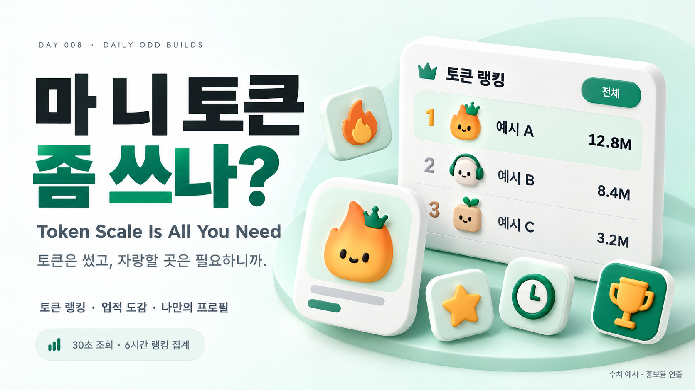
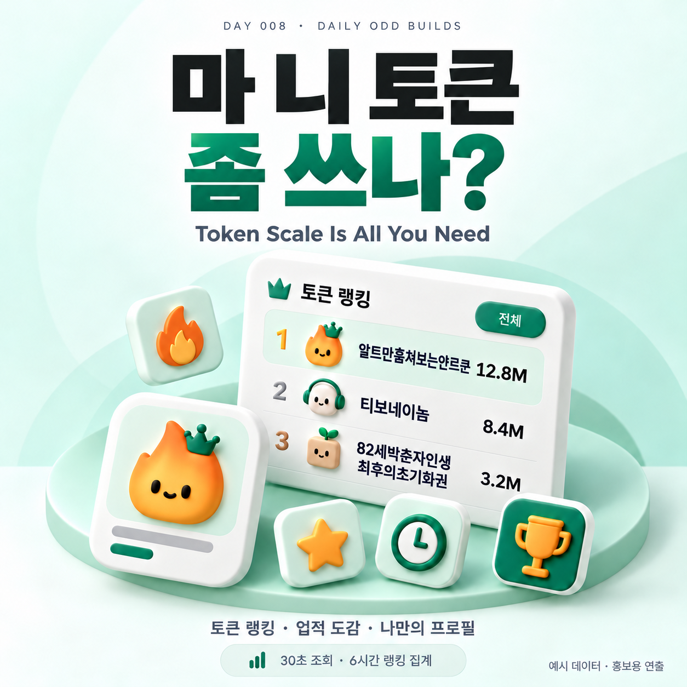
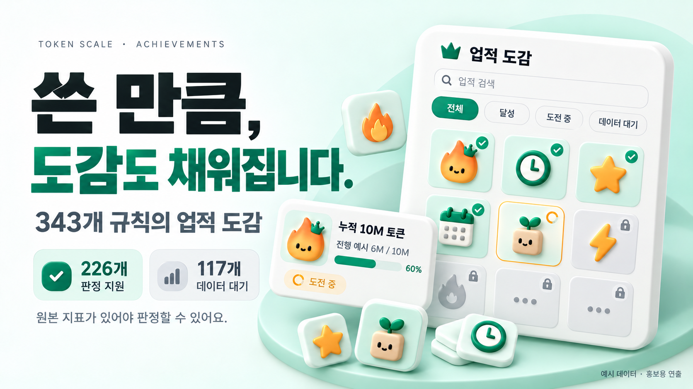
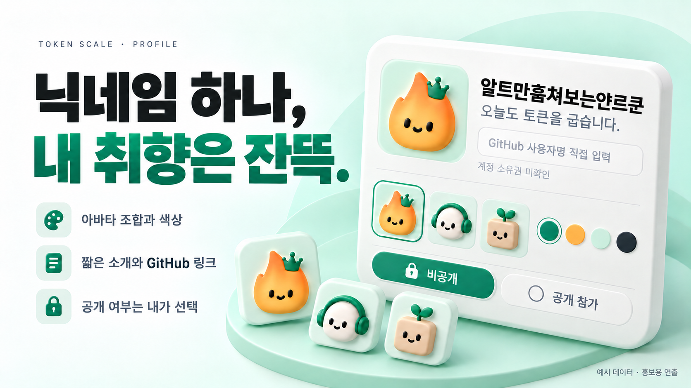
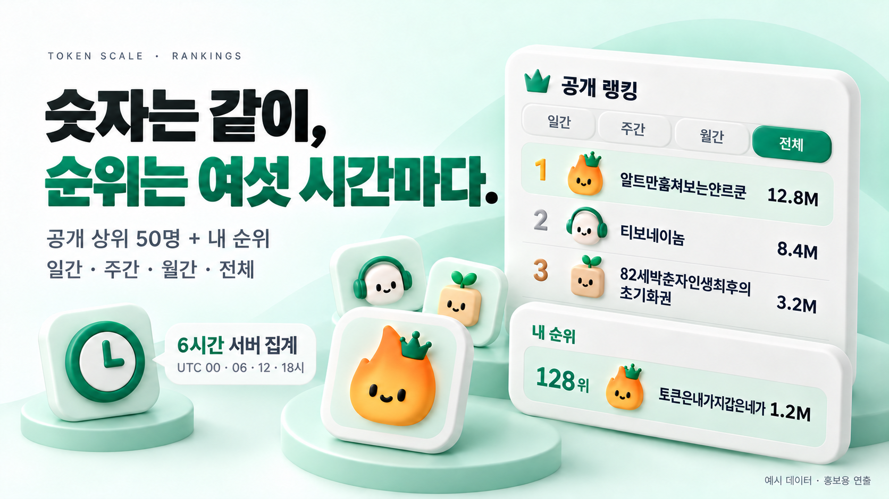

<p align="right"><sub>AI로 작성되었습니다. 슬롭 같으면 님 말이 맞음.</sub></p>

<h1 align="center">마 니 토큰 좀 쓰나?</h1>

<p align="center">
  <b>토큰은 썼고, 자랑할 곳은 필요하니까.</b><br>
  <sub>Token Scale Is All You Need · Day 008</sub>
</p>

<p align="center">
  
  
  
  <a href="LICENSE"></a>
</p>

<p align="center"><b><a href="https://token-arena-hssum9409.web.app/">랭킹 구경하기 →</a></b> · <a href="https://token-arena-hssum9409.web.app/download/">수집기 다운로드</a> · <a href="https://token-arena-hssum9409.web.app/about/?lang=ko">소개·개인정보 안내</a></p>



<p align="center"><sub>화면과 수치는 예시를 사용한 홍보용 연출입니다. 실제 사용자 기록이나 순위 인증 화면이 아닙니다.</sub></p>

**Codex 계정의 토큰 통계를 모아 보고, 닉네임으로 순위를 비교하고, 업적을 구경하는 작은 커뮤니티입니다.**

백그라운드 수집기가 로컬 Codex에서 통계를 읽으면 웹에서 내 기록을 볼 수 있습니다. 공개 랭킹에 참여할지는 별도로 고릅니다. 아바타를 꾸미고 배지를 내걸면 제법 그럴듯합니다. 생산성이 올라가는지는 각자 알아서 증명해주세요.

Day 008 of [Daily Odd Builds](https://daily-odd-builds-portal.web.app/). **OpenAI가 제작·승인한 공식 서비스가 아니며, 토큰 소비량은 생산성이나 실력의 지표가 아닙니다.**

<details>
<summary>정사각 소개 카드 보기</summary>



</details>

## 시작하기

1. 컴퓨터의 **Codex에 ChatGPT 계정으로 로그인**합니다.
2. [다운로드 페이지](https://token-arena-hssum9409.web.app/download/)에서 운영체제에 맞는 수집기를 받아 **전부 압축 해제**합니다.
3. Windows는 **`Install.vbs`**, Mac은 **`Install Token Scale.app`**을 실행합니다. Mac 설치 앱과 같은 폴더의 파일도 함께 유지하세요.
4. 처음 열리는 웹에서 **Google 로그인 → 이 수집기 연결**을 누릅니다. 브라우저가 로컬 네트워크 접근을 물으면 연결을 허용합니다.
5. 닉네임과 프로필을 정하고 내 통계를 확인합니다. 원하면 **공개 랭킹 참가**를 켭니다. 기본값은 비공개이며 기존 설정은 유지합니다.

| 환경 | 설치 후 동작 | 확인 범위 |
| --- | --- | --- |
| Windows x64 | 메인 창 없이 알림 영역의 트레이 아이콘으로 실행 | 실제 설치·Codex 조회·웹 연결·서버 저장 확인 |
| macOS 14 이상 · Apple Silicon / Intel | 메뉴 막대의 `TS`로 실행 | **실기기 미검증 preview** |

수집기용 Flutter·Dart·Xcode 개발 도구나 개인 API 키를 따로 준비할 필요는 없습니다. **Google 로그인은 이 서비스의 계정 연결이고, Codex 로그인은 통계 원본의 인증입니다. 두 로그인은 별개입니다.**

## 순위는 같이, 기록은 내 방식대로

| 기능 | 볼 수 있는 것 |
| --- | --- |
| 커뮤니티 랭킹 | 기간·플랜별 공개 상위 50명과 랭킹 참가자 본인의 순위 |
| 내 통계 | 누적·날짜별 토큰 통계와 제공되는 사용 지표 |
| 업적 도감 | 검색, 달성·도전 중·데이터 대기 필터, 조건과 진행도 |
| 내 프로필 | 닉네임, 조합형 아바타와 색상, 짧은 소개, GitHub 링크 |
| 백그라운드 수집 | 트레이/메뉴 막대에서 동기화, 일시정지, 자동 시작, 업데이트 |
| 네 가지 언어 | 한국어 · English · 日本語 · 简体中文 |

### 쓴 만큼, 도감도 채워집니다



**업적 도감에는 343개 규칙이 있습니다.** 현재 판정기가 지원하는 규칙은 226개, 필요한 지표를 아직 받지 못하는 규칙은 117개입니다. 지원되는 규칙도 계정에서 원본 값을 받지 못하면 데이터 대기로 남습니다.

1M부터 1T까지의 토큰 단계, 최장 단일 턴, 관측된 연속 사용과 매일 일정량 사용하기 등을 살펴볼 수 있습니다. 내 공개 프로필에는 대표 배지를 최대 다섯 개 보여줍니다. 과거 통계가 정정되면 업적 상태도 바뀔 수 있습니다.

### 닉네임 하나, 내 취향은 잔뜩



아바타는 모양·눈·입·장식을 조합하고 세 가지 색을 고릅니다. 색을 빼도 192가지 조합입니다. 소개는 최대 100 UTF-16 단위이며, 일부 이모지는 두 단위로 셉니다. **GitHub는 직접 입력하는 프로필 링크로, OAuth 연결이나 계정 소유권 인증이 아닙니다.**

## 내 숫자는 자주, 랭킹은 여섯 시간마다



0.4.0 수집기는 **30초 간격으로 로컬 통계를 조회**합니다. 최초 웹 연결 직후에도 한 번 읽습니다. 마지막 저장 성공값과 비교해 달라진 값과 날짜만 보내며, 그대로라면 전송하지 않습니다.

본인 통계 화면은 서버가 수신한 변경분을 반영하고, 공개 랭킹은 **6시간마다** 집계합니다. 따라서 내 기록이 바뀌어도 순위는 다음 집계까지 같을 수 있습니다. Codex 원본의 집계 지연, 절전이나 네트워크 장애도 영향을 줍니다.

<details>
<summary>수집 주기·정정·업적 판정의 자세한 기준</summary>

- 토큰은 30초, 추가 메타데이터는 시작 시 및 한 시간마다 조회합니다. 플랜처럼 토큰 응답에 함께 오는 값은 매 조회에서 비교합니다.
- 변경된 **최신 절대값**으로 교체합니다. 수치가 줄어든 정정과 실제 0도 반영하며, 누락된 값을 0으로 만들지 않습니다.
- 서버는 변경분을 RTDB에 보관하고, 매시간 UTC 55분 및 랭킹 배치 전에 대기분을 Firestore에 반영합니다. 매 조회마다 통계 이력을 한 건씩 쌓지 않습니다.
- 랭킹 배치는 UTC 00/06/12/18시입니다. 한국 시간으로 03/09/15/21시이며 반영에는 처리 시간이 걸립니다.
- 원본 날짜의 시간대가 확인되지 않아 기간 통계와 순위는 잠정입니다. 불완전한 기간의 값으로 완전한 기간 순위를 만들지 않습니다.
- 스킬·연결 앱의 가용 개수는 실제 사용 횟수가 아닙니다. 초기화권 보유량 감소로 사용 이력을 추정하지 않습니다.
- 수집기가 꺼져 있던 동안의 세부 관측이나 과거 플랜 이력을 만들어내지 않습니다.

[0.4.0 동기화 계약](docs/stream-sync.md)

</details>

## 공개 여부는 따로 고르세요

수집에 동의해도 공개 랭킹 참가가 자동으로 켜지지 않습니다. 공개하면 닉네임·아바타·소개·GitHub 링크와 공개 통계·대표 배지가 표시됩니다. 비공개로 돌리면 서버의 공개 조회 대상에서 제거합니다. 서비스 계정과 통계 삭제는 웹에서 할 수 있으며 Codex 계정에는 영향을 주지 않습니다.

**OpenAI 인증 토큰, 대화, 코드, 프로젝트 경로는 이 서비스로 보내지 않습니다.** 허용된 토큰 수치·날짜·플랜·최소 집계 지표와 사용자가 정한 서비스 프로필을 처리합니다. 로컬 Firebase 세션은 Windows DPAPI 또는 macOS Keychain을 사용하도록 구현되어 있습니다. Mac의 실제 Keychain 동작은 실기 검증 전입니다.

랭킹은 **`community_reported`**, 즉 이용자 기기에서 제출한 기록입니다. Google 로그인은 제출자를 식별할 뿐 통계의 진위를 보증하지 않습니다. 원본 API가 발급한 서명이 없으므로 조작 불가능한 기록이나 공식 인증 순위라고 주장하지 않습니다. [개인정보·인증 구조·이용 안내](https://token-arena-hssum9409.web.app/about/?lang=ko)

## 업데이트와 제거

자동 업데이트는 기본 켜짐입니다. 6시간마다 GitHub 정식 릴리스를 확인하고 파일 검증 후 수집기를 교체합니다. 트레이/메뉴 막대에서 수동으로 업데이트를 확인할 수도 있습니다. 자동 업데이트를 끄려면 설치된 CLI의 `settings --auto-update off`를 사용합니다. 설정과 로그인은 보존하며 시작 실패 시 이전 버전으로 복구하도록 구현했습니다. **Mac의 실제 자동 업데이트는 실기기 미검증입니다.**

0.3.1 사용자의 업데이트 호환성을 위해 릴리스 태그는 `day004-cli-v0.4.0` 형식을 유지합니다. 공개 프로젝트 번호와 표시 이름은 **Day 008**입니다. 실행 관리자나 런타임 변경을 포함한 갱신은 새 설치본을 실행하세요. 현재 배포 버전과 파일은 [다운로드 페이지](https://token-arena-hssum9409.web.app/download/)에서 확인합니다.

Windows는 **설정 → 앱 → Token Scale**에서 제거합니다. Mac은 설치 폴더의 관리 스크립트로 제거합니다. 일반 제거는 로컬 로그인과 캐시를 보존합니다. 로컬 로그인을 지우려면 CLI의 `logout`, 서버 계정과 통계를 지우려면 웹의 계정 삭제를 사용하세요.

<details>
<summary>데이터가 안 나오거나 연결이 풀렸어요</summary>

1. Codex에 ChatGPT 계정으로 로그인되어 있는지 확인합니다. API 키 인증만으로는 이 계정 통계를 제공하지 않습니다.
2. 트레이/메뉴 막대에서 상태를 확인하고 일시정지 상태면 재개합니다. 아이콘이 숨겨져 있으면 Windows 알림 영역의 숨겨진 아이콘도 확인하세요.
3. 연결이 필요하면 웹 연결을 다시 엽니다. 로그인한 Google 서비스 계정이 맞는지 확인하고 브라우저의 로컬 네트워크 권한을 확인합니다. 연결 안내는 시간이 지나면 만료될 수 있습니다.
4. 지금 동기화 후 웹의 조회·전송 시각을 확인합니다. 수치가 그대로면 전송 시각도 유지될 수 있고, 순위는 다음 6시간 배치를 기다려야 합니다.
5. 원본 Codex 계정을 바꿨다면 자동으로 이전 기록을 덮어쓰지 않습니다. 원본 변경 절차를 확인하고 명시적으로 다시 연결해야 합니다.

수집기 상태 확인은 설치된 CLI의 `status`를 사용합니다. 로컬 `collector.log`는 고정 오류 코드 위주로 기록합니다. Mac 설치 오류 로그는 `~/Library/Logs/Token Scale/install.log`입니다. 설치 로그에는 로컬 경로가 포함될 수 있으므로 공개 제보 전에 확인하세요.

Windows 설치 폴더는 `%LOCALAPPDATA%/Programs/Token Scale`, 데이터 폴더는 `%LOCALAPPDATA%/TokenScaleCLI`입니다. Mac 설치 폴더는 `~/Library/Application Support/Token Scale`, 데이터 폴더는 `~/.config/token-scale`입니다.

</details>

<details>
<summary>Mac 제거 명령과 검증 범위</summary>

```sh
"$HOME/Library/Application Support/Token Scale/manage.sh" uninstall \
  "$HOME/Library/Application Support/Token Scale"
```

0.4.0은 실제 Windows 설치 엔진, 로그인된 Codex의 원본 통계 조회, Google 서비스 계정의 웹 연결, 운영 RTDB 저장과 시간별 Firestore 반영을 확인했습니다. 변경 없는 조회의 전송 생략도 확인했습니다. 기존 Google 사용자를 재연결한 시험이며 새 서비스 가입을 이번에 다시 검증한 것은 아닙니다.

응답 유실·과거 수치 정정·재전송 복구는 실제 Windows 데몬에 합성 원본과 Firebase Emulator를 연결해 확인했습니다. 실제 OpenAI의 과거 정정 사건을 재현한 증거는 아닙니다. 새 코드의 6시간 운영 랭킹 배치는 해당 검증에서 다시 기다려 시험하지 않았습니다.

Mac의 네이티브 빌드와 패키지 검사는 실제 설치·Finder·Keychain·메뉴 막대·Gatekeeper·재로그인 동작을 대신하지 않습니다. macOS는 실기기 미검증 preview입니다. 제품의 정식 Authenticode / Developer ID 서명·Apple 공증은 제공하지 않으며, 체크섬이 OS 서명을 대신하지 않습니다.

[0.4.0 검증 기록](docs/verification-0.4.0.md) · [이미지 출처와 표현 범위](docs/README-MEDIA.md)

</details>

## 언어마다 한마디씩

| 언어 | 사이트 이름 |
| --- | --- |
| 한국어 | 마 니 토큰 좀 쓰나? |
| English | You Call That Token Burn? |
| 日本語 | トークン、それだけ？ｗ |
| 简体中文 | 不是哥们，就烧这么点 Token？ |

## 만든놈

### [hssum9409](https://github.com/hssum9409)

매일 한개씩 잡동사니 만드는 사람.<br>
요청사항은 [GitHub](https://github.com/hssum9409/daily_odd_builds-public/issues)에 보내면 수정할지도 안할지도. 버그는 가능한 빠르게 수정함.

그 외 잡동사니가 보고싶은 사람은 [여기](https://daily-odd-builds-portal.web.app/)로.<br>
AI 슬롭 같다구요? 으쩌라구요

제보에는 OS·수집기 버전·재현 순서를 남겨주세요. 계정 이메일·UID·로그인 토큰·개인 통계·인증 파일은 공개 이슈에 올리지 마세요.

## 소스와 라이선스

공개 디렉터리는 `day-008-token-scale`입니다. 공개 클라이언트 코드는 [MIT](LICENSE)이며 승인된 버전의 소스 스냅샷을 배포합니다. 운영 백엔드와 어뷰즈 방어 코드는 비공개입니다. 비공개 개발 이력과 사용자 데이터는 공개 소스에 포함하지 않습니다. 홍보 이미지의 출처와 사용 범위는 [ARTWORK.md](docs/ARTWORK.md)를 따릅니다.
