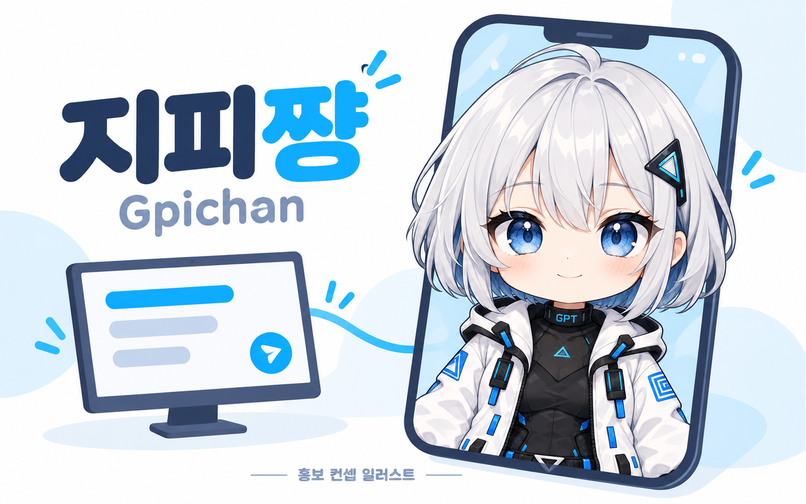
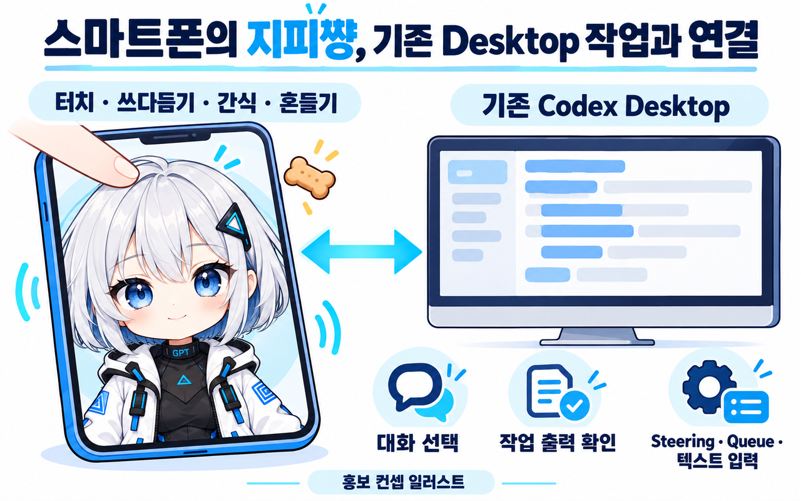

<h1 align="center">지피쨩</h1>

<b>코딩은 컴퓨터에서. 응원은 책상 옆 작은 파트너에게.</b> Gpichan · Daily Odd Builds Day 010 · 0.5.1 public beta

Android 휴대폰에 지피쨩을 두고 머리를 쓰다듬거나 코를 콕 찔러 보세요. 캐릭터는 바로 반응하고, 연결을 켜 두면 상호작용을 모아 **컴퓨터에서 이미 진행 중인 Codex Desktop 대화**에 전달합니다. 작업을 새 AI 채팅으로 옮기지 않습니다.

[Android APK · 다운로드](https://github.com/hssum9409/daily_odd_builds-public/releases/download/day010-gpichan-v0.5.1/Gpichan-android-0.5.1.apk) · [컴퓨터 호스트 · 다운로드](https://github.com/hssum9409/daily_odd_builds-public/releases/tag/day010-gpichan-v0.5.1) · [설치·연결 가이드](QUICKSTART.md) · [개인정보처리방침](PRIVACY.md)

공개 포털의 **Day 010 기록일은 2026-10-21**이며, 이 배포물은 **2026-10-22**에 공개했습니다. OpenAI가 제작하거나 승인한 공식 앱은 아닙니다. Windows/Android 베타이며 **macOS는 실기기 미검증 preview**입니다. Google Play에 출시된 앱이 아니라 직접 설치하는 APK입니다.

## 얼굴만 움직이는 그림보다 조금 더

머리·턱·볼 쓰다듬기, 이마·코·볼 콕 찌르기와 길게 꾹 누르기, 볼 늘이기, 얼굴 감싸기, 간식, 기기 흔들기에 반응합니다. 머리카락·볼·눈·입과 반투명 손이 나뉜 2D 리그를 사용하며, 볼을 당길 때 눈까지 함께 늘어나지 않도록 분리했습니다. Cubism 모델 파일이 아닌 Flutter용 파트·메시 리그입니다.

## 대화는 원래 있던 곳에서

휴대폰에서 기존 대화를 선택하고 공개 대화·추론 요약·작업 기록을 확인할 수 있습니다. 머리 위 말풍선과 하단 입력창에서 Codex 출력과 로컬 반응을 구분합니다. 작업 중 **Steering**, 후속 입력 **Queue**, 명시적인 **새 Turn**을 나눠 보냅니다. 모델과 Fast 설정은 기존 Desktop에서 읽거나 변경 요청합니다.

전달 접수는 모델의 실제 인식과 다릅니다. 전달 확인 탭과 후속 대화로 확인하세요. 읽을 수 없는 상태·요약은 미확인으로 표시하며, 내부 원본 추론이나 모든 승인 요청을 보여주는 앱은 아닙니다.

## 시작하기

1. 컴퓨터에서 로그인한 기존 Codex Desktop을 실행합니다.
2. Windows용 호스트 또는 Mac preview를 설치하고 `gpichan start`를 실행합니다. 컴퓨터 호스트에는 별도의 앱 창이나 트레이 UI가 없습니다.
3. 컴퓨터와 Android를 같은 Wi-Fi에 연결하고 Android APK를 설치합니다.
4. 컴퓨터의 `gpichan pair` QR을 Android에서 스캔합니다. `gpichan pending`으로 요청을 확인하고 `gpichan approve <요청-ID>`로 직접 승인합니다.
5. 휴대폰에서 사용할 기존 대화를 선택합니다. 처음에는 중요한 작업 대신 테스트 대화로 전달을 확인하세요.

[실제 명령·중단·삭제·자동 시작 안내](QUICKSTART.md)

## 지원과 확인 범위

| 환경 | 제공 형태 | 확인 범위 |
| --- | --- | --- |
| Android | 별도 배포 키로 서명한 APK | 자동 UI·리그·연결 검사, release 빌드. 이번 버전의 실제 휴대폰 연결은 미검증 |
| Windows x64 | 사용자 계정 Setup / 런타임 포함 포터블 | 실제 설치·업데이트·제거 및 native/로컬 TLS·WSS 검사 통과. 미서명 Setup은 다른 PC의 OS 정책에 차단될 수 있음 |
| macOS | 터미널 설치 ZIP · preview | Dart 3.13.5 kernel. Python 3·Node.js·OpenSSL·동일 Dart SDK 필요. 실제 Mac 설치·Desktop 연결 미검증 |

Windows SmartScreen의 ‘추가 정보 → 실행’은 정책이 허용할 때만 가능합니다. **Smart App Control에는 앱별 허용 버튼이 없습니다.** 포터블로 바꾸는 것만으로 이 제한이 사라지지 않습니다. Mac Gatekeeper의 개별 허용 절차도 OS 정책에 따릅니다. 보호 기능을 자동으로 끄지 않습니다.

공개 대화와 작업 기록 읽기, Desktop IPC 및 Queue 지원은 Codex 버전에 따라 달라질 수 있습니다. 최신 Codex 버전과의 모든 조합이나 1~2초 내 모델 반응을 보장하지 않습니다. 검수 결과와 남은 실기기 항목은 [검증 기록](VERIFICATION.md)에 구분했습니다.

## 내 컴퓨터와 내 휴대폰 사이

자체 클라우드 백엔드·Firebase·광고 SDK를 사용하지 않습니다. PC가 로컬 암호화 연결을 제공하며 QR, 인증서 지문, 장치 승인을 확인합니다. 승인한 휴대폰에는 실제 개발 대화와 프로젝트 정보가 표시되므로 본인 기기만 승인하세요. Android QR 인식용 Google ML Kit의 SDK 진단 지표와 기존 Codex의 모델 처리는 각각 해당 외부 서비스 정책에 따릅니다. [처리 항목과 삭제 안내](PRIVACY.md)

## 공개 범위와 이미지

앱·호스트의 전체 개발 소스와 비공개 커밋 이력은 공개하지 않습니다. 실행에 필요한 helper 스크립트, 제3자 라이선스와 안내는 배포물에 포함합니다. [라이선스 안내](LICENSE-NOTICE.md)

위 hero와 기능 이미지는 **AI로 제작한 홍보용 컨셉 일러스트**이며 실제 화면 캡처나 연결 성공 증거가 아닙니다. [이미지 제작 안내](ARTWORK.md)

문의: [GitHub Issues](https://github.com/hssum9409/daily_odd_builds-public/issues). 비밀번호·연결 QR·토큰·개인 대화 원문을 첨부하지 마세요.

확인 가능한 주 작업 제작 누적은 **200,214,773토큰**입니다(캐시 입력 포함, 이미지 보조 세션 미포함). [집계 시점과 범위](TOKEN-USAGE.md)
