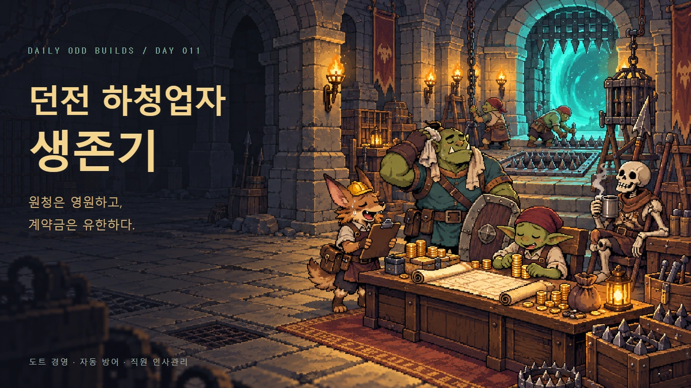
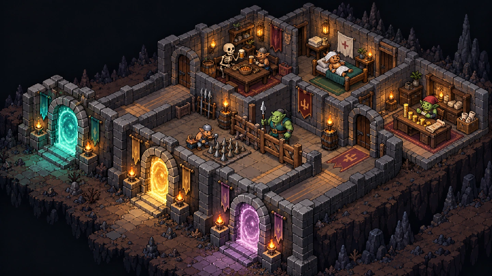
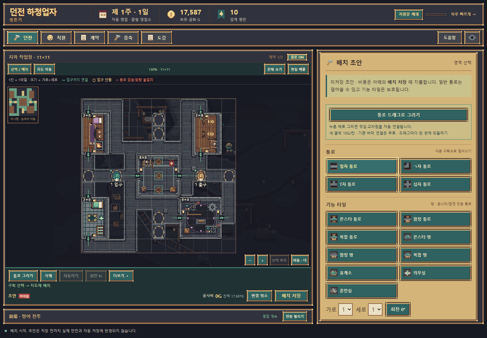
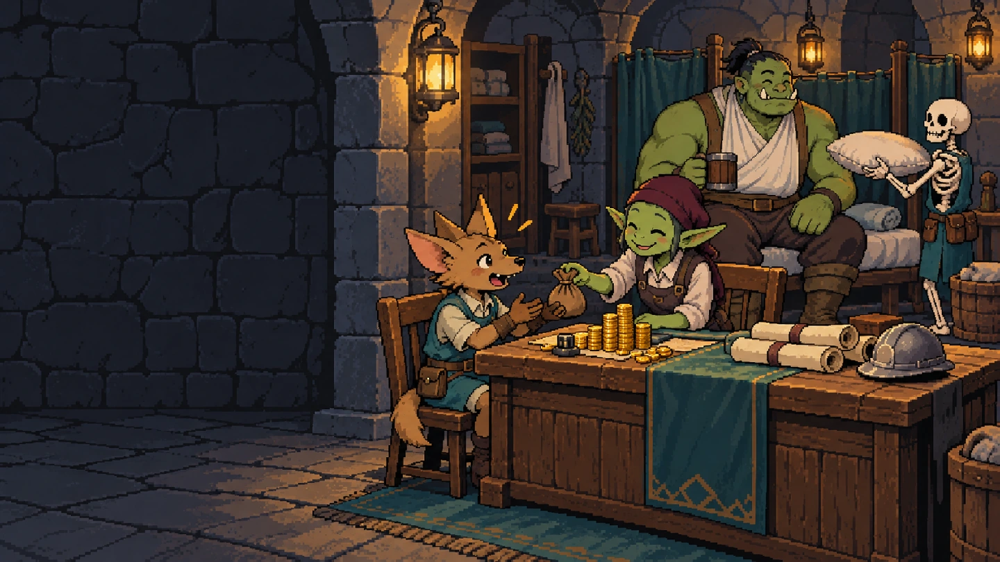
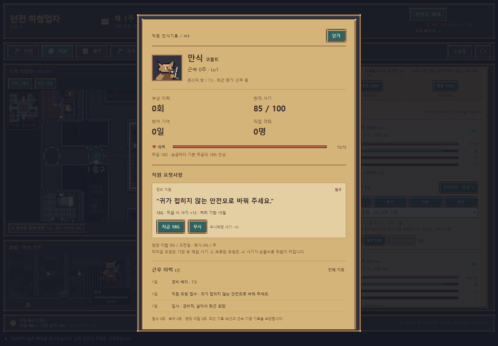
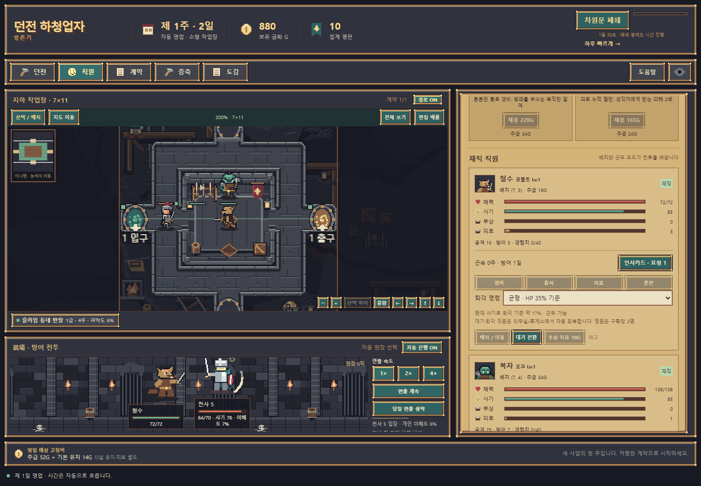
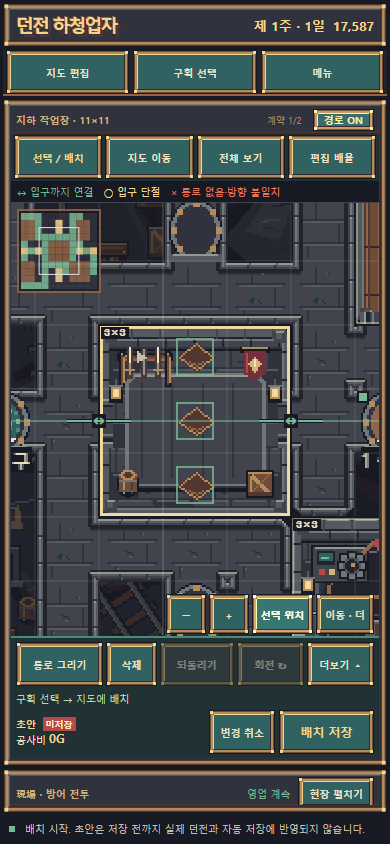

# Day 011 · 던전 하청업자 생존기

**원청은 영원하고, 계약금은 유한하다.**

작은 던전 하나로 외주 방어업을 시작하세요. 통로와 방을 설계하고, 몬스터 직원을 고용하고, 여러 원청의 차원문 계약을 함께 운영하는 고전 도트 경영·자동 방어 웹게임입니다. 공사비·급여·치료비와 위약금까지 대체로 사장님 몫입니다.

[게임 시작](https://daily-odd-builds-dungeon.web.app/) · [웹 배포 ZIP · 0.13.0](https://github.com/hssum9409/daily_odd_builds-public/releases/tag/day011-dungeon-v0.13.0) · [처음 시작하기](QUICKSTART.md) · [Day 011 기록](https://daily-odd-builds-portal.web.app/detail?id=day-2026-10-22)

포털 기록일 **2026-10-22** · 실제 공개 **2026-10-23** · 버전 **0.13.0 MVP**. 포털 시작일(2026-10-12) 기준 Day 011입니다.

| 할 일 | 게임에서 일어나는 일 |
| --- | --- |
| 던전 설계 | 통로·방·연결문을 초안으로 편집하고 배치 저장으로 확정합니다. |
| 직원 관리 | 몬스터를 고용하고 급여·사기·피로·부상을 살핍니다. |
| 계약과 자동 방어 | 하나의 던전에서 여러 원청의 침입을 막고 주간 정산을 받습니다. |
| 진행 보관 | 기기 자동저장과 저장 코드로 진행을 보관합니다. |

## 한 던전, 여러 원청

계약을 바꿔도 던전은 남습니다. 7×11 작업장에서 시작해 가로·세로를 한 칸씩, 최대 30×30까지 증축합니다. 2×3·3×3·4×3 방과 전용 통로를 회전해 놓고 양방향 연결문을 일반 통로로 이으세요. 몬스터 대기석과 고정 함정은 구획마다 다릅니다.

원청 20종에 원청별 접두사와 등급이 붙습니다. 게시판은 현재 업체 등급 주변의 공고만 보여 줍니다. 여러 계약의 입구·출구는 하나의 던전을 공유하며, 살아서 퇴각한 침입자는 길과 위험을 배워 돌아올 수 있습니다. 차원문을 닫으면 새 침입을 막지만 날짜는 흐르고 계약별 폐쇄 벌칙도 발생합니다.

위 그림은 게임성을 설명하는 홍보용 일러스트입니다. 아래 이미지는 브라우저의 실제 게임 UI이며 기능 검수용 저장 데이터를 불러와 촬영했습니다.

## 숫자 뒤에 직원이 있습니다

코볼트·고블린·오크·해골은 각각 이름과 경력을 가진 직원입니다. 체력·사기·피로·부상·급여와 퇴각 명령이 실제 전투에 영향을 줍니다. 인사카드의 짧은 요청을 지급하면 돈은 줄고 사기는 회복됩니다. 무시한 요청, 산재와 퇴직도 기록에 남습니다.

의무실·휴게소는 대기·퇴각 직원을 회복시킵니다. 침입자도 치료합니다. 안 그러면 공격받으니까요. 항복하거나 기절한 침입자는 포로로 잡아 교환할 수 있습니다.

위 그림은 기능 소개용 일러스트이며, 아래는 실제 인사카드 화면입니다.

## 설계하고, 지켜보고, 정산합니다

통로는 마우스나 손가락으로 이어 그립니다. ㄱ자·T자·십자는 자동 연결되며 방 외곽선·가로×세로 크기·연결문 상태를 격자로 확인할 수 있습니다. 배치는 초안으로만 편집하다 **배치 저장**을 눌렀을 때 공사비와 구조를 확정합니다.

시간과 침입은 자동으로 진행합니다. 전투는 도트 캐릭터의 이동·공격·피격·쓰러짐과 작은 사이드뷰 현장 화면으로 보여 줍니다. 커서를 구획에 올려 해당 현장을 살피거나 자동 관찰, 배속·연출 생략을 사용할 수 있습니다. 주마다 보수·성과급·급여·유지비·치료·위약금을 정산합니다.

모바일 배치 모드에서는 전투 현장과 보조 메뉴를 접어 지도 공간을 확보합니다. **구획 선택**에서 크기를 고르고, **선택 위치**로 방 전체와 연결문을 확대합니다. 화면 전체가 움직이는 대신 지도와 관리 목록 안에서만 이동·스크롤합니다.

## 실행과 저장

설치·로그인·서버 계정 없이 HTTPS 주소에서 실행합니다. 시작 금화는 1,200G이며 [첫 방어 준비](QUICKSTART.md)에 따라 직원 두 명과 첫 계약부터 시작할 수 있습니다. 설정에서 BGM·효과음·동작 줄이기를 조절합니다.

30초마다 기기에 자동저장합니다. 다른 기기나 브라우저, 로컬 미리보기에서 공개 주소로 옮길 때는 **설정 → 저장 코드 만들기 → 복사** 후 새 주소의 **저장 코드 불러오기**를 사용하세요. 저장 코드는 게임 상태이므로 공유한 사람에게 해당 진행 상태가 전달됩니다. 미저장 설계 초안은 자동저장·저장 코드에 포함하지 않습니다.

브라우저를 닫은 동안에는 마지막 배치·배속으로 최대 28게임일의 오프라인 영업을 반영합니다. 급여·부상·계약 실패도 발생합니다. 첫 온라인 로드와 서비스워커 준비 후 네트워크 없이 다시 열 수 있습니다. 브라우저의 데이터 삭제나 사생활 보호 모드는 저장 유지에 영향을 줄 수 있으므로 중요한 진행은 저장 코드를 따로 보관하세요.

## 지원 환경과 확인 범위

PC 마우스 조작을 우선하며 모바일 레이아웃과 터치 입력을 제공합니다. Windows Chromium에서 실제 게임 루프·저장 복구·오프라인 재접속·BGM·아이콘을 확인했습니다. 모바일 크기와 손가락 입력은 브라우저 에뮬레이션이며 실물 iOS/Android·Safari·Firefox·홈 화면 설치 검증은 별도입니다.

모든 고급 계약 조합의 장기 밸런스를 검증한 것은 아닙니다. 반복 플레이 가능한 초기 MVP이며, 버전·검증·배포 ZIP 해시는 [검증 기록](VERIFICATION.md)에 정리했습니다.

정사각 홍보 카드 보기

몬스터 직원과 하청 경영을 소개하는 생성 홍보 그림입니다. 게임 화면이나 실제 UI의 투영법을 나타내지 않습니다.

## 아트·데이터·공개 범위

게임의 타일·크기별 방·캐릭터·아이콘·BGM·효과음은 프로젝트 원본입니다. 원본 픽셀을 유지하는 WebP·PNG와 FLAC으로 배포합니다. 홍보 그림과 실제 UI 캡처의 구분 및 제작 기록은 [미디어 안내](MEDIA.md)에 적었습니다.

게임 진행은 해당 브라우저에 저장하며 게임에 로그인·분석·광고 SDK나 플레이 데이터를 전송하는 서버 기능을 넣지 않았습니다. 공개되는 것은 이 안내·이미지·정적 웹 배포물이며 개발 원본 소스와 제작 도구·작업 이력은 비공개입니다. 의존 라이브러리 고지는 배포 ZIP의 `THIRD_PARTY_LICENSES.txt`와 `PROJECT_NOTICES.md`를 확인하세요.

[제작 토큰 집계](TOKEN-USAGE.md) · [문제 제보](https://github.com/hssum9409/daily_odd_builds-public/issues)
