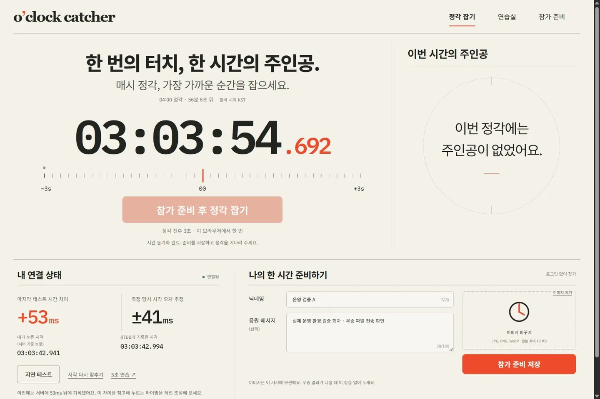
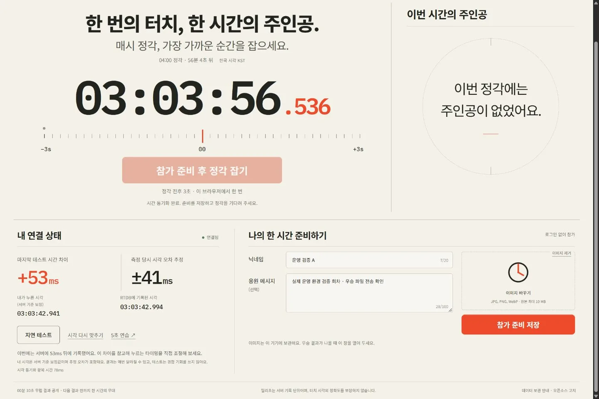

# Day 012 · o'clock catcher

**한 번의 터치, 한 시간의 주인공.** 매시 정각에 가장 가까이 도착한 한 사람의 이미지와 문구를 다음 결과까지 전시합니다.

[정각 잡으러 가기](https://oclock-catcher-20261027.web.app/) · [데이터 보관 안내](https://oclock-catcher-20261027.web.app/privacy.html) · [릴리즈 0.1.1](https://github.com/hssum9409/daily_odd_builds-public/releases/tag/day012-web-v0.1.1)

## 참가하기

1. 사이트를 열고 지연 테스트를 누릅니다. 내 클릭 시각과 RTDB 기록의 차이를 확인하고 5초 연습에서 타이밍을 조절합니다.
2. 닉네임, 선택 문구와 이미지를 준비해 저장합니다. 등록은 정각 3초 전에 닫힙니다.
3. 매시 정각 전후 3초 동안 **정각 잡기**를 한 번 누릅니다. 같은 익명 신원에는 추가 기회가 없습니다.
4. 약 00분 10초에 결과를 공개합니다. 우승한 브라우저는 이미지를 자동 전송하므로 창을 열어 두세요.

로그인 화면 없이 브라우저에 익명 신원을 유지합니다. 새로고침과 같은 브라우저의 탭에는 보통 같은 신원이 이어집니다. 브라우저 데이터 삭제·다른 브라우저·다중 기기와 자동 클릭을 동일인으로 묶는 기능은 없습니다.

## 서버가 받은 순간으로

화면은 동기화한 로컬 시계로 부드럽게 움직이고, 판정은 RTDB의 서버 도착 시각으로 합니다. 지연 테스트를 누른 순간의 내 시각과 RTDB 기록 시각, 두 값의 차이를 밀리초로 보여줍니다. 예를 들어 +58ms라면 이 차이를 참고해 더 일찍 누르는 감각을 직접 조절할 수 있습니다. 내 시각은 별도 측정으로 서버 기준에 맞춘 값이며 추정 오차도 함께 표시합니다. 밀리초는 서버 기록의 단위이며 손가락 시각의 1ms 정확도를 보장하지 않습니다.

절대 오차가 같으면 더 먼저 도착한 접수, 같은 ms면 익명 식별자 순서로 결정합니다. Scheduler 지연이나 서비스 장애가 있으면 결과 발표가 늦어질 수 있습니다.

## 우승자만 이미지 전송

선택한 파일은 브라우저 안에서 긴 변 1280px·WebP 128 KiB 이하로 압축해 보관합니다. 준비할 때 서버에는 해시만 보내고, 우승한 뒤 2분 안에 그 브라우저가 파일을 전송합니다. 서버는 실제 이미지를 검사하고 메타데이터 없는 정적 WebP로 다시 인코딩합니다.

우승자가 탭을 닫거나 업로드에 실패하면 문구만 전시됩니다. 참가자 전원의 파일을 받는 비용을 줄여도 관람객에게 이미지를 보내는 전송량은 남습니다. 동일 이미지 URL과 캐시로 반복 다운로드를 줄입니다.

## 지원과 검증

Web / Mobile Web MVP. Windows Chromium의 실제 운영 HTTPS 접속·익명 준비 저장·연결 테스트·5초 연습과 390px 모바일 배치를 확인했습니다. 데스크톱 캡처는 실제 운영 사이트이며 모바일 캡처는 데스크톱 브라우저의 작은 화면 검증입니다.

2026-10-27 02:00 KST 자연 정각 실행은 빈 회차를 10.158초 뒤 게시했습니다. 별도 운영 검증 회차에서 실제 브라우저의 독립 익명 세션 2개로 ±3초 입력·1회 잠금·서버 판정·우승 파일 자동 전송과 양쪽 화면 표시를 확인했습니다. 검증 회차는 운영자 전용 Scheduler로 정산했으며 서버 기준 우승 오차는 +42ms였습니다. 실제 대규모 동시 접속, 물리 모바일, Safari와 Firefox는 미검증입니다. 한 RTDB 인스턴스를 사용하므로 무제한 처리량을 약속하지 않습니다.

로컬 빌드 및 단위 7개·Firebase 에뮬레이터 통합 13개 시험을 통과했습니다. 에뮬레이터·합성 부하 시험은 실사용자 부하 검증과 구분합니다. GitHub Actions는 사용하지 않습니다.

## 배포 자료

릴리즈 ZIP은 로컬에서 빌드한 공개 웹 파일과 SHA-256 매니페스트입니다. 운영 Firebase backend는 별도 서비스이므로 ZIP만으로 독립 서버가 실행되지는 않습니다. 앱과 서버의 원본 소스·개발 이력·운영 자격증명은 비공개입니다. 타사 코드의 고지는 [THIRD-PARTY-NOTICES.txt](THIRD-PARTY-NOTICES.txt)를 따릅니다.

포털 Day 012 기록일은 2026-10-23입니다. 실제 운영 공개·검증일은 2026-10-27입니다. [제작 토큰 집계](TOKEN-USAGE.md) · [문의](https://github.com/hssum9409/daily_odd_builds-public/issues)
