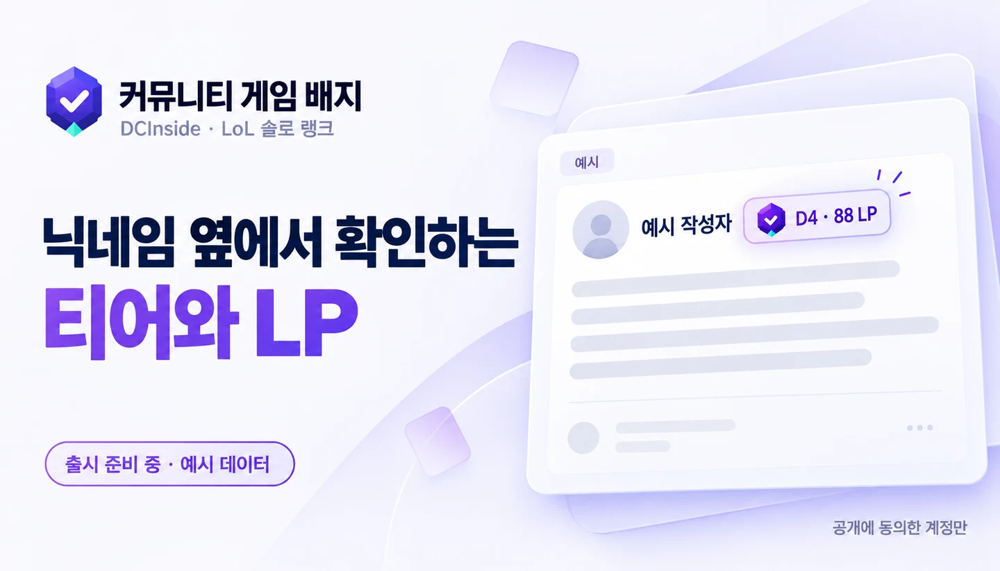
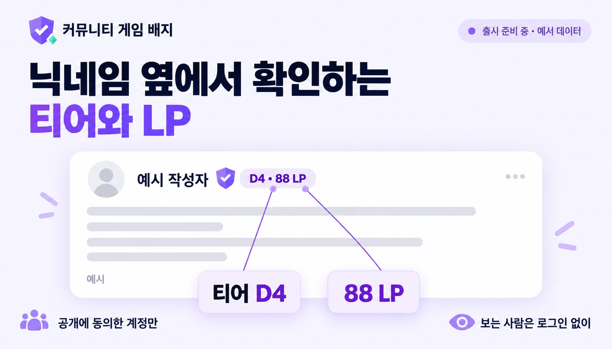
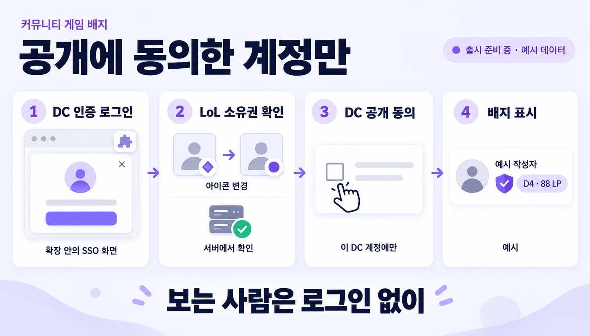
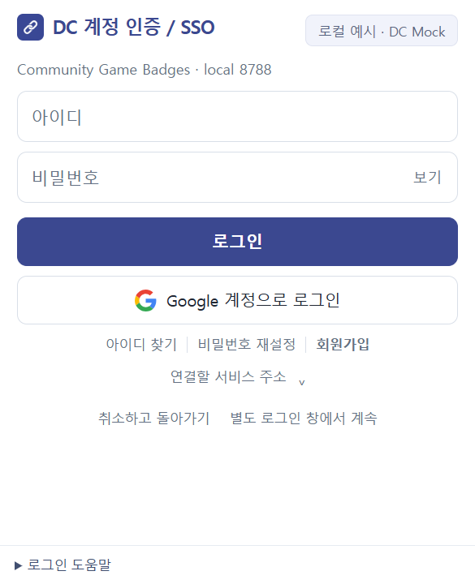
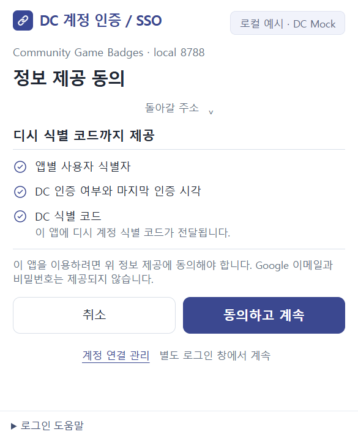
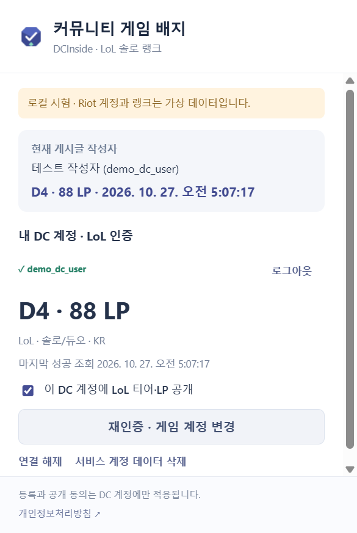
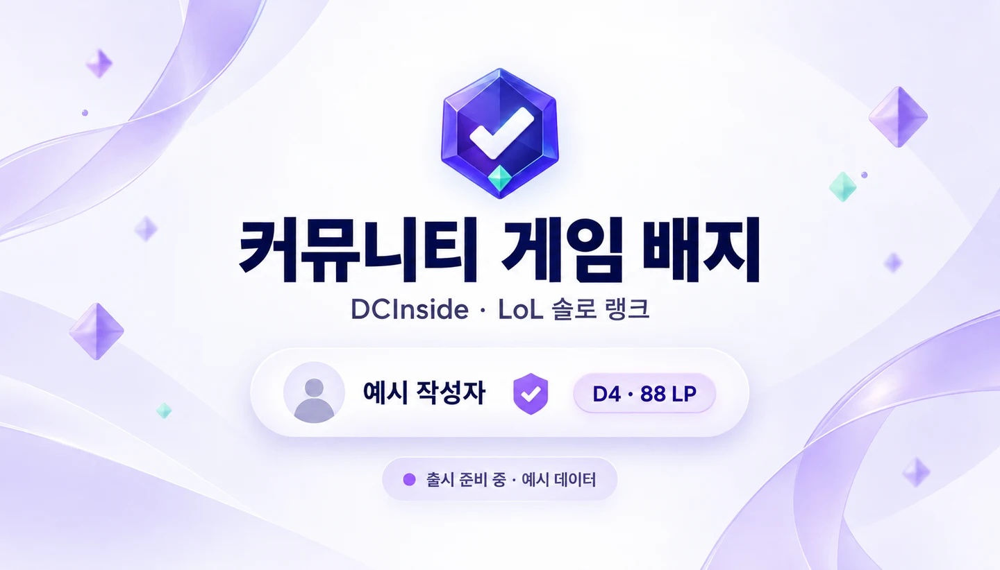

AI로 작성되었습니다. 슬롭 같으면 님 말이 맞음.

<h1 align="center">커뮤니티 게임 배지</h1>

DC 닉네임 옆에서 확인하는 티어와 LP 공개에 동의한 계정만, 보는 사람은 로그인 없이

  
  
  
  

<b><a href="https://github.com/hssum9409/daily_odd_builds-public/releases/download/day013-extension-v0.6.0/community-game-badges-0.6.0-chrome-preview.zip">설치 후보 ZIP · 출시 준비 중 →</a></b> · <a href="USAGE.md">설치·사용 안내</a> · <a href="https://community-game-badges-20261022.web.app/">출시 준비 안내</a> · <a href="https://community-game-badges-20261022.web.app/privacy">개인정보처리방침</a>

기능을 설명하는 생성 일러스트입니다. 실제 Riot 계정이나 현재 제공 중인 운영 배지를 촬영한 화면이 아닙니다.

**게시글 작성자가 공개에 동의한 LoL 솔로 랭크 티어와 LP를 닉네임 옆에 표시하는 Chrome 확장을 준비하고 있습니다.**

글을 읽는 사람은 배지를 보기 위해 로그인하지 않습니다. 자기 티어를 등록하는 사람만 DC 신원과 게임 계정 소유권을 확인하고 공개 여부를 선택하는 방식입니다.

**현재는 출시 준비 중이며 실제 Riot API 연동은 아직 되지 않았습니다.** 공개 ZIP은 설치 후보입니다. 운영 게임 인증·실제 티어 조회·배지 제공은 열리지 않았고 Chrome 웹스토어에도 게시하지 않았습니다. ZIP을 설치해도 현재 실제 LoL 계정을 인증하거나 티어를 등록할 수 없습니다.

Day 013 · 포털 기록일 **2026-10-24** · 설치 후보 사전 공개 **2026-10-27**. 개발 소스는 비공개로 유지하고 설치용 실행 번들과 사용 안내·소개 이미지만 제공합니다.

## 설치

1. 위 ZIP을 받아 **전부 압축 해제**합니다.
2. Chrome 주소창에 `chrome://extensions`를 입력하고 **개발자 모드**를 켭니다.
3. **압축해제된 확장 프로그램을 로드합니다**에서 `manifest.json`이 있는 폴더를 선택합니다.
4. 확장 아이콘을 고정하고 이름·버전·사이트 접근 권한을 확인합니다.

현재 후보는 설치·권한·기본 팝업 확인용입니다. 운영 API가 준비되지 않아 **서버에 연결하지 못했습니다** 안내가 나올 수 있으며, 실제 티어 배지가 나타나지 않는 것이 현재 상태입니다. Riot API 키나 비밀번호를 저장소·이슈·확장 설정에 입력할 필요가 없습니다. [자세한 설치·제거·현재 제한](USAGE.md)

## 구현한 흐름과 확인한 범위

| 기능 | 구현과 검증 | 현재 공개 상태 |
| --- | --- | --- |
| 닉네임 옆 작은 티어·LP | 실제 Chrome 확장과 합성 게시글·가상 랭크로 확인 | 실제 Riot 랭크 제공 전 |
| 팝업 안 DC 로그인·동의 | Day7 로컬 OIDC 엔진과 합성 DC 계정으로 확인 | 운영 확장 연결 설정 대기 |
| LoL 계정 소유권 확인 | 서버가 아이콘 변경을 조회하는 흐름을 가상 Riot HTTP로 확인 | 실제 Riot 계정 검증 전 |
| 공개 ON/OFF·연결 해제 | 자체 데이터 저장소 Emulator와 실제 팝업에서 확인 | 운영 서비스 개방 전 |
| 캐시·최종 갱신 시각 | 로컬 캐시와 중복 요청 병합을 격리 환경에서 확인 | 운영 호출량·실제 비용 미측정 |

### 작게 붙이고, 공개한 계정만

설치자에게만 보이는 배지입니다. 작성자가 글에 이미지나 HTML 배지를 삽입하는 방식이 아닙니다. 사이트가 제공하는 작성자 계정 식별자를 찾고, 해당 DC 계정이 공개한 랭크만 표시하도록 구현했습니다. 확실한 식별자가 없으면 배지를 만들지 않습니다.

첫 대상은 **DCInside × LoL 솔로 랭크**입니다. 다른 커뮤니티나 게임이 이미 지원된다는 뜻은 아닙니다. 그림의 티어와 LP는 설명용 예시입니다.

### 로그인과 게임 인증은 별개로

DC 로그인만 성공했다고 게임 계정도 인증된 것으로 처리하지 않습니다. 별도로 LoL 계정 소유권을 확인한 뒤, 해당 DC 계정에 티어·LP를 공개할지 선택하는 흐름입니다. Google 로그인이나 브라우저 제한이 있으면 별도 인증 창으로 이어갑니다.

게임 클라이언트를 열어 팝업이 닫혀도 다시 열어 진행 중 요청을 복원하도록 구현했습니다. 기본 로그인 팝업은 **390×480 CSS px**이고 밝게·어둡게·시스템 테마와 컴팩트 표시 옵션을 지원합니다. 아래 캡처는 운영 서비스가 아닌 **로컬 엔진·합성 계정·가상 Riot**을 이용한 실제 Chrome 팝업입니다.

정보 제공 동의와 가상 랭크 화면 보기

로컬 시험에서 인증·공개·해제 동작을 확인한 캡처입니다. 실제 Riot API 또는 실제 LoL 계정 소유권을 검증한 증거가 아닙니다.

## 데이터와 공개 범위

공개 랭크에는 해당 커뮤니티 계정의 상태·티어·LP·갱신 시각만 제공하도록 설계했습니다. Riot ID·PUUID, SSO 내부 사용자 키, 다른 커뮤니티 연결 목록은 공개하지 않습니다. 정확한 티어와 LP 변화 자체로 같은 게임 계정을 추정할 가능성까지 없애는 것은 아닙니다.

전체 게시글 URL·본문·댓글·방문 이력을 서버에 수집하지 않습니다. 성공한 랭크 캐시는 기본 최대 약 1시간이며, 공개 중단도 기존 캐시에는 그만큼 남을 수 있습니다. 마지막 성공 관측이 6시간 이상 오래되면 정상 최신 배지처럼 표시하지 않도록 했습니다. 운영 전 실제 정책과 화면을 다시 검증합니다. [개인정보처리방침](https://community-game-badges-20261022.web.app/privacy)

## 아직 남은 것

실제 Riot 제품 승인·운영 키·소수 실계정의 소유권/랭크 검증, 운영 배지 서버와 실제 웹스토어 확장 ID 연결, Chrome 웹스토어 심사·공개가 남아 있습니다. 현재 API 오류나 준비 상태를 실제 랭크 또는 언랭크 인증으로 대신 표시하지 않습니다.

로컬 검증은 Windows의 실제 Chrome 155, 별도 브라우저 프로필에서 수행했습니다. 320·360·390·420px의 로그인·동의 화면, 테마·복원·별도 창 전환과 가상 Riot 연결을 확인했습니다. TypeScript/Functions/확장·Flutter Web 빌드, 자동 검사 81개와 Rules/Functions Emulator 5개가 통과했습니다. macOS/Linux 실환경, 실제 Google 계정 로그인과 관리형 쿠키 제한 환경은 이번 검증에 포함하지 않았습니다.

공유용 소개 이미지

설명용 생성 일러스트입니다. 실제 서비스 출시나 게임 계정 인증 완료를 의미하지 않습니다. [이미지와 캡처 구분](docs/MEDIA.md)

제작 기록

기록된 누적 토큰은 **147,965,513**입니다. 2026-10-27 06:00 KST 스냅샷이며 캐시 입력을 포함합니다. 이 프로젝트 메인 작업과 공개 소개 이미지 작업의 세션별 최신 누적을 한 번씩 합산했습니다. 별도 SSO 프로젝트 작업과 이후 유지보수는 제외하며 캐시 입력·추론 토큰을 중복으로 더하지 않았습니다.

## 소스와 설치 파일

이 공개 폴더에는 사용 안내와 소개 이미지만 있습니다. **확장·관리 웹·서버의 개발 소스, 소스맵, 운영 설정과 개발 이력은 공개하지 않습니다.** 설치 ZIP에는 Chrome 실행에 필요한 번들 JavaScript·HTML·CSS가 포함되므로 설치자가 해당 파일을 열어볼 수는 있습니다. 이는 개발 원본을 공개하거나 프로젝트 코드를 오픈소스로 배포한다는 뜻이 아닙니다.

프로젝트 자체 코드에는 별도의 오픈소스 라이선스를 부여하지 않았습니다. 포함된 오픈소스 구성요소에는 ZIP 안의 `THIRD_PARTY_NOTICES.txt`에 적힌 해당 라이선스가 적용됩니다. GitHub가 자동 제공하는 ‘Source code’ ZIP/tar.gz는 이 공개 안내 저장소의 사본이며, 이 확장의 개발 소스나 권장 설치 파일이 아닙니다.

## 만든놈

[hssum9409](https://github.com/hssum9409) · [Daily Odd Builds 포털](https://daily-odd-builds-portal.web.app/)

문의·버그 제보는 [GitHub Issues](https://github.com/hssum9409/daily_odd_builds-public/issues) 또는 [공개 문의 메일](mailto:hkw96110886@gmail.com)로 보내 주세요. Chrome 버전, 확장 버전과 재현 순서를 적어 주세요. 비밀번호·쿠키·인증 코드·API 키는 보내지 마세요.

Community Game Badges is not endorsed by Riot Games and does not reflect the views or opinions of Riot Games or anyone officially involved in producing or managing Riot Games properties. Riot Games and all associated properties are trademarks or registered trademarks of Riot Games, Inc.

DCInside의 공식 제품이 아닙니다.
