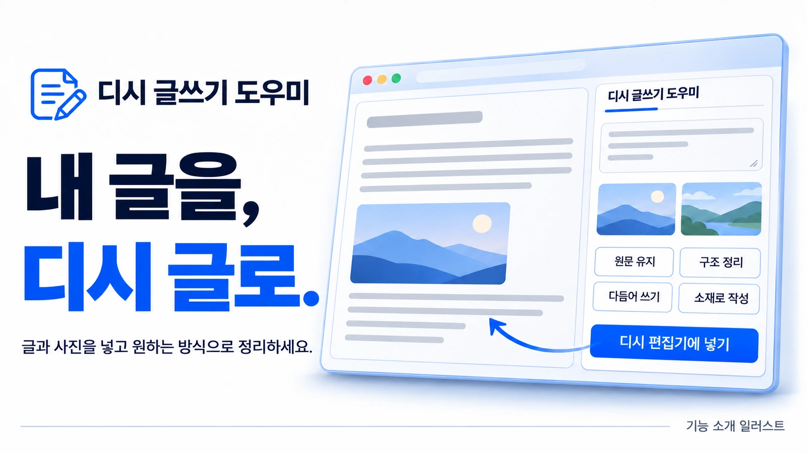
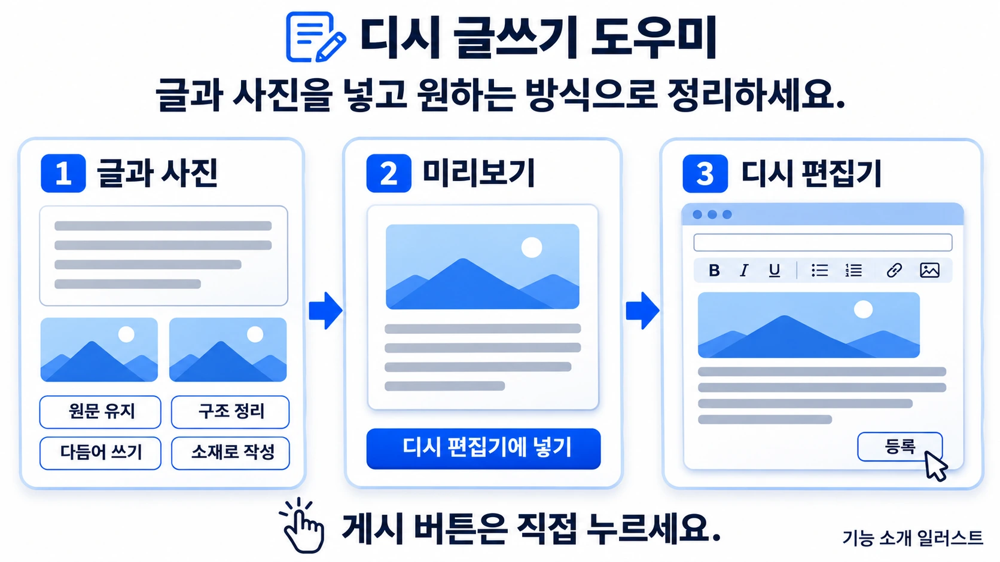
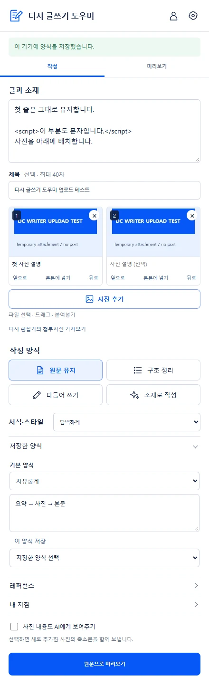

AI로 작성되었습니다. 슬롭 같으면 님 말이 맞음.

<h1 align="center">디시 글쓰기 도우미</h1>

내 글을, 디시 글로. 글과 사진을 넣고 원하는 방식으로 정리하세요.

  
  
  
  

<b><a href="https://github.com/hssum9409/daily_odd_builds-public/releases/download/day016-dc-writer-v0.1.7/dc-writer-0.1.7.zip">Chrome 확장 ZIP 다운로드 →</a></b> · <a href="extension/">소스 코드</a> · <a href="docs/INSTALLATION.md">설치·업데이트 안내</a> · <a href="docs/DATA.md">데이터 처리</a>

*제품 기능을 설명하는 AI 생성 일러스트입니다. 실제 게시 결과나 ChatGPT 인증 성공의 증거는 아닙니다.*

**붙여넣은 글과 사진을 다듬고, 미리본 뒤 디시 기본 편집기에 넣습니다.**

소재는 모았는데 글로 엮기 귀찮을 때 쓰는 Chrome 확장입니다. 원문 그대로 가져가거나, 구조만 정리하거나, 표현을 다듬거나, 소재로 새 글을 작성할 수 있습니다. 게시 버튼은 직접 누르세요.

Daily Odd Builds **Day 016 · 2026-10-27**. **0.1.7 ZIP preview와 릴리즈 소스를 공개**하며 이후 같은 Day에서 업데이트합니다. Day 날짜는 포털 기록일이며 첫 공개일은 2026-11-05입니다. Chrome 웹 스토어에는 제출하지 않았습니다.

## 빠른 시작

1. 위 ZIP을 내려받아 계속 보관할 폴더에 **전부 압축 해제**합니다.
2. Chrome의 `chrome://extensions`에서 **개발자 모드 → 압축해제된 확장 프로그램 로드**를 선택하고 `manifest.json`이 있는 폴더를 지정합니다. 공개 소스는 `extension/` 폴더를 선택합니다.
3. 디시 PC 글쓰기 화면을 열고 확장 아이콘을 누릅니다. **먼저 글과 사진 준비하기**에서 소재와 사진을 넣습니다.
4. **원문 유지**는 로그인 없이 미리볼 수 있습니다. AI 작성은 **ChatGPT로 계속하기**에서 로그인·사용 권한 동의를 마친 뒤 계정에서 제공하는 모델을 고릅니다.
5. 작성 방식과 레퍼런스·지침·양식을 정하고 **초안 만들기**를 누릅니다. 미리보기에서 내용과 사진 순서를 확인합니다.
6. 대상 글쓰기 탭을 확인하고 **디시 편집기에 넣기**를 누릅니다. 기본은 기존 본문 뒤에 추가합니다. 교체는 별도 확인을 받습니다.
7. 디시 편집기에서 최종 확인한 뒤 사용자가 게시합니다.

별도 로컬 도우미·API 키·외부 이미지 호스팅은 필요 없습니다. AI 이용에는 인터넷과 계정의 사용 권한·한도가 적용됩니다. [설치와 문제 해결](docs/INSTALLATION.md)

## 어떤 걸 할 수 있나요?

| 기능 | 동작 |
| --- | --- |
| 네 가지 작성 방식 | 원문 유지 / 구조 정리 / 다듬어 쓰기 / 소재로 작성 |
| 레퍼런스 우선 | 참고 글의 말투와 구성을 가장 먼저 따르고, 내 지침·양식·스타일을 보조로 반영 |
| 완성된 본문 | 입력용 메모 표식이나 답변 안내 대신 독자가 읽을 문장으로 작성 |
| 사진 준비 | 파일 선택·드래그·붙여넣기, 순서·설명·본문 위치 지정, 기존 디시 첨부사진 가져오기 |
| 미리보기·직접 수정 | 제목·본문을 확인하고 편집한 뒤 적용 |
| 디시 기본 편집기 연결 | 기존 글 뒤에 추가하거나 확인 후 교체, 방금 적용한 제목·본문 되돌리기 |
| 기기 안에 초안 저장 | 사진과 초안 자동 저장을 끄거나 저장 자료 삭제 |
| ChatGPT 연결 유지 | 같은 Chrome 프로필에 연결을 저장하고, 갱신 기한이 약 10일 남으면 창이 열린 동안 자동 갱신 |

## 재료부터 미리보기, 편집기까지

*AI 생성 기능 설명 일러스트입니다.*

레퍼런스가 있으면 **레퍼런스 → 내 지침 → 양식 → 스타일**, 없으면 **내 지침 → 양식 → 스타일** 순입니다. 사실은 원자료를 기준으로 하며 레퍼런스의 경험·수치를 내 글에 끌어오지 않도록 요청합니다. 레퍼런스는 붙여넣은 내용만 사용하므로 링크만 입력하면 본문을 읽지 못합니다.

AI는 문단·소제목·목록·인용·사진 ID를 구조화해 반환하고 확장이 HTML을 만듭니다. 임의 HTML이나 외부 사진 URL을 AI가 삽입하도록 허용하지 않습니다. [글쓰기 프롬프트 전문과 HTML 범위](docs/writing-prompt.md)

*실제 확장 UI의 Chrome 캡처입니다. 예시 자료와 모의 인증·모델 응답을 사용했습니다.*

## 사진은 디시에 올립니다

사진은 먼저 기기에 준비하고 **디시 편집기에 넣기**를 눌렀을 때 디시의 기본 업로더로 첨부합니다. 확장 자체의 이미지 서버나 외부 호스팅은 없습니다. 기존 첨부사진도 가져올 수 있습니다.

최대 20장, 파일당 20MB를 받습니다. 새 PNG·JPG는 기본으로 긴 변 1,600px 이하로 줄이며 원본 유지도 선택할 수 있습니다. GIF·WebP·BMP는 원본을 유지합니다. 실제 업로드 가능 개수와 거절 여부는 디시 제한도 따릅니다.

되돌리기는 제목·본문을 복원하며 이미 업로드한 서버 첨부파일 삭제를 뜻하지 않습니다. 업로드 완료 여부가 불확실하면 중복 업로드를 추측해 반복하지 않고 새로고침을 안내합니다.

## 데이터와 지원 범위

AI 실행 시 소재·제목·레퍼런스·지침·사진 설명이 OpenAI로 전송됩니다. **사진 내용도 AI에게 보여주기**를 선택한 경우에만 준비한 새 사진의 축소본도 보냅니다. 기존 디시 사진을 임의로 내려받아 AI에 보내지 않습니다. 원문 유지 모드는 AI를 호출하지 않습니다.

로그인 연결은 같은 Chrome 프로필의 확장 전용 저장소에 암호화합니다. 초안·사진도 자동 저장 설정에 따라 기기에 남습니다. 연결 해제와 초안·사진 삭제는 각각 따로 제공합니다. [데이터 처리와 권한](docs/DATA.md)

Windows Chrome에서 실계정 로그인·모델 호출·디시 편집기 적용을 사용자와 확인한 이력이 있습니다. 현재 0.1.7은 격리 Chrome에서 합성 OAuth·모델·편집기 응답으로 검증했습니다. 사진 기본 업로더의 실제 임시 업로드 이력은 있으나 게시 완료와 모든 갤러리·계정 조합을 검증한 것은 아닙니다. [검증·릴리즈 기록](docs/RELEASE.md)

PC 일반·마이너·미니 갤러리 글쓰기 화면을 대상으로 합니다. 모바일 Chrome, macOS·Linux 실기기, 스토어 설치는 미검증입니다. OpenAI 로그인 절차나 디시 편집기 구조가 바뀌면 영향을 받을 수 있습니다. 모델의 표현·사실 판단도 틀릴 수 있으므로 게시 전에 직접 확인하세요.

## 소개 이미지

*AI 생성 홍보 이미지입니다. [아트워크와 실제 캡처 구분](docs/ARTWORK.md)*

## 만든놈

[hssum9409](https://github.com/hssum9409) · [요청·버그 제보](https://github.com/hssum9409/daily_odd_builds-public/issues) · [다른 잡동사니](https://daily-odd-builds-portal.web.app/)

제보에는 **Day 016, 확장 버전, Chrome 버전, 재현 순서**를 남겨 주세요. 비밀번호·토큰·민감한 원문이나 사진은 보내지 마세요.

## 소스와 업데이트

`extension/`, `tests/`, `tools/`와 개발 안내를 **0.1.7 릴리즈 소스 스냅샷**으로 공개합니다. 자체 작성 코드는 [MIT](LICENSE), 포함된 ChatGPT 인증 모듈은 고정된 버전의 MIT 코드를 사용합니다. [개발 안내](docs/DEVELOPMENT.md) · [인증 모듈](docs/AUTH-MODULE.md) · [제3자 고지](docs/THIRD-PARTY-NOTICES.txt)

업데이트는 같은 설치 폴더에 새 ZIP 내용을 교체하고 기존 확장을 새로고침합니다. 이후 기능 개선도 Day 016의 버전 업데이트로 제공합니다. 개발 Git 이력·인증정보·브라우저 프로필·운영 로그는 공개하지 않습니다. 소개 이미지는 소스 코드의 MIT 적용 대상에서 제외합니다.

디시인사이드·OpenAI·ChatGPT·Chrome의 공식 제품이 아닙니다. [제작 사용량 집계](docs/TOKEN-USAGE.md)
