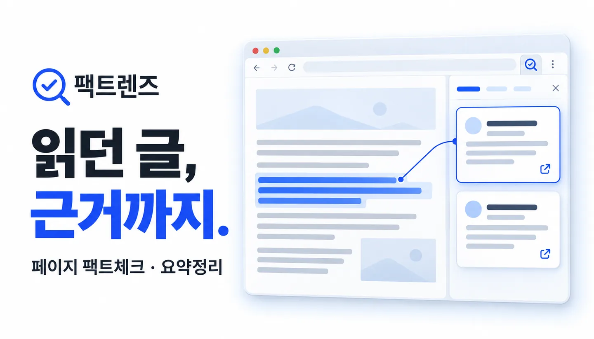
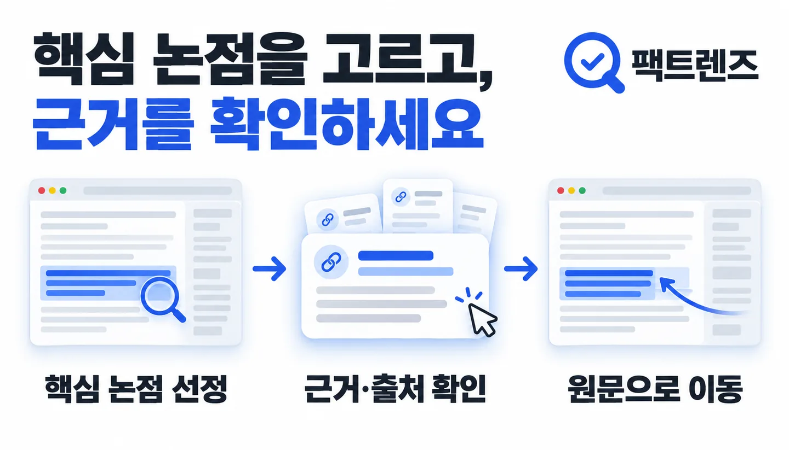
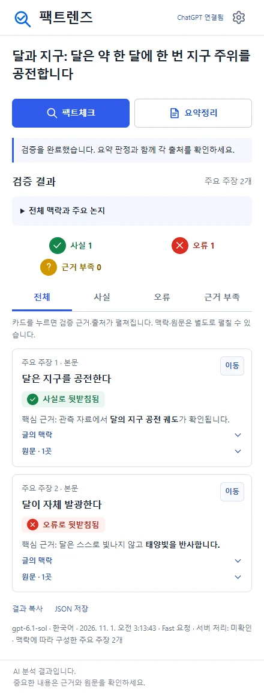
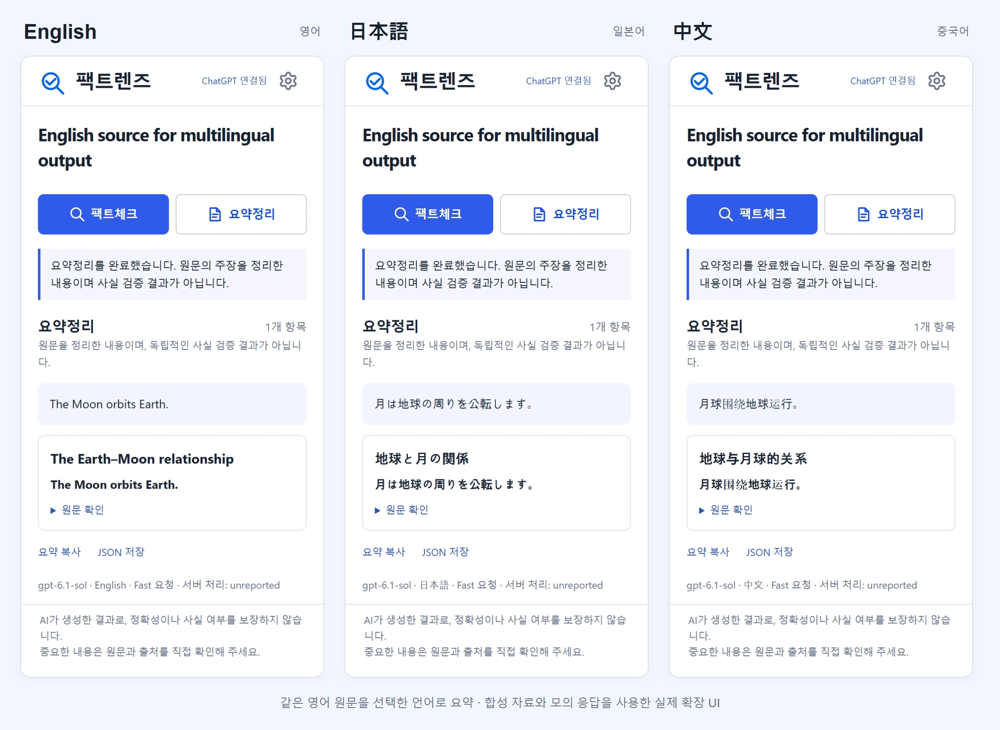
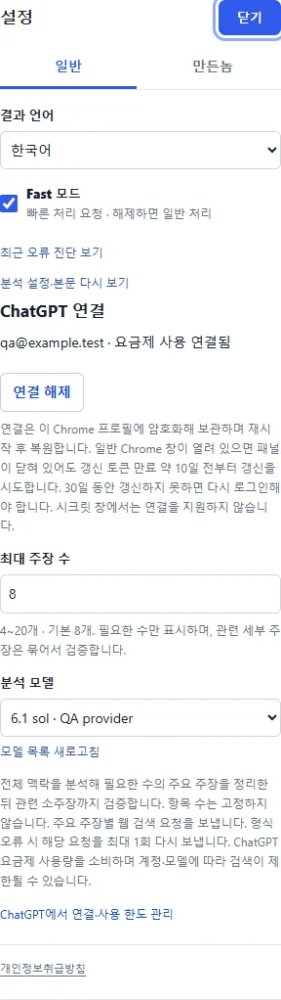

AI로 작성되었습니다. 슬롭 같으면 님 말이 맞음.

<h1 align="center">팩트렌즈</h1>

읽던 글, 근거까지. 페이지 옆에서 팩트체크하고 요약하세요.

  
  
  
  

<b><a href="https://github.com/hssum9409/daily_odd_builds-public/releases/download/day017-fact-lens-v0.1.20/fact-lens-0.1.20.zip">Chrome 확장 ZIP 다운로드 →</a></b> · <a href="docs/INSTALLATION.md">설치·업데이트 안내</a> · <a href="https://daily-odd-builds-portal.web.app/privacy/fact-lens">개인정보취급방침</a>

*제품을 설명하는 AI 생성 일러스트입니다. 실제 기사나 검증 결과의 화면 캡처가 아닙니다.*

**글의 핵심 주장을 고르고, 각 주장 가까이에서 근거를 확인합니다.**

읽던 기사나 게시글을 다른 창에 복사하지 않아도 됩니다. Chrome 사이드패널에서 팩트체크 또는 요약정리를 선택하세요. ChatGPT 계정으로 연결하며 별도의 로컬 서버나 API 키를 준비할 필요가 없습니다.

Daily Odd Builds **Day 017 · 2026-10-28**. 첫 ZIP 공개는 2026-11-01이며, Chrome 웹 스토어 대신 **파일을 내려받아 직접 설치**하는 방식으로 배포합니다.

## 설치

1. 위의 **Chrome 확장 ZIP**을 내려받아 계속 보관할 폴더에 압축을 풉니다.
2. Chrome 주소창에 `chrome://extensions`를 입력하고 오른쪽 위 **개발자 모드**를 켭니다.
3. **압축해제된 확장 프로그램을 로드합니다**를 누르고, `manifest.json`이 바로 들어 있는 폴더를 선택합니다. ZIP 파일 자체를 선택하지 않습니다.
4. Chrome 도구 모음의 확장 메뉴에서 **팩트렌즈**를 고정하고, 확인할 페이지에서 아이콘을 누릅니다. 모든 사이트 접근 권한을 허용해 주세요.
5. **ChatGPT로 로그인**을 누르고 열린 공식 로그인 화면에서 연결합니다. 모델을 선택하고 전송할 내용을 확인한 뒤 **팩트체크** 또는 **요약정리**를 누릅니다.

폴더를 지우거나 옮기면 확장이 작동하지 않을 수 있습니다. 업데이트도 같은 폴더에 파일을 교체하고 확장을 새로고침합니다. [자세한 설치·로그인·업데이트 안내](docs/INSTALLATION.md)

## 페이지 옆에서 하는 일

| 기능 | 동작 |
| --- | --- |
| 핵심 주장 선정 | 전체 맥락에서 중요한 대주장을 먼저 고릅니다. 기본 최대 8개, 설정에서 **4–20개**로 바꿀 수 있으며 개수를 억지로 채우지 않습니다. |
| 외부 웹 검증 | 게시글 안의 링크에 한정하지 않고 여러 검색어와 외부 출처를 대조합니다. 최대 3개 주장을 동시에 검증합니다. |
| 짧은 결과 카드 | 주장·판정·핵심 근거 한 줄을 먼저 표시합니다. 카드를 누르면 검증근거와 출처, 함께 검증한 세부 내용을 봅니다. |
| 원문 확인 | 맥락·원문은 별도로 펼치고, **이동**으로 해당 위치를 찾아 하이라이트합니다. |
| 이미지·댓글 | 읽을 수 있는 이미지의 글자와 시각적 내용, 본문 외 댓글을 구분해 참고합니다. 홍보성 댓글은 제외합니다. |
| 요약정리 | 웹 검증과 별개로 글의 핵심을 정리합니다. 요약은 사실 판정이 아닙니다. |
| 출력 언어 | 원문의 언어와 관계없이 한국어·영어·일본어·중국어 중 설정한 언어로 제공합니다. 기본은 한국어입니다. |
| 선택형 오류 리포트 | 전송 항목을 먼저 확인하고 보냅니다. 접수 번호로 문제를 알릴 수 있습니다. |

## 작은 사실을 무작정 늘리지 않습니다

*AI 생성 기능 설명 일러스트입니다.*

먼저 글의 논지와 중요한 논점을 읽고 설정한 최대 개수 안에서 대주장을 선정합니다. 하나의 대주장에 명시된 여러 사실은 함께 검증할 수 있습니다. 다만 대주장이 사실이어도 별개인 수치나 후속 사건 때문에 판정이 내려가지 않도록 범위 밖 세부 내용은 제외합니다.

여러 외부 발행처의 근거를 찾고 반대 근거도 확인하도록 요청합니다. 검색으로 추적할 수 있는 출처만 표시하며, 확보하지 못하면 근거 부족으로 남깁니다. 검색 결과가 없을 때는 검색어를 바꿔 한 번 더 시도합니다. 출처 수와 내용의 충분성을 보장하지는 않습니다.

*실제 확장 UI를 Chrome에서 실행한 합성 자료·모의 응답 캡처입니다. 실제 뉴스의 판정이나 실계정 검색 성공을 나타내지 않습니다.*

## 요약과 언어는 내 목적에 맞게

*합성 자료·모의 응답으로 확인한 실제 확장 UI입니다.*

검증이 필요하면 **팩트체크**, 먼저 글을 정리하고 싶으면 **요약정리**를 누릅니다. 진행 중인 기능의 버튼에만 진행 표시가 나타납니다. 페이지가 바뀌면 **페이지 내용 반영하기**를 눌러 새 내용을 읽습니다.

톱니바퀴 설정에서 **언어, Fast, 최대 주장 수, 모델**을 바꿉니다. 설정 맨 아래의 작은 **개인정보취급방침** 링크로 공개 방침을 열 수 있습니다. Fast는 기본으로 켜져 있으며 계정·모델 지원에 따라 일반 처리로 복구하고 결과에 알립니다. 원문 인용은 원래 언어로 유지합니다.

설정 화면 보기

## 계정과 페이지 내용은 어떻게 처리하나요?

ChatGPT 로그인은 OpenAI의 화면에서 진행합니다. 로그인 정보는 해당 Chrome 프로필 안에서 관리하고 갱신합니다. 팩트체크·요약을 실행하면 선택한 페이지의 본문·제목·맥락과 포함한 댓글·이미지가 OpenAI로 전송됩니다. 팩트체크는 외부 웹 검색도 사용합니다. 민감한 글은 전송 내용을 먼저 확인해 주세요.

페이지를 읽기 위한 **모든 사이트 접근 권한**을 요청합니다. 페이지 방문만으로 본문을 자동 업로드하지 않습니다. 입력 중인 폼·비밀번호·작성 초안 등은 추출에서 제외하도록 처리합니다. 오류 리포트는 별도 서버로 **사용자가 전송할 때만** 보내며 본문·URL·제목·계정·토큰을 포함하지 않습니다. [개인정보취급방침](https://daily-odd-builds-portal.web.app/privacy/fact-lens) · [간단한 데이터 처리 안내](docs/PRIVACY.md)

패널 하단에는 **AI가 생성한 결과로, 정확성이나 사실 여부를 보장하지 않습니다.**라는 안내를 작은 글씨로 표시합니다. 중요한 내용은 원문과 출처를 직접 확인해 주세요.

## 지원 범위와 확인한 한계

Windows의 **Chrome 156**에서 로컬 빌드 확장의 UI·페이지 추출·모의 로그인 및 모델 응답 처리를 검증했습니다. 사용자 확인으로 실제 계정의 Fast 처리와 gpt-6.1-terra의 정상 완료가 확인된 이력이 있습니다. 이번 외부 검색 보완의 실계정·해당 아카라이브 글 재검증은 별도이며, 모의 테스트 성공으로 대신하지 않습니다. [검증 범위와 릴리즈 기록](docs/RELEASE.md)

Chrome 120 이상을 대상으로 합니다. macOS·Linux, 다른 Chromium 브라우저, 모든 사이트와 모델 조합은 미검증입니다. Chrome 내부 페이지·PDF·접근이 막힌 콘텐츠는 지원하지 않습니다. 로그인·사이트 구조·이미지 보안 정책에 따라 일부 내용을 읽지 못할 수 있으며, 이미지 인식도 오류가 있을 수 있습니다. 계정의 모델·이미지·웹 검색 권한과 사용 한도가 적용됩니다. 자동 업데이트는 제공하지 않습니다.

## 소개 이미지

*AI 생성 홍보 일러스트. [이미지 출처와 범위](docs/ARTWORK.md)*

## 만든놈

### [hssum9409](https://github.com/hssum9409)

매일 한개씩 잡동사니 만드는 사람 
요청사항은 [github](https://github.com/hssum9409/daily_odd_builds-public/issues)에 보내면 수정할지도 안할지도. 버그는 가능한 빠르게 수정함.

제보할 때 **Day 017, 확장 버전, Chrome 버전, 재현 순서와 오류 리포트 접수 번호**를 적어 주세요. 비밀번호·인증 토큰이나 민감한 페이지 내용은 보내지 마세요.

[다른 잡동사니 보기](https://daily-odd-builds-portal.web.app/) · [Day 017 기록](https://daily-odd-builds-portal.web.app/detail?id=day-2026-10-28) · [제작 사용량 집계](docs/TOKEN-USAGE.md)

## 공개 범위

이 폴더에는 소개·설치·검증 안내와 이미지만 공개합니다. 확장 실행 파일은 해당 버전의 ZIP으로 제공합니다. 앱·서버의 원본 소스, 개발 이력과 운영 자료는 비공개입니다. 저장소의 다른 제품에 적용된 라이선스가 이 제품 전체에 자동 적용되는 것은 아닙니다. 포함된 오픈소스의 권리와 고지는 [THIRD-PARTY-NOTICES.txt](docs/THIRD-PARTY-NOTICES.txt)를 따릅니다.

팩트렌즈는 OpenAI·ChatGPT·Chrome 또는 확인 대상 사이트의 공식 제품이 아닙니다.
