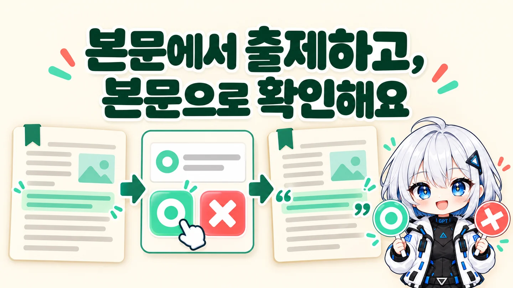
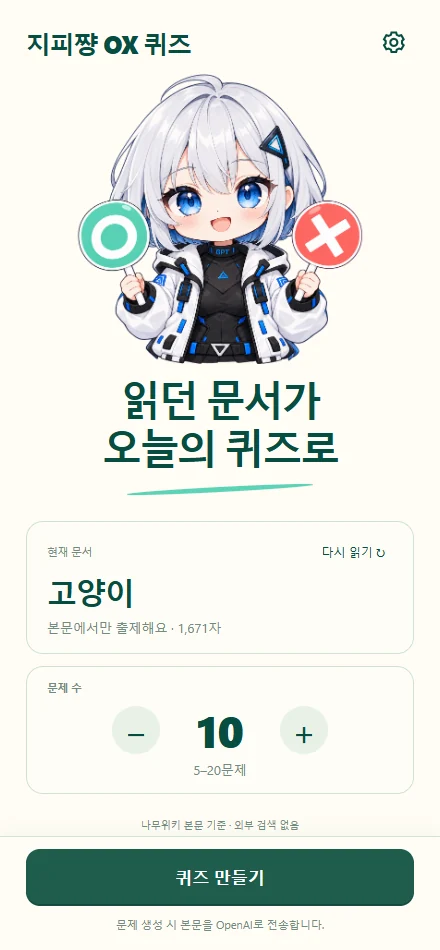
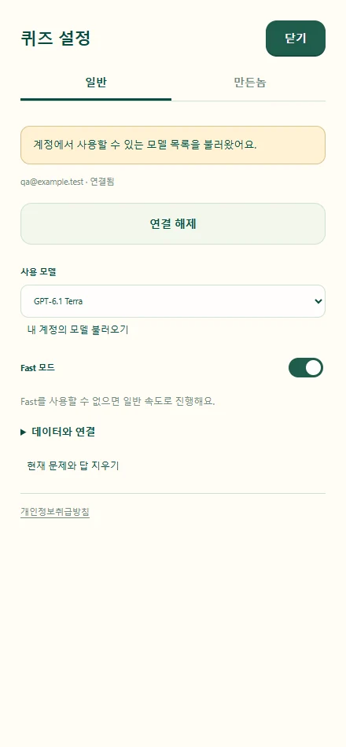

AI로 작성되었습니다. 슬롭 같으면 님 말이 맞음.

<h1 align="center">지피쨩 나무위키 OX 퀴즈</h1>

읽던 문서가 오늘의 퀴즈로. 눈팅하다가 시험 보게 생김.

  
  
  
  

<b><a href="https://github.com/hssum9409/daily_odd_builds-public/releases/download/day018-namuwiki-ox-v0.1.5/gpichan-namuwiki-ox-0.1.5.zip">Chrome 확장 ZIP 다운로드 →</a></b> · <a href="docs/INSTALLATION.md">이 확장 설치 방법</a> · <a href="docs/DATA.md">데이터 처리</a>

지피쨩 캐릭터 참조로 제작한 생성 일러스트입니다. 실제 나무위키 화면이나 계정 연결 성공의 증거가 아닙니다.

**현재 열어둔 나무위키 본문으로 OX 퀴즈를 만들고, 답을 고르면 본문 근거를 보여주는 Chrome 확장입니다.**

문서 읽는 김에 얼마나 기억했는지도 확인합니다. 판정 기준은 **해당 문서가 서술한 내용**입니다. 나무위키 내용의 현실 세계 정확성을 검증하는 팩트체커는 아닙니다.

Day 018 · **0.1.5 ZIP preview와 릴리즈 소스를 공개합니다.** Chrome 웹 스토어에는 제출하지 않았습니다. 포털 기록일은 2026-10-29, 첫 ZIP 공개일은 2026-11-01입니다. 실제 나무위키 「고양이」 문서 본문 추출을 확인했으며, 실제 ChatGPT 계정의 권한·모델 사용은 별도 확인이 필요합니다.

## 빠른 시작

1. [설치 안내](docs/INSTALLATION.md)에 따라 다운로드한 ZIP을 푼 폴더 또는 공개 소스의 `extension/` 폴더를 Chrome 개발자 모드로 로드합니다.
2. 나무위키 문서 탭에서 확장 아이콘을 눌러 사이드패널을 엽니다.
3. **ChatGPT로 로그인**하고 요금제 사용에 동의합니다. API 키나 별도 로컬 프로그램은 사용하지 않습니다.
4. **다시 읽기**로 문서 제목을 확인하고 문제 수를 고릅니다. 기본 **10개**, 최소 **5개**, 최대 **20개**입니다.
5. **퀴즈 만들기**를 누른 뒤 O 또는 X를 고릅니다. 해설과 본문 인용을 읽고 **다음 문제**로 넘어갑니다.

로그인과 출제에는 인터넷 연결이 필요합니다. **자체 서버는 없으며, 로그인과 문제 생성은 OpenAI에 직접 요청합니다.** 퀴즈 만들기를 누르면 추출한 본문을 전송합니다. 출제가 끝난 문제의 풀이·채점·다시 풀기는 로컬에서 동작합니다.

## 어떤 걸 할 수 있나요?

| 기능 | 동작 |
| --- | --- |
| 현재 문서로 출제 | HTTPS `namu.wiki/w/`의 표시된 본문만 읽습니다. 링크를 따라가거나 외부 검색을 하지 않습니다. |
| 5–20문제 | 숫자 입력과 −/+로 1개씩 조절합니다. 기본은 10개입니다. |
| OX와 해설 | 답을 고른 뒤 정답, 해설, 정확한 본문 인용과 소제목을 보여줍니다. |
| 한 번 더 검사 | 원문 인용·중복·문항 수를 검사하고, 애매한 문제와 잘못된 정답·해설은 자동으로 고칩니다. |
| 내 모델과 Fast | 기본 GPT-6.1 Terra + Fast. 설정에서 계정 모델을 조회·선택하고 Fast를 끌 수 있습니다. |
| 다시 풀기 | 같은 문제 전체 또는 틀린 문제만 다시 풉니다. 추가 모델 요청이 없습니다. |
| 이어 풀기 | 같은 브라우저 세션에서 패널을 다시 열어 이어 풉니다. 연결 해제 시 문제와 답도 지웁니다. |

### 본문에서 출제하고, 본문으로 확인해요

생성 모델에 외부 검색 도구를 제공하지 않습니다. 모든 문항은 전송한 본문 구간의 정확한 인용을 가져야 합니다. X 문제도 본문에 없는 내용을 추측하는 방식 대신 **본문의 명시적 사실과 충돌하는 진술**을 만들도록 요청하고 재검사합니다.

인용 일치는 로컬에서 검증하지만 정답의 의미 판단은 모델을 사용합니다. 모델 재검사도 오류 가능성을 완전히 없애지는 못합니다. 애매한 문제는 본문에 명시된 다른 사실로 교체합니다. 인용·개수·형식이 어긋나면 자동으로 다시 다듬으며, 잘못된 근거를 그대로 통과시키지는 않습니다.

숨김·접힌 내용, 목차, 편집 버튼, 각주, 폼, 사이드 메뉴, 이미지 속 글자는 출제 범위에서 제외합니다. 긴 문서는 최대 60,000자이며 일부만 읽었으면 화면에 표시합니다. 나무위키의 DOM 변경·접근 확인·로딩 지연으로 추출이 실패할 수 있습니다.

### 설정은 오른쪽 위 톱니바퀴

**일반 / 만든놈** 탭에서 설정과 제작자 소개를 나눠 봅니다. 설정은 패널 전체 화면으로 열리고, 상단의 초록색 **닫기** 버튼이나 `Esc`로 풀던 화면에 돌아갑니다. 두 탭 공통 하단의 [개인정보취급방침](https://daily-odd-builds-portal.web.app/privacy/namuwiki-ox)을 새 탭으로 열 수 있습니다.

기본 모델은 **GPT-6.1 Terra**, **Fast는 켜짐**입니다. 설정에서 **내 계정의 모델 불러오기**로 계정에 노출된 모델을 선택합니다. 기본 모델이 계정 목록에서 확인되지 않아도 다른 모델로 자동 변경하지 않습니다.

Fast를 허용하지 않는 계정·모델에서는 일반 처리로 재요청하고 결과에 요청 등급과 실제 응답 등급을 구분해 표시합니다. 특정 모델 또는 Fast의 계정별 이용 가능성을 보장하지 않습니다.

지피쨩 홍보 카드

설명용 생성 이미지입니다. [에셋 제작 기록](docs/ARTWORK.md)

### 스크롤해도 버튼은 아래에

**퀴즈 만들기**, 답변 후의 **다음 문제 / 결과 보기**는 패널 하단에 고정됩니다. 문제와 해설·본문 근거는 위 영역에서 스크롤하며 다음 문항에서 처음 위치로 돌아갑니다.

 

실제 확장 HTML을 Chrome에서 실행한 화면입니다. 본문·인증·모델 응답은 테스트용이며 실제 계정 사용의 증거가 아닙니다.

### 출제 중에도, 다른 탭에서도

출제 전용 화면에서 **본문 읽기 → 문제 만들기 → 정답·근거 확인** 단계와 경과 시간을 보여줍니다. 기다리는 동안 취소할 수 있고 완성되면 퀴즈로 전환합니다. 탭이나 문서를 바꾸면 **문서 내용 갱신하기** 버튼으로 새 본문을 반영합니다.

나무위키 문서가 아닌 탭에서는 책을 든 지피쨩과 **나무위키 바로가기**를 보여줍니다. 돌아오면 풀던 문제와 답을 이어 볼 수 있습니다. 결과 화면에서는 큰 **새 퀴즈 만들기** 버튼으로 다음 문서를 준비하고, 같은 문제·오답 복습은 작은 버튼으로 선택합니다.

## 데이터와 지원 범위

자체 API, Firebase, 분석·신고 서버를 사용하지 않습니다. 인증·모델 조회·문제 생성은 OpenAI와 직접 통신합니다. 퀴즈 생성에는 평소 모델 사용량이 소모될 수 있으며, 답하기·채점·오답 복습은 추가 요청을 보내지 않습니다.

인증정보는 확장 전용 IndexedDB에 AES-GCM으로 암호화하며 키는 내보낼 수 없게 저장합니다. OS 비밀 저장소는 아니므로 Chrome 프로필 전체에 접근할 수 있는 공격으로부터 격리되는 것은 아닙니다. 설정은 로컬 저장, 문제·답·출제 본문은 `chrome.storage.session` 저장입니다. 동기화하지 않습니다. [자세한 데이터 처리](docs/DATA.md)

대상은 데스크톱 Chrome입니다. 모바일 Chrome, macOS 실기기, Chrome Web Store 설치와 실제 사용자 계정의 최초 동의·모델 사용은 이번 로컬 합성 테스트로 검증한 것으로 취급하지 않습니다. [검증·릴리즈 기록](docs/RELEASE.md)

## 만든놈

[hssum9409](https://github.com/hssum9409) · [요청·버그 제보](https://github.com/hssum9409/daily_odd_builds-public/issues) · [다른 잡동사니](https://daily-odd-builds-portal.web.app/)

이 폴더는 **0.1.5 릴리즈 소스 스냅샷**입니다. `extension/`을 직접 로드하거나 [개발 안내](docs/DEVELOPMENT.md)에 따라 검사·빌드할 수 있습니다. 비공개 개발 이력·인증정보·세션 로그는 포함하지 않습니다. 코드는 [MIT](LICENSE)이며 이미지는 별도 [아트워크 안내](docs/ARTWORK.md)를 따릅니다. 나무위키 또는 OpenAI의 공식 제품이 아닙니다.
