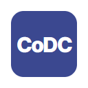
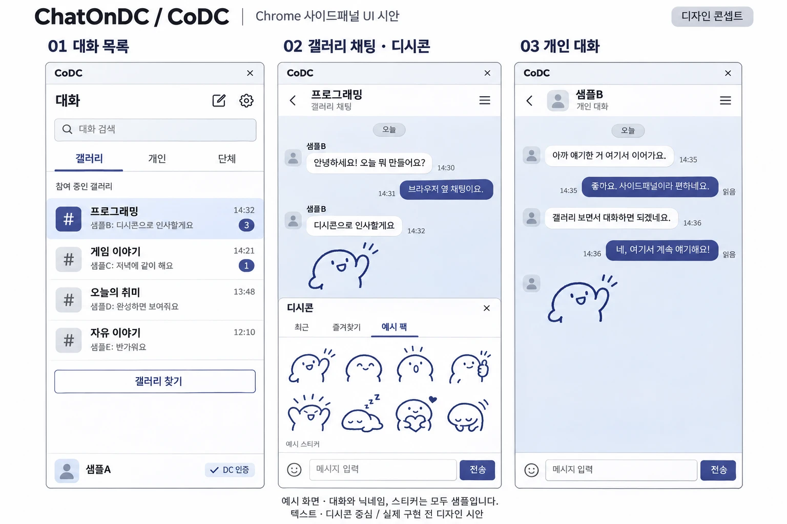
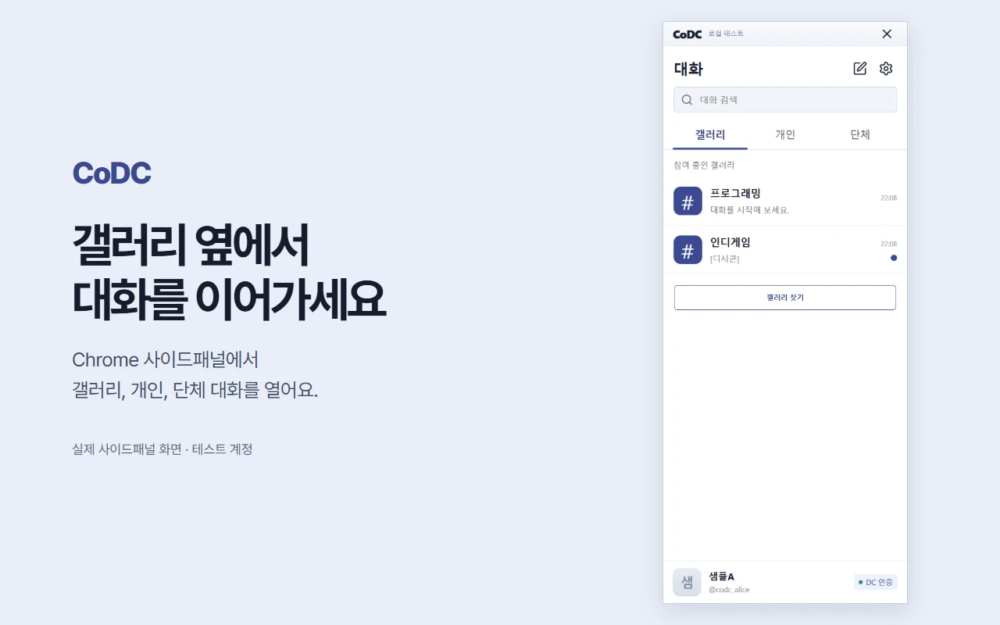
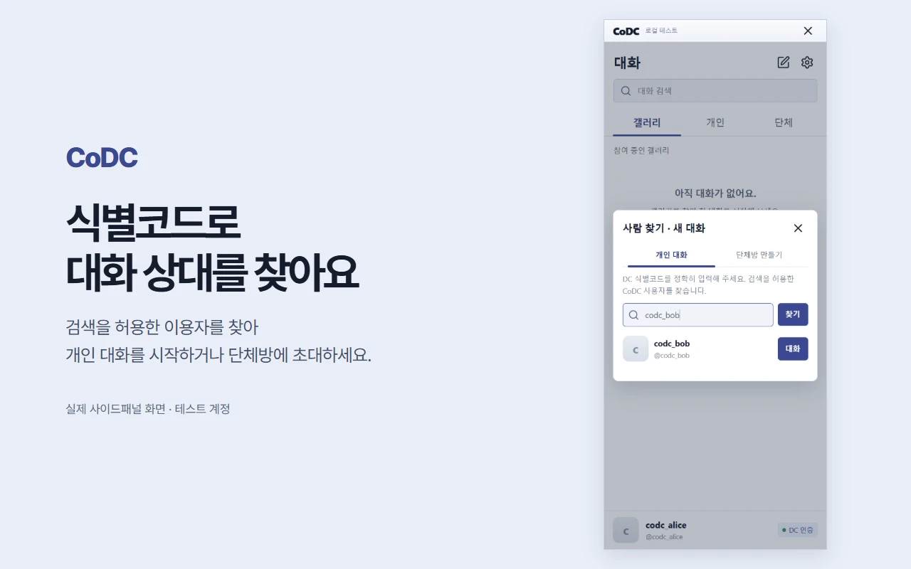

AI로 작성되었습니다. 슬롭 같으면 님 말이 맞음.

<h1 align="center">ChatOnDC · CoDC</h1>

갤러리 옆, 우리 대화. 보던 글을 닫지 않고 이야기해요.

  
  
  

<a href="https://daily-odd-builds-portal.web.app/detail?id=day-2026-10-30">Daily Odd Builds Day 019</a> · <a href="https://daily-odd-builds-portal.web.app/privacy/chatondc">개인정보처리방침</a>

개발 초기에 만든 화면 시안입니다. 아래 실제 Chrome 화면과 구성이 다를 수 있습니다.

디시인사이드 갤러리를 보면서 Chrome 사이드패널에서 대화하는 확장입니다. DC SSO로 계정 소유를 확인한 사람끼리 갤러리 채팅방을 이용하고, 식별코드로 사람을 찾아 개인 대화나 단체방을 시작할 수 있습니다.

| 갤러리 대화 목록 | 식별코드로 사람 찾기 |
| --- | --- |
|  |  |

화면은 Chrome에서 로컬 테스트 계정으로 캡처했습니다. 텍스트는 메시지당 최대 100글자입니다. 디시콘은 텍스트와 따로 보내며, 더블콘으로 최대 2개를 붙일 수 있습니다. 갤러리 매니저와 부매니저는 해당 방의 채팅을 끄거나 메시지를 숨기고 발언을 제한할 수 있습니다.

Chrome 웹스토어 등록을 준비하고 있습니다. 설치 링크는 게시 후 이곳에 안내합니다. CoDC는 독립적으로 개발한 확장이며, 개발 소스는 비공개입니다.

만든 사람: [hssum9409](https://github.com/hssum9409)
